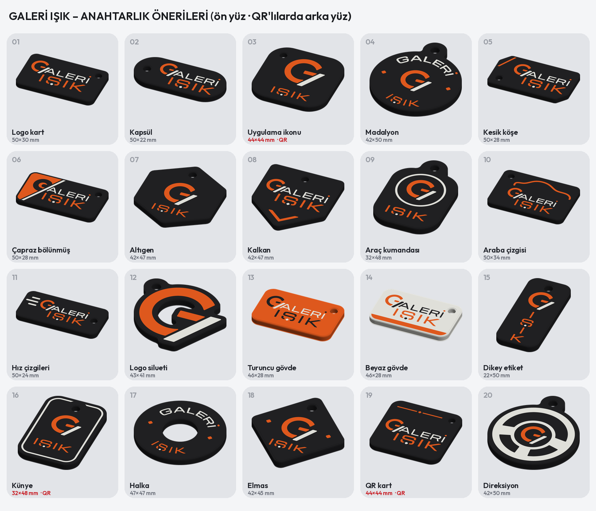
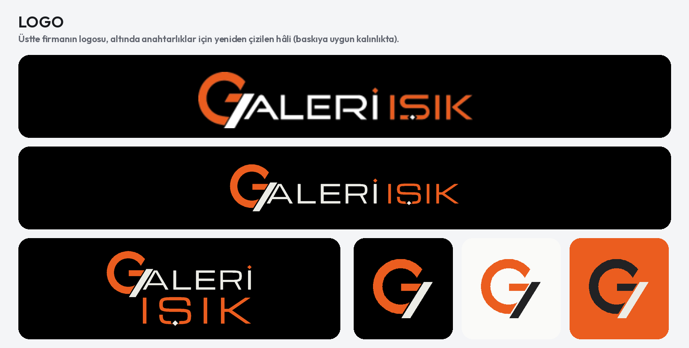

# GALERİ IŞIK – kurumsal anahtarlık önerileri (siyah, turuncu, beyaz)



20 görsel öneri; seçilen tasarım Bambu Lab X2D dosyasına çevrilecek. Hepsi en çok **50 × 50 mm**, 3 renk.

- **Müşteriye gönderilecek:** `musteri_1.png` (1–10) ve `musteri_2.png` (11–20); ikisi birlikte `musteri_katalog.pdf`.
  Her öneride ön ve arka yüz görünür.
- **Ayrıntı sayfaları:** `01_*.png` … `20_*.png`. Her birinde ön yüz, arka yüz ve perspektif var.

## Logo



Firmanın logosu (`kaynak_logo.png`) anahtarlıklar için geometriyle yeniden çizildi:

- **G işareti:** kalın turuncu C ve ortada yatay kol. Sağdan beyaz eğik çizgi geçer, C'nin altından taşar. Ölçüler
  logodan alındı: halka 0,33 R, kol 0,26 R, eğik çizgi 0,31 R genişliğinde ve 0,62 eğimli.
- **Yazı:** Michroma (OFL), logodaki geniş ve geometrik harflere en yakın yazı tipi. Harf çizgileri 0,4 nozul için
  ≥ ~0,78 mm'ye kalınlaştırılır.
- **İ ve Ş:** İ'nin noktası turuncu elmas. Ş'nin alt çizgisinde, logodaki gibi beyaz elmas var.
- **Renkler:** GALERİ beyaz, IŞIK turuncu (#EB5D1F).
- **Logo kilitleri:**
  - yan yana (logonun kendisi);
  - iki satır: G + ALERİ, altında ALERİ genişliğinde IŞIK (anahtarlıklarda çoğunlukla bu kullanılır);
  - yalnız G işareti + IŞIK;
  - yay üstünde GALERİ / IŞIK.

## Öneriler

| | Ad | Ne var |
| --- | --- | --- |
| 1 | Logo kart | sade kart, iki satırlı logo |
| 2 | Kapsül | hap biçimi, solda delik |
| 3 | Uygulama ikonu | yuvarlak kare, büyük G, IŞIK · **arkada QR** |
| 4 | Madalyon | ortada G, yaylarda GALERİ / IŞIK, yanlarda elmas |
| 5 | Kesik köşe | iki köşe eğik çizgiyle aynı açıda kesik |
| 6 | Çapraz bölünmüş | sol yan turuncu, eğik çizgi kartı boydan boya böler, içinde siyah G |
| 7 | Altıgen | bijon somunu gibi |
| 8 | Kalkan | sivri uçta turuncu şevron |
| 9 | Araç kumandası | kumanda biçimi, düğme gibi halka içinde G |
| 10 | Araba çizgisi | tek çizgiyle turuncu araba silueti |
| 11 | Hız çizgileri | G'nin solunda üç çizgi |
| 12 | Logo silueti | anahtarlığın kendisi G işareti |
| 13 | Turuncu gövde | gövde turuncu, G siyah |
| 14 | Beyaz gövde | gövde beyaz, altta turuncu şerit |
| 15 | Dikey etiket | alt alta I-Ş-I-K |
| 16 | Künye | ince beyaz çerçeve · **arkada QR** |
| 17 | Halka | simit biçimi, yaylarda yazılar |
| 18 | Elmas | logodaki elmas noktadan |
| 19 | QR kart | **arkada QR** ve numara |
| 20 | Direksiyon | simit, göbek ve üç kol; göbekte G |

- **Arka yüz:** 0546 807 07 00 ve ANTALYA (Outfit ExtraBold, en az 3,2 mm), arada elmaslı turuncu çizgi.
- **QR'lı öneriler (3, 16, 19):** arka yüzdeki QR telefonu arar (`TEL:+905468070700`).
  - QR sürüm 1 (21 × 21), hata düzeltme M, kare 0,98–1,0 mm.
  - Her QR, arka yüz görüntüsünden okunarak doğrulandı.
  - İstenirse QR site ya da Instagram bağlantısı da olabilir.
- **Otomatik kontroller** (her öneri için):
  - kenara ya da deliğe değen ve kırpılan öğe yok;
  - delik Ø4,4 mm, çevresinde ≥ 3 mm et;
  - öğelerde 0,6 mm'den ince yer yok (QR hariç);
  - farklı öğeler arası ≥ 0,6 mm.

```bash
pip install segno zxing-cpp
python3 scripts/galeri_isik_anahtarlik.py            # 20 öneri, genel görünüm, müşteri sayfaları (4 süreçte)
python3 scripts/galeri_isik_anahtarlik.py 06_ 20_    # yalnız eşleşen öneriler
python3 scripts/galeri_isik_anahtarlik.py logo       # logo sayfası
```
