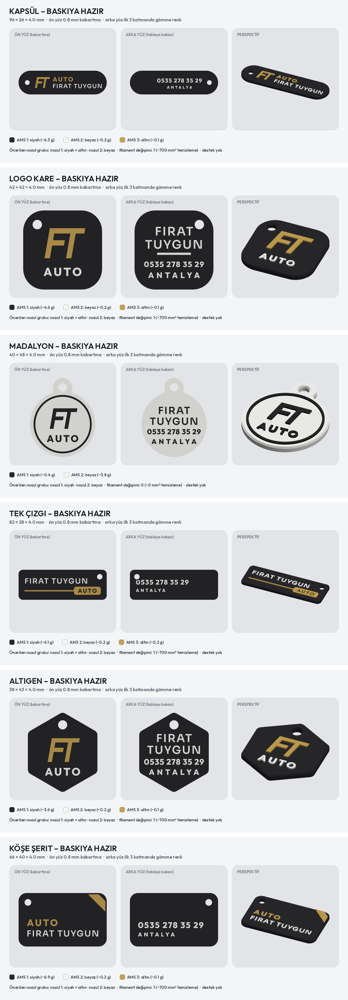
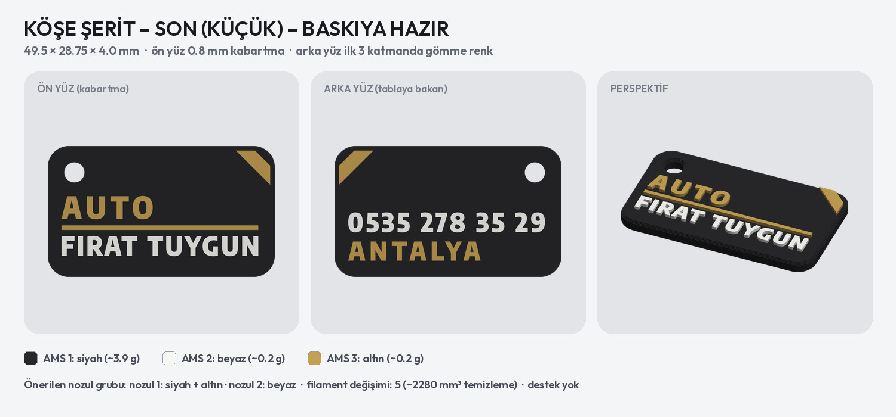
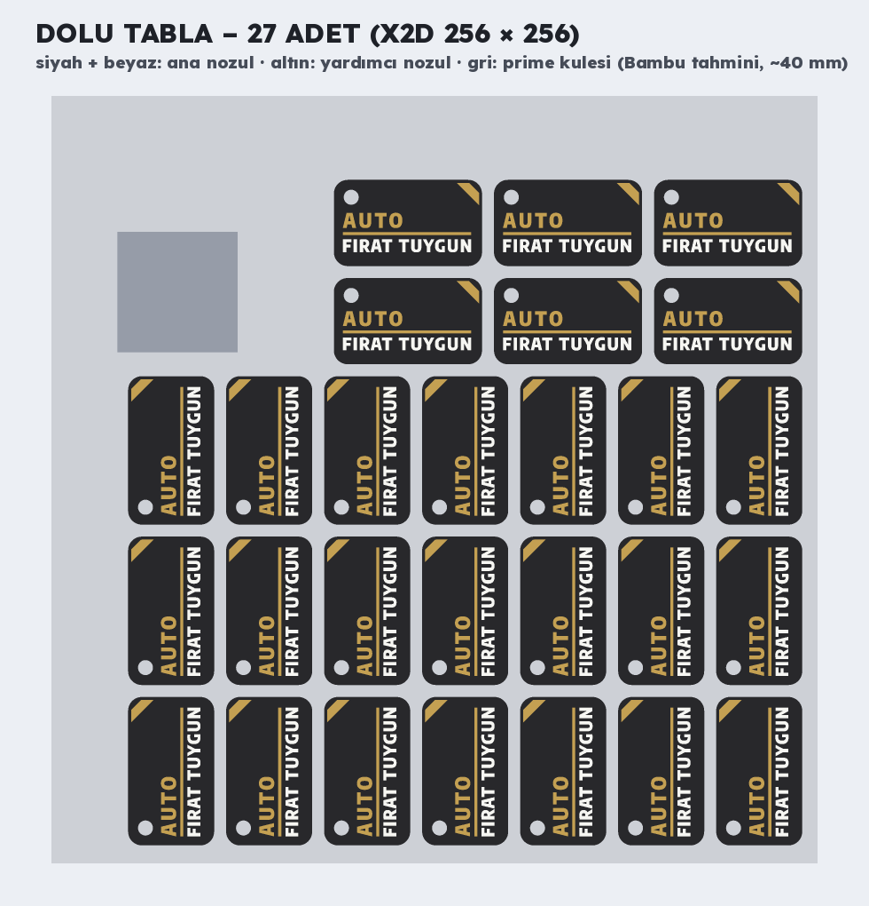
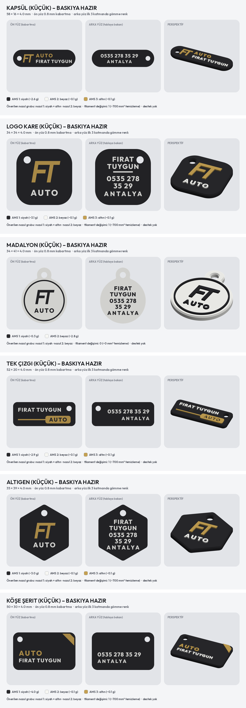

# AUTO FIRAT TUYGUN – kurumsal anahtarlıklar, baskıya hazır (Bambu Lab X2D)



Müşterinin seçtiği konseptler (1, 2, 3, 6, 7, 9). Her `.3mf` Bambu Studio'da doğrudan açılıp dilimlenebilir.
Tek parça, desteksiz basılır. Ayarlar: **Bambu Lab X2D 0.4, Bambu PLA Basic, 0.20 mm Standard**, Arachne duvar.

| Dosya | Ölçü (mm) | AMS sırası | Filament (yaklaşık) |
| --- | --- | --- | --- |
| `1_kapsul.3mf` | 96 × 26 × 4,0 | 1 siyah · 2 beyaz · 3 altın | 6,3 g + 0,2 g + 0,1 g |
| `2_logo_kare.3mf` | 42 × 42 × 4,0 | 1 siyah · 2 beyaz · 3 altın | 4,6 g + 0,2 g + 0,1 g |
| `3_madalyon.3mf` | 40 × 48 × 4,0 | 1 siyah · 2 beyaz | 0,4 g + 3,8 g |
| `6_tek_cizgi.3mf` | 82 × 28 × 4,0 | 1 siyah · 2 beyaz · 3 altın | 6,1 g + 0,2 g + 0,2 g |
| `7_altigen.3mf` | 38 × 43 × 4,0 | 1 siyah · 2 beyaz · 3 altın | 3,6 g + 0,2 g + 0,1 g |
| `9_kose_serit.3mf` | 66 × 40 × 4,0 | 1 siyah · 2 beyaz · 3 altın | 6,9 g + 0,2 g + 0,1 g |

Gramajlar parçanın kendisi içindir; temizleme kulesi ve renk değişimi atığı hariç.
Altın: **Bambu PLA Basic Gold**. Mat görünüm istenirse AMS'te PLA Matte siyah/beyaz da seçilebilir.

## Müşterinin son seçimi: köşe şerit, son sürüm, 49,5 × 28,75 mm — `kucuk/9_kose_serit_v5.3mf`



Önce / sonra (aynı ölçekte): [`kucuk/onizleme/once_sonra.png`](kucuk/onizleme/once_sonra.png)

Onaylanan diziliş aynen korundu: önde AUTO / ince altın çizgi / FIRAT TUYGUN (tek satır), arkada telefon (tek satır) /
ANTALYA, delik sol üstte, iki yüzde köşe şeridi (3,0 mm).

**Neden değişti:** Önceki baskılarda yazılar "çorba" gibi çıktı. Ölçüldü: Outfit ExtraBold'da tek satıra sığınca
harf çizgilerinin isimde %34'ü, telefonda %49'u, ANTALYA'da %61'i 0,9 mm'den inceydi (0,4 nozulla iki hattan az).
Tek satır sığdıran 50 yazı tipi/kalınlık denendi; en iyisi **Encode Sans Condensed Black** (OFL, `scripts/fonts/`):
harfler daha uzun ve kalın, tasarım ve diziliş aynı.

| Yazı | Önce (Outfit) | Son (Encode Sans Condensed Black) |
| --- | --- | --- |
| FIRAT TUYGUN | 3,8 mm · 0,9'dan ince %34 | **4,4 mm · %6** |
| 0535 278 35 29 | 3,9 mm · %49 · rakam içleri ≥0,70 | **4,4 mm · %14 · rakam içleri ≥0,80** |
| ANTALYA | 3,4 mm · %61 | **4,2 mm · %7** |
| AUTO | Outfit 4,4 mm | Encode 5,0 mm |

- Yazılar kenardan 3 mm içeride (43,5 mm yazı alanı); altın çizgi 1,0 mm, isim kadar uzun.
- Kalan tek dar yer A harflerinin küçük üçgen içi (~0,5 mm); A'nın şekli bu boyda buna izin vermiyor, harf okunur.
- Kart 49,5 × 28,75 × **3,8 mm** (gövde **2,6** + ön kabartma **1,2 mm**), köşe yarıçapı 4,6.
- **Anahtarlık halkası için:** çelik halka 3,2 mm'lik gövdeyi kavrayamıyordu. Gövde 3,2 → 2,6 mm inceltildi (%19;
  %15 = 2,72 mm katman katı değil, 2,8 mm halka için hâlâ sıkı kalırdı). Delik Ø5,0 (et payı 3,3 mm), deliğin üst ve alt
  kenarı pahlı. Tasarım bütün, basamak yok.
- Arka yüz tablaya yattığı için kabartma olamaz (destek gerekir, yüzey bozulur). İki yüzde kabartma istenirse
  anahtarlık iki ince yarım olarak basılıp sırt sırta yapıştırılabilir.

**Dosyaya yazılan baskı ayarları (Bambu Studio'da açınca hazır):**

| Ayar | Değer | Neden |
| --- | --- | --- |
| Tabla tipi | Textured PEI Plate (PLA 55 °C) | Şablonda Cool Plate (35 °C) vardı; PEI tablada ilk katman tutmaz |
| İlk katman hattı | 0,42 mm (0,50 yerine) | Arka yazıların harf içleri kapanmasın |
| İlk katman hızı / dolgu | 30 / 40 mm/s | Arka yazılar düzgün otursun |
| Fil ayağı telafisi | 0 | Gövdede zaten 0,6 mm ilk katman pahı var; ilk katman yazıları incelmesin |
| Dış duvar | 50 mm/s, ivme 2000 | Kabartma harf kenarları keskin |
| İç duvar / boşluk dolgusu | 100 / 60 mm/s | Harf içleri düzgün dolsun |
| Üst yüzey | 80 mm/s | Harf üstleri düz |
| Ütüleme | üst yüzeyler | Harf üstleri ve siyah yüz düz, parlak |
| Hassas duvar, duvarları geçmekten kaçın | açık | Ölçü hassasiyeti, harfler arasında ip/iz olmasın |
| Dikiş | hizalı + dış duvarda kademeli (scarf) dikiş | Yuvarlak harflerde dikiş izi kalmaz |
| Katman | 0,20 mm | Renk katmanları buna göre |

- **Ayarlar artık gerçekten uygulanıyor.** Önceki dosyalarda bu ayarlar 3MF'in içinde vardı ama "sistem profilinden
  farklı" listesine (`different_settings_to_system`) yazılmamıştı; Bambu Studio dosyayı açarken listede olmayan her
  ayarı **0.20mm Standard @BBL X2D** değerine geri döndürüyordu (ütüleme kapalı, dış duvar 200 mm/s, ilk katman
  0,50 mm…). Yalnız tabla tipi (proje ayarı) kalıyordu. Şimdi 13 ayarın hepsi listede.
- **Kontrol:** dosyayı proje olarak açın (çift tıklama ya da *Dosya → Proje aç*; *İçe aktar* yalnız modeli alır).
  Baskı profili adının yanında *(değiştirildi)* görünür; *Kalite → Ütüleme türü* **Üst yüzeyler**, *Hız → Dış duvar*
  **50**, *Kalite → Çizgi genişliği → İlk katman* **0,42** olmalı (değişen değerler turuncu).
- Önizlemedeki beyaz noktalar **dikiş işaretidir**, filament değildir.
- AMS: **1 siyah · 2 beyaz · 3 altın**. Siyah ile altın aynı nozulda, beyaz öbüründe. 5 filament değişimi (~2,8 g temizleme).
- **En keskin arka yazı için düz PEI tabla** (Smooth PEI / High Temp Plate); düz tabla kullanılacaksa Bambu Studio'da tabla
  tipi "Smooth PEI Plate / High Temp Plate" seçilir (PLA 55 °C, aynı). Tabla deterjanla yıkanır, yapıştırıcı sürülmez.

### Dolu tabla: 28 adet — `kucuk/9_kose_serit_v5_dolu_tabla.3mf`



Aynı anahtarlık, 7 × 4 = 28 adet (90° döndürülmüş, 4 mm ara), prime kulesi arkada ortada. Kartlar, yardımcı nozulun
ulaşabildiği alanda (x ≥ 20,5 mm) ortalandı.

- **Baskı ayarları: Bambu standart profili** (0.20mm Standard @BBL X2D, ütüleme yok). Tek baskıda en iyi sonucu bu verdi.
  Dosyadan yalnız tabla tipi (Textured PEI) ve kule yeri geliyor.
- **Nozul ataması elle sabit:** siyah ve beyaz **ana nozulda** (1. ekstrüder, doğrudan sürücü), altın **yardımcı
  nozulda** (2. ekstrüder, Bowden). Otomatik gruplama siyahı yardımcı nozula koyuyordu. Bowden beslemenin geri çekmesi
  zayıf ve yüksek akışta basıncı gecikir; gövdeyi basan siyahta ipliklenme ve tozlu, pürüzlü yüzey yapıyordu.
- **Filament profili:** Elas PLA Pro (siyah, beyaz) için **Generic PLA @BBL X2D 0.4 nozzle**: eritme hızı 21 yerine
  12 mm³/s, doğrudan sürücüde geri çekme 0,8 mm. Bambu PLA Basic profili hızlı PLA (ör. Porima XPLA) içindir; başka marka
  PLA bu hızda tam eriyemez. Altın (Filamix Silk) değişmedi: Bambu PLA Basic, sorun yok.
- Filament değişimi tabla başına 4–5 (yaklaşık 2,5–3,6 g temizleme, çoğu beyaz) + kule yaklaşık 1,2 g; adet başına
  ~0,15 g.
- Model: siyah 95,4 g · beyaz 5,9 g · altın 6,9 g (adet başına 3,9 g). Süre yaklaşık 5 saat 15 dakika (hazırlık ve
  filament değişimleriyle; PrusaSlicer'da aynı ayarlarla tahmin).
- Gönderirken **Akış dinamiği kalibrasyonu** işaretlenmeli (yeni filament). Yeni makaralar 50–55 °C'de 6–8 saat
  kurutulursa ipliklenme daha da azalır.

## Küçük boy (~45–50 mm): `kucuk/`



**Büyük dosyaları Bambu Studio'da küçültmeyin:** harf çizgileri de küçülür ve 0,4 nozulun basabileceği ~0,5–0,6 mm'nin
altına iner, A/O/8 gibi harflerin içi kapanır, yazı bulanık çıkar
([karşılaştırma](kucuk/onizleme/neden_bulanik.png): %60 küçültülmüş kapsülde yazının %37'si çok ince, yeniden
çizilende %4, o da yalnızca harflerin sivri köşeleri). Küçük boy bu yüzden yeniden çizildi:

- Bütün yazılar **Outfit ExtraBold**, en az 3,0 mm (ANTALYA 2,8 mm). İnce Sora yazı tipi küçük boyda basılamıyor.
- Hiçbir yazı çıkarılmadı. Dar tasarımlarda isim (FIRAT / TUYGUN) ve telefon (0535 278 / 35 29) iki satır.
- Delik Ø4,4 mm, çevresinde en az 3,1 mm et. Baskı yapısı büyük boyla aynı (0,8 mm kabartma, arka gömme, tek renk değişimi).
- Kontrol: kabartmada 0,6 mm'den ince çizgi ve 0,5 mm'den dar boşluk, arkada (ilk katman) 0,5 / 0,45 mm.

| Dosya | Ölçü (mm) | AMS sırası |
| --- | --- | --- |
| `kucuk/1_kapsul.3mf` | 58 × 16 × 4,0 | 1 siyah · 2 beyaz · 3 altın |
| `kucuk/2_logo_kare.3mf` | 34 × 34 × 4,0 | 1 siyah · 2 beyaz · 3 altın |
| `kucuk/3_madalyon.3mf` | 34 × 41 × 4,0 | 1 siyah · 2 beyaz |
| `kucuk/6_tek_cizgi.3mf` | 52 × 20 × 4,0 | 1 siyah · 2 beyaz · 3 altın |
| `kucuk/7_altigen.3mf` | 35 × 39 × 4,0 | 1 siyah · 2 beyaz · 3 altın |
| `kucuk/9_kose_serit.3mf` | 50 × 30 × 4,0 | 1 siyah · 2 beyaz · 3 altın |

Kapsül, bütün yazılar sığsın diye 58 mm (hepsi tek satır, en az 3 mm).

## Katmanlar

| Kısım | Yükseklik | Açıklama |
| --- | --- | --- |
| Arka yazılar (telefon, ANTALYA, isim) | 0 – 0,6 mm (ilk 3 katman) | Tablaya bakan yüz; gövdeye gömme renk, yüzeyle aynı hizada, tabla yüzeyi kadar düz |
| Gövde | 0 – 3,2 mm (16 katman) | Alt ve üst kenarda 3 katmanlık 0,6 mm pah; ilk katman 0,6 mm içeride (fil ayağı yapmaz) |
| Ön yüz logo ve yazılar | 3,2 – 4,0 mm (son 4 katman) | **0,8 mm kabartma** |

Kabartma yalnız ön yüzde: arka yüz tablaya yattığı için orada kabartma desteksiz basılamaz, bu yüzden arka yazılar
gömme renk. Arka yüz tablanın dokusunu alır (düz PEI: parlak, dokulu PEI: ince dokulu).

## X2D için yapılan iyileştirmeler

- **Tek filament değişimi:** Arka yazılar tek renk (siyah gövdede beyaz). Böylece 3 renkli dosyalarda
  **siyah + altın aynı nozulda, beyaz öbür nozulda** olur. Siyah→altın değişimi bütün baskıda yalnız bir kez
  (gövde bitince) yapılır; geri kalan renk geçişleri nozul değiştirerek, atıksız olur. Madalyonda (siyah + beyaz) hiç
  filament değişimi yok. Bambu Studio'da gruplama *Auto For Flush* modunda; dilimledikten sonra *Filament grouping*
  bölümünde siyah ile altının aynı nozulda olduğunu kontrol edin, değilse elle böyle ayarlayın.
- **Konsept görsellerinden tek fark:** Görsellerde arkadaki ANTALYA (ve logo karedeki çizgi) altındı. Baskıda,
  yukarıdaki tek değişim avantajı için beyaz. Altın istenirse betikte tek satırla geri alınır (ilk 3 katmanda
  her katmanda renk değişimi olur, ~3 g fazla atık).
- **Ölçüler 0,4 nozula göre:** Kabartmalar en az 0,7 mm, aralarında en az 0,6 mm boşluk (betik kontrol ediyor,
  kalan birkaç mm² harflerin sivri köşeleri). Yazılar kenardan en az 1 mm, delikten en az 0,8 mm içeride; deliklerin
  çevresinde en az 3,2 mm et var.
- **Kontroller:** Her dosyada parçalar kapalı ve sağlam katı, birbirinin içine girmiyor, birlikte tek gövde oluşturuyor;
  filament ayarları (renk sayısı, varyantlar, temizleme matrisi) parça atamalarıyla uyumlu.

## Baskı

1. Dosyayı Bambu Studio'da aç, AMS eşleşmesini yukarıdaki sıraya göre kontrol et.
2. Çok adet için nesneye sağ tıkla → *Örnek ekle* (ya da `+`), sonra *Düzenle* (`A`) ile tablaya yerleştir.
   Farklı modelleri aynı tablada basmak için dosyaları *İçe aktar* ile tek projeye ekleyebilirsin.
3. Dilimle → Yazdır. Destek gerekmez.

## Yeniden üretme

```bash
python3 scripts/anahtarlik_kurumsal.py            # büyük boy, hepsi
python3 scripts/anahtarlik_kurumsal.py kapsul     # yalnız biri
python3 scripts/anahtarlik_kurumsal_kucuk.py      # küçük boy
```

Kabartma yüksekliği `RAISE`, gövde kalınlığı `BODY_H`, arka gömme derinliği `INLAY` değişkenleriyle değişir.
Tasarımların kendisi `scripts/anahtarlik_konsept.py` içindeki konseptlerden gelir.
