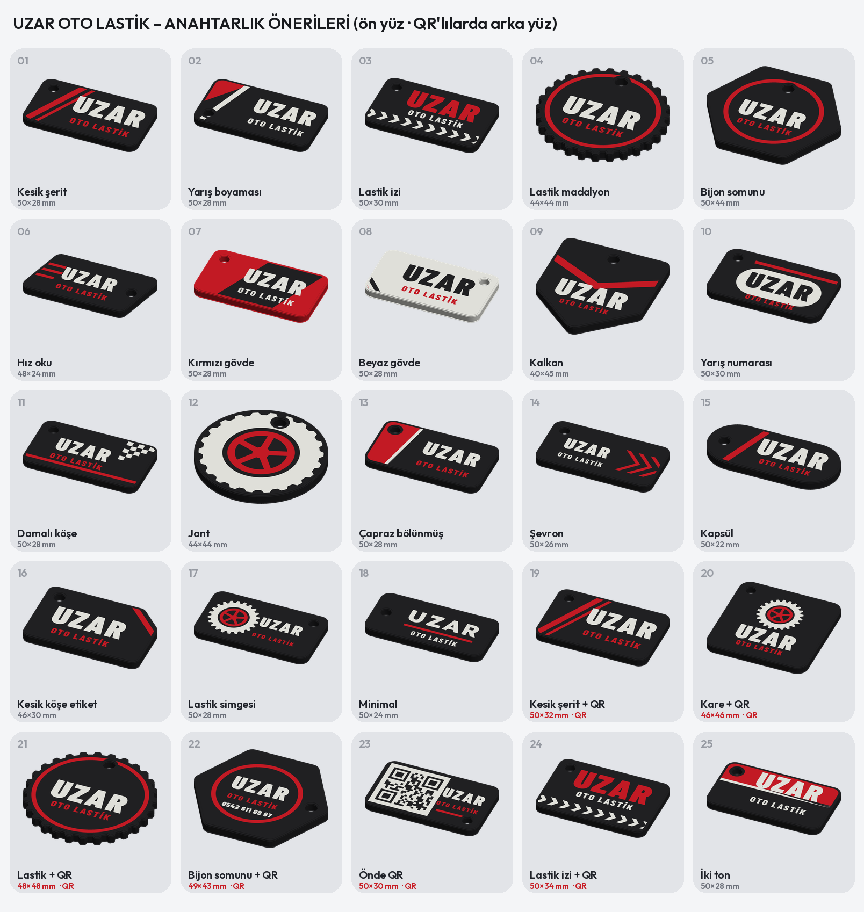

# UZAR OTO LASTİK – anahtarlık önerileri (siyah, kırmızı, beyaz)

25 görsel öneri; seçilen tasarım Bambu Lab X2D dosyasına çevrilecek. Hepsi en çok **50 × 50 mm**, 3 renk.
Her sayfada ön yüz, arka yüz ve perspektif: `01_*.png` … `25_*.png`.

- Ön yüz: **UZAR**, **OTO LASTİK**; fotoğraftaki yarış boyaması gibi keskin kırmızı şeritler ve lastik motifleri
  (lastik dişi bandı, dişli lastik kenarı, jant, bijon somunu biçimi, damalı bayrak, şevron).
- Arka yüz: **0542 611 69 87** ve **ANTALYA**.
- **QR'lı (19–24):** arka yüzde telefon QR'ı. Okutunca arama açılır (`TEL:+905426116987`). QR sürüm 1 (21 × 21),
  hata düzeltme M (%15), kare boyu 1,0–1,2 mm (0,4 nozul rahat basar), çevresinde 2 karelik beyaz boşluk.
  Arka yüz tablada basılacağı için QR ilk katmanlarda beyaz zemin üstüne siyah kare olur: düz ve keskin.
  Her QR arka yüz görüntüsünden okunarak doğrulandı. 23'te QR ön yüzde (görsel çeşitlilik için; arka yüz daha keskin).
- QR içeriği istenirse WhatsApp (`wa.me/905426116987`), Google Haritalar konumu ya da Instagram bağlantısı olabilir;
  bağlantı uzarsa QR büyür (sürüm 2–3), 50 mm'ye yine sığar.
- Delik Ø4,4 mm, kenara en az 3,2 mm et payı; yazılar delikle çakışmıyor (otomatik kontrol).
- Görsellerdeki kalınlık 3,6 mm; baskı dosyasında maliyet için 2,6–3,0 mm gövde + ince ön kabartma yapılır
  (FIRAT TUYGUN anahtarlığındaki gibi). Türkçe İ için Barlow Condensed yazı tipi.

Yeniden üretme: `pip install segno zxing-cpp` · `python3 scripts/uzar_anahtarlik.py` (yalnız genel sayfa: `genel`)
