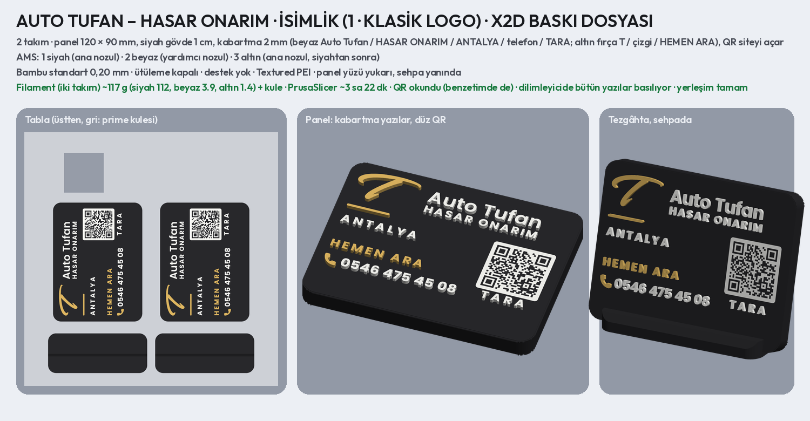
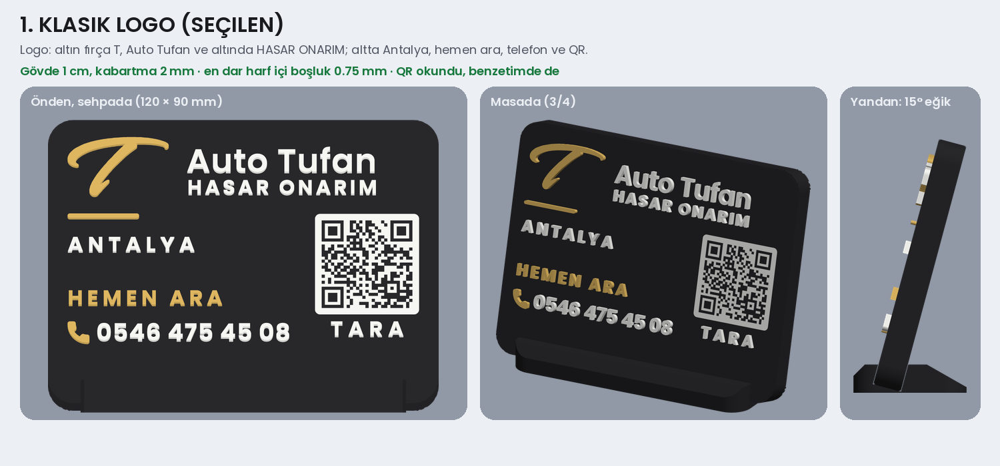
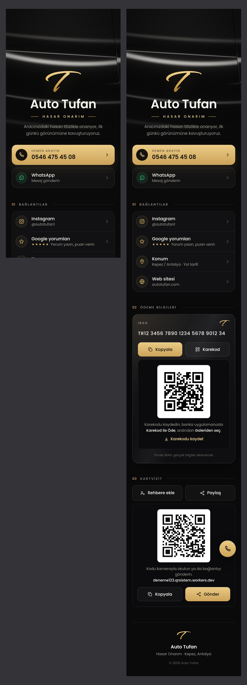
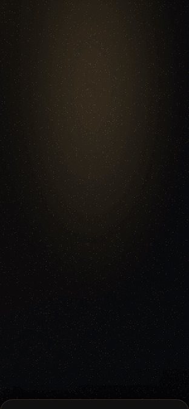

# AUTO TUFAN – Kaporta & Boya: QR'lı masa isimliği önerileri

Müşteriye gönderilecek katalog: **`musteri_1.jpg`** (1–6), **`musteri_2.jpg`** (7–10); PNG'leri ve ikisi birlikte
**`musteri_katalog.pdf`**. Ayrıntılı sayfalar: `<numara>_<ad>.png` (önden, masada, yandan).

- **Renkler:** hepsi siyah zemin, altın ve beyaz kabartma yazı ve şekil.
- **Logo:** müşterinin logosundan.
  - Fırça T görselden vektöre çevrildi (`logo/`, `scripts/autotufan_logo.py`) ve altın basılıyor.
  - "Auto Tufan" Poppins SemiBold; logodaki yazıyla birebir örtüşüyor.
  - "KAPORTA & BOYA" Poppins Bold. Logodaki Medium, 2 mm kabartmada fazla ince kalıyor.
- **Şekiller işe göre:**
  1 Klasik logo · 2 Ortalı · 3 Araba · 4 Boya tabancası · 5 Fırça darbesi (oyma Auto Tufan) · 6 Altın çerçeve ·
  7 Kalkan · 8 Boya damlaları · 9 Parlama · 10 Alt bant (oyma telefon).
- **İçerik:** Auto Tufan, KAPORTA & BOYA, HASAR ONARIM, ANTALYA, telefon **0546 475 45 08**, QR (TARA).
- **QR:** işletme sayfası `https://deneme123.qrsistem.workers.dev` (`bilgiler.json` → `sayfa_url`).
  - Ortak Cloudflare hesabında (`qrsistem`) Worker adı tam olarak `deneme123` olmalı.
  - Sondaki `/` olmadan adres 3. sürüme (29 × 29) sığıyor; 30–34 mm'de kare 0,91–1,03 mm.
  - Hepsi görüntüden ve baskı hatası benzetiminden okundu.
- **Yapı:** Uzar, İNCE, Çalık ve Soylu isimlikleriyle aynı.
  - 120 × 90 mm, köşeler R8, siyah gövde 1 cm, 15° eğik sehpa.
  - Yazılar ve şekiller 2 mm kabartma.
  - QR yüzeyle aynı hizada beyaz karo.
- **Kontroller:**
  - Küçük yazılar en az 4,6 mm büyük harf; 0,8 mm'den ince çizgi %6'dan az.
  - Harf içi boşluklar en az 0,6 mm.
  - Satırlar arası ve kenarlara en az 2 mm.
  - Oyma telefonda rakam araları en az 1 mm altın.
- **Filament:** altın için Bambu PLA Basic Gold (#E4BD68) ya da benzeri.

```bash
python3 scripts/autotufan_logo.py <logo_görseli>   # bir kez: fırça T (logo/)
python3 scripts/autotufan_isimlik.py               # 10 öneri ve katalog (4 süreçte)
python3 scripts/autotufan_isimlik.py kalkan        # yalnız eşleşen tasarımlar
python3 scripts/autotufan_isimlik.py katalog       # yalnız katalog sayfaları
```

## Baskı dosyası: seçilen 1 · Klasik logo, HASAR ONARIM (X2D)





**Müşterinin isteği:** 1 numara, ama KAPORTA & BOYA yazmasın, yalnız HASAR ONARIM yazsın. Logonun altındaki satır
HASAR ONARIM oldu; alttaki ayrı HASAR ONARIM satırı tekrar etmesin diye kalktı. Yerine ANTALYA ve HEMEN ARA geldi.

**`baski/autotufan_isimlik_x2d.3mf`**: Bambu Studio'da proje olarak açılıp doğrudan basılır. Ölçüler ve ayarlar
lastikçilerin isimlikleriyle aynı.

| | |
| --- | --- |
| Tabla | 2 takım (panel + sehpa) |
| Panel | 120 × 90 mm, siyah gövde 1 cm, köşeler R8, kenarlar basamaklı pahlı; yüzü yukarı basılır |
| Kabartma | 2 mm (10 katman). Beyaz: Auto Tufan, HASAR ONARIM, ANTALYA, telefon, TARA. Altın: fırça T, çizgi, HEMEN ARA, telefon simgesi |
| QR | siteyi açar (**https://deneme123.qrsistem.workers.dev**); 32 mm, kare 0,96 mm; yüzeyle aynı hizada beyaz karo |
| AMS | 1 siyah · 2 beyaz · 3 altın. Siyah ve altın ana nozulda (altın yalnız kabartmada, siyah bitince bir kez geçer); beyaz yardımcı nozulda |
| Ayarlar | Bambu standart 0,20 mm; **ütüleme kapalı**; destek yok; Textured PEI; Generic PLA |
| Filament | iki takım ~117 g (siyah 112, beyaz 3,9, altın 1,4) + kule; PrusaSlicer ~3 sa 22 dk |
| Sehpa | 100 × 40 × 10 mm, siyah, aynı tablada; panel yuvaya (10,3 mm) 15° eğik takılır |

**Dilimleyici kontrolü:** dosya PrusaSlicer'da aynı ayarlarla dilimlendi (`scripts/dilim.py`).

- Her yazı kabartmanın ilk katmanında (kenar) ve son katmanında kendi renginde basılıyor: %94–97 dolu.
- Fırça T, çizgi ve telefon simgesi de basılıyor.
- T'nin sivri uçları nozuldan ince kalmasın diye kenarı 0,3 mm kalınlaştırıldı.
- QR'ın beyaz karosu %98 dolu.

```bash
python3 scripts/autotufan_isimlik_baski.py   # 3MF, önizleme, ölçüm, dilimleyici kontrolü (~2 dk)
```

## Dijital kartvizit sayfası (isimlikteki QR'ın açtığı site)





Solda ilk ekran, sağda tüm sayfa (karekod ve paylaş kutuları açık). Tur GIF'inde açılış.

**4. sürüm: kurumsal oto stüdyosu dili.**

- **Geçmiş:**
  - 1. sürüm (sakin, tek kart) beğenilmedi: "lastikçilere yaptığımız gibi, havalı olsun".
  - 2. sürüm (çizgi araba) için: "hizalamalar iyi değil, arabayı sil, boyama animasyonu ekle".
  - 3. sürüm (boya tabancası, damlayan altın bant) için: "mantık çok iyi ama daha profesyonel olsun, çocuk işi gibi
    kalmış". Yapı aynı kaldı; görünüş baştan yapıldı.
- **Başlık, boya kabini:**
  - parlak siyah boyalı bir kaportada kabin ışıklarının yansıması (WebGL);
  - açılışta ışıklar birer birer, titreyerek yanar; yansımalar kaportanın kıvrımı ve bel çizgisi boyunca eğilir,
    yavaşça kayar; ışığa yakın metalik boya pulları parlar; ışıklardan biri altın;
  - logodaki altın fırça T fırça darbesiyle boyanır (önce üst kol, sonra gövde), üstünden bir parlama geçer;
  - "Auto Tufan" (logodaki yazı tipi), HASAR ONARIM ve kısa açıklama gelir.
- **Sadelik:**
  - tek yazı tipi (Poppins, logodaki), eğik ve kalın yazı yok;
  - tek vurgu rengi (şampanya altını), ince çizgiler;
  - damla, tabanca, eğik şerit gibi süsler kalktı.
- **Hemen ulaşın:** başlıkta altın Ara düğmesi (numara üstünde) ve WhatsApp. Ekrandan çıkınca sağ altta altın ara
  düğmesi belirir.
- **01 Bağlantılar:** tek listede Instagram @autotufan1, Google yorumları, konum (Kepez / Antalya, yol tarifi), web
  sitesi autotufan.com.
- **Hizalama:**
  - Ara, WhatsApp ve bağlantı satırları aynı iskelette: simge, başlık ve alt satır, ok;
  - simgeler, yazılar ve oklar sayfa boyunca aynı çizgide (önizlemede denetlenir);
  - her bölüm aynı kenar payında (20 px).
- **02 Ödeme bilgileri:** banka kartı gibi bir kart.
  - IBAN; Kopyala düğmesi.
  - Karekod: açılır, kaydedilir; banka uygulamasında galeriden okutulur.
- **03 Kartvizit:** Rehbere ekle ve Paylaş (isimlikteki QR, Kopyala / Gönder); altbilgi.
- **Paylaşım görseli ve simge:** aynı kabin ışıkları, altın T, Auto Tufan.
- **Bağlantılar aynı sekmede açılır.** Yeni sekme, QR okuyucuların uygulama içi tarayıcılarında ve önizlemelerde
  çoğu zaman açılmıyor.
- **Açılır kutular (karekod, paylaş):** JavaScript'siz de açılır (`#karekod`, `#paylas` bağlantısı).
- **Hareketi azalt ya da WebGL yok:** animasyonlar oynamaz; başlığın arkasında aynı görüntünün durgun hâli
  (`boya.jpg`, aynı çiziciyle üretilir) görünür, sayfa son hâliyle açılır.
- **Pil:** ışıklar başlık ekrandayken çizilir; aşağı kaydırınca durur.
- **Boyut:** ~145 KB.

**Bilgiler** (`bilgiler.json`):

- **IBAN şimdilik örnek:** `TR12 3456 7890 1234 5678 9012 34` (`iban_ornek: true`). Sayfada küçük "Örnek IBAN"
  notu var.
  - Gerçeği gelince `iban` alanına yazılır ve `iban_ornek` silinir; IBAN mod-97 ile doğrulanır.
  - Alıcı adı istenirse `iban_alici` alanına yazılır.
- **Banka karekodu:** şimdilik karekod yalnız IBAN'ı içeriyor.
  - Bankanın "karekod ile para gönder" ekran görüntüsünün içeriği `iban_karekod` alanına yazılınca (Uzar'daki gibi;
    CRC ve IBAN doğrulanır) banka uygulaması okutunca alıcı ve IBAN dolu açılır.
- **Google yorumları:** şimdilik "auto tufan kepez yorumları" araması.
  - İşletme profilindeki **Yorum iste** bağlantısı (`https://g.page/r/…/review`) `google` alanına yazılırsa doğrudan
    yorum penceresi açılır.

**Denemek için:** `sayfa_deneme.html` tek dosya (yazı tipleri, karekod, simge ve rehber kartı içinde); en iyisi
Chrome ile açmak.

**Yayın:** ortak Cloudflare hesabında (`qrsistem`) yeni bir Worker açılır, adı tam olarak `deneme123` olur ve
`autotufan_site.zip` yüklenir. Adres `https://deneme123.qrsistem.workers.dev` olur; isimlikteki QR bu adresi açar.

```bash
python3 scripts/autotufan_sayfa.py            # site, zip, önizleme ve tur GIF'i
python3 scripts/autotufan_sayfa.py --hizli    # GIF'siz
```
