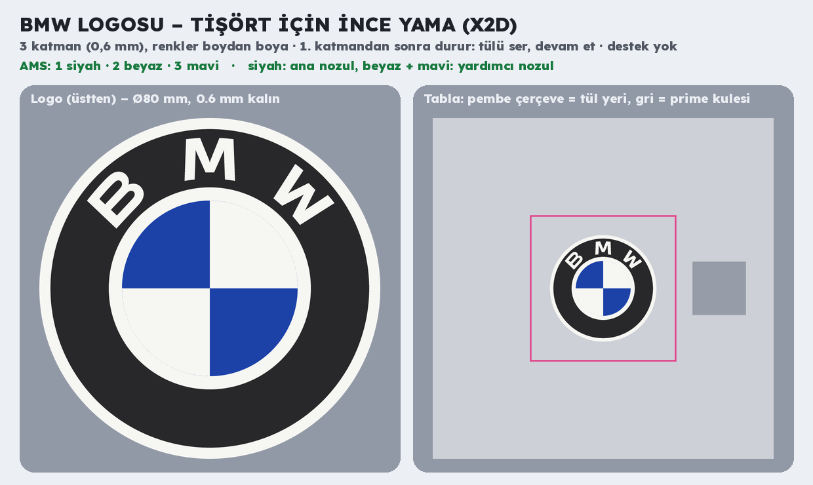

# BMW logosu – tişört için ince yama (Bambu Lab X2D)



**`bmw_logo_tisort.3mf`**: Bambu Studio'da proje olarak açılıp doğrudan basılır.

| | |
| --- | --- |
| Ölçü | Ø80 mm, **0,6 mm** (3 katman); renkler kalınlık boyunca, iki yüzde de logo görünür |
| Renkler (AMS sırası) | 1 siyah · 2 beyaz · 3 mavi |
| Nozullar (elle sabit) | siyah ana nozulda; beyaz ve mavi yardımcı nozulda |
| Filament | ~3,8 g (+ ~2 g temizleme ve kule), ~11 dk baskı |
| Ayarlar | Bambu standart profili; Elas için Generic PLA, mavi Bambu PLA Basic; destek yok; tabla Textured PEI |

Renk bölgeleri: beyaz = dış ince halka, B-M-W harfleri, iç ince halka, sağ üst ve sol alt çeyrek; siyah = geniş
halka; mavi = sol üst ve sağ alt çeyrek. En ince yerler ≥0,8 mm (yalnız harf köşeleri daha ince, %0,2'den az).

## Tül sandviç: esnek, dikilebilir yama

Dosyada **1. katmandan sonra duraklatma hazır** (2. katmandan önce, z 0,4 mm).

1. ~11 × 11 cm **polyester/naylon tül** kes (perde tülü olur).
2. Baskıyı başlat. İlk katman bitince yazıcı durur.
3. Kapağı aç, tülü logonun üstüne gergin ser; köşelerinden kâğıt bantla tablaya yapıştır. Tül ve bant önizlemedeki
   **pembe çerçevenin** (110 mm) içinde kalsın: sağdaki prime kulesine taşmasın.
4. Devam et. Kalan 2 katman tülün gözeneklerinden ilk katmana kaynar; tül plastiğin içinde kalır.
5. Tabladan çıkar, tülü logonun 5–8 mm dışından kes. Bu tül kenardan tişörte **dik** (elde ya da düz makine
   dikişi) ya da tekstil yapıştırıcısıyla yapıştır. Üst yüz (son basılan) dışa baksın; logo o yüzde doğru yönde.

- Yıkama: tişörtü ters çevir, 30 °C, hassas program. **Ütü ve kurutma makinesi yok** (PLA ~60 °C'de yumuşar).
- Duraklatmayı istemezsen: Bambu Studio önizlemesinde katman çubuğunda duraklatma işaretine sağ tık → sil.
- Boyut değiştirmek için yalnız **X ve Y** ölçeklenir (Z 0,6 mm kalır); tül çerçevesi ve kule yeri buna göre kontrol
  edilir.
- Daha esnek ve yıkamaya dayanıklı yama için TPU (ör. Bambu TPU 95A) kullanılabilir; ayarları değişir.

**Neden doğrudan tişörtün üstüne değil:** X2D'nin tablası sabit ve kapalı kasalı; tişört serilince iki katı da tablaya
gelir (plastik iki kata birden yapışır), kumaş baskı kafasına ya da nozul temizleyicisine takılabilir, prime kulesi de
kumaşın üstüne basılır. Tül yama aynı görüntüyü verir, temiz ve dikilebilir.

Logo çizimi Simple Icons'tan (`scripts/logolar/bmw.svg`, CC0). BMW logosu BMW AG'nin tescilli markasıdır; kişisel
kullanım dışında (satış) marka sahibinin izni gerekir.

## Yeniden üretme

```bash
pip install svgelements
python3 scripts/bmw_logo.py
```
