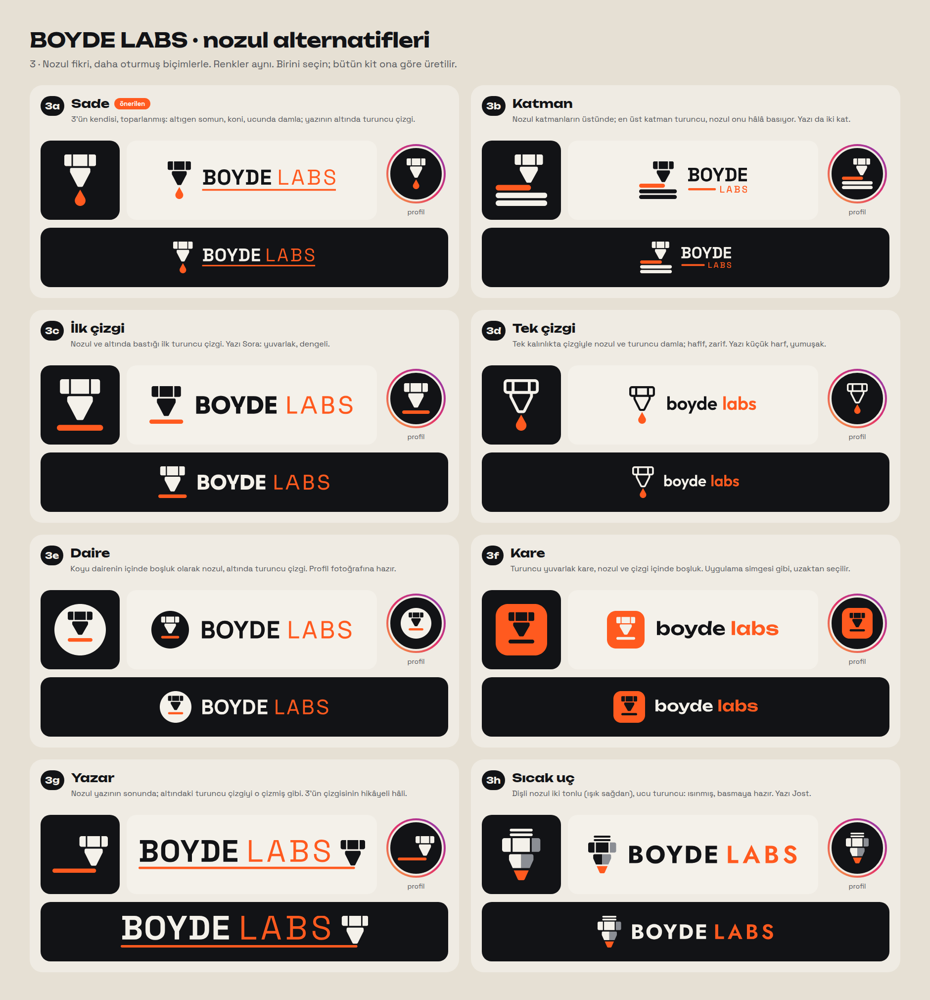
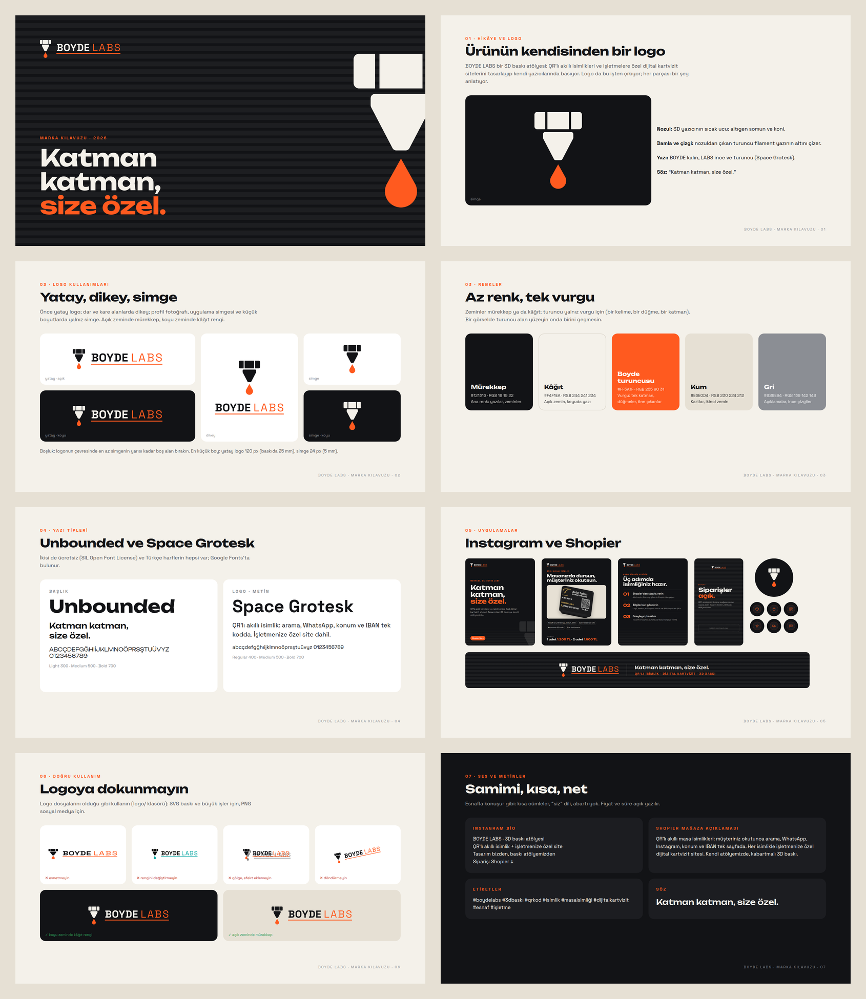

# BOYDE LABS · marka kimliği





**Ürün (varsayım):** QR'lı akıllı masa isimliği ve işletmeye özel dijital kartvizit sitesi. Hepsi 3D baskı, kendi
atölyede. Marka bir 3D baskı atölyesi ("Labs").

## Logo

**Seçilen: 3a · Nozul (Sade).** 3D yazıcının nozulu, ucunda turuncu damla; yazının altını aynı turuncu çizgi çizer.

- **Nozul:** altıgen somun (üç yüzü görünür) ve koni; köşeler yumuşak.
- **Damla ve çizgi:** nozuldan çıkan turuncu filament yazının altını çizer.
- **Yazı:** BOYDE kalın, LABS ince ve turuncu (Space Grotesk).
- **Söz:** "Katman katman, size özel."

**Seçim nasıl yapıldı:**

- Önce birbirinden farklı 8 yön çizildi (`secenekler.png`): 1 Küp, 2 Şişe, 3 Nozul, 4 Etiket, 5 Rozet,
  6 Katmanlı yazı, 7 QR, 8 b ve d.
- 3 beğenildi, "daha estetik dursun" denildi. Alternatifleri `secenekler_nozul.png`'de: 3a Sade, 3b Katman,
  3c İlk çizgi, 3d Tek çizgi, 3e Daire, 3f Kare, 3g Yazar, 3h Sıcak uç.
- 3'ün kendisi istendi; 3a onun toparlanmış hâli.
- Başka biri seçilirse bütün kit yeniden üretilir: `python3 scripts/boyde_marka.py --yon 3e`.
- Önceki taslaklar (B'li ve bd'li logolar) git geçmişinde duruyor.

**`logo/` klasörü:**

- Biçimler: `yatay`, `dikey`, `simge`, `yazi` (simgesiz).
- Zeminler:
  - `acik`: açık zemin için, mürekkep rengi;
  - `koyu`: koyu zemin için, kâğıt rengi;
  - `siyah`, `beyaz`: tek renk; baskı, kaşe, lazer, 3D baskı.
- Her biri iki dosya:
  - **SVG:** büyütülebilir, yazılar çizgiye çevrili; matbaa ve tabela için;
  - **saydam PNG:** sosyal medya ve belgeler için.

## Nereye ne yüklenir

| Dosya | Yer | Ölçü |
| --- | --- | --- |
| `shopier/logo_kare_800.png` | Shopier → Dükkan Yönetimi → Logo & Banner → logo | 800 × 800 (en az 200 × 200, kare) |
| `shopier/banner_1920x200.png` | Shopier → Logo & Banner → banner (geniş ekran) | 1920 × 200 |
| `shopier/banner_mobil_400x100.png` (ya da `_800x200` keskin sürüm) | Shopier → banner (mobil) | 400 × 100 |
| `shopier/hakkinda_kapak_4x3.png` | Shopier → Hakkında sayfası, giriş kapağı | 1600 × 1200 (4:3) |
| `shopier/hakkinda_genis_16x9.png` | Shopier → Hakkında, geniş görsel (metinsiz) | 1920 × 1080 (16:9) |
| `instagram/profil_1080.png` | Instagram profil fotoğrafı (yuvarlak kırpmaya göre ortalı) | 1080 × 1080 |
| `instagram/one_cikan/*.png` | Öne çıkan hikâye kapakları: Ürünler, Sipariş, QR isimlik, Yorumlar, Kargo, İletişim | 1080 × 1920 |
| `instagram/gonderi_1_tanitim.png` | İlk gönderi: tanıtım | 1080 × 1350 (4:5) |
| `instagram/gonderi_2_urun.png` | Ürün gönderisi: QR'lı isimlik, fiyat | 1080 × 1350 |
| `instagram/gonderi_3_nasil.png` | Nasıl sipariş verilir (3 adım) | 1080 × 1350 |
| `instagram/hikaye_siparis.png` | Hikâye: "Siparişler açık" (alttaki boşluğa Shopier bağlantı çıkartması) | 1080 × 1920 |
| `kilavuz.pdf` | Marka kılavuzu (8 sayfa): logo, kullanım, renkler, yazı tipleri, uygulamalar, metinler | 1600 × 900 |

**Shopier ölçüleri:** Shopier'ın yardım sayfasından alındı: banner geniş ekran 1920 × 200, mobil 400 × 100; logo en
az 200 × 200 ve kare. Banner kenarlardan kırpılabildiği için logo ve yazı ortada.

**Ürün görseli:** gönderi 2'deki örnek, Auto Tufan isimliğinin çizimi (`kaynak/urun_ornek.png`). Kendi ürün
fotoğraflarınızla değiştirilebilir.

## Renkler

| Ad | HEX | RGB | Nerede |
| --- | --- | --- | --- |
| Mürekkep | `#121316` | 18 19 22 | ana renk: yazılar, koyu zeminler |
| Kâğıt | `#F4F1EA` | 244 241 234 | açık zemin; koyu zeminde yazı |
| Boyde turuncusu | `#FF5A1F` | 255 90 31 | yalnız vurgu: tek katman, düğme, bir kelime |
| Kum | `#E6E0D4` | 230 224 212 | kartlar, ikinci zemin |
| Gri | `#8B8E94` | 139 142 148 | açıklamalar, ince çizgiler |

## Yazı tipleri

- **Unbounded:** başlıklar; Light 300, Medium 500, Bold 700.
- **Space Grotesk:** logo yazısı ve metin; Regular 400, Medium 500, Bold 700.

İkisi de ücretsiz (SIL Open Font License), Türkçe harflerin hepsi var, Google Fonts'ta bulunur.

## Metinler

**Instagram bio:**

```
BOYDE LABS · 3D baskı atölyesi
QR'lı akıllı isimlik + işletmenize özel site
Tasarım bizden, baskı atölyemizden
Sipariş: Shopier ↓
```

**Shopier mağaza açıklaması:** QR'lı akıllı masa isimlikleri. Müşteriniz okutunca arama, WhatsApp, Instagram, konum
ve IBAN tek sayfada açılır. Her isimlikle işletmenize özel bir dijital kartvizit sitesi gelir. Kendi atölyemizde
kabartmalı 3D baskı.

**Etiketler:** #boydelabs #3dbaskı #qrkod #isimlik #masaisimliği #dijitalkartvizit #esnaf #işletme

**Ses:** esnafla konuşur gibi. Kısa cümleler, "siz" dili, abartı yok; fiyat ve süre açık yazılır.

## Yeniden üretmek

```bash
python3 scripts/boyde_marka.py              # yalnız seçenek sayfaları
python3 scripts/boyde_marka.py --yon 3a     # seçilen yönle bütün kit (~30 sn)
```

Metinler (söz, fiyat, adımlar, bio) `scripts/boyde_marka.py` içinde. Değişince komut yeniden çalıştırılır.
