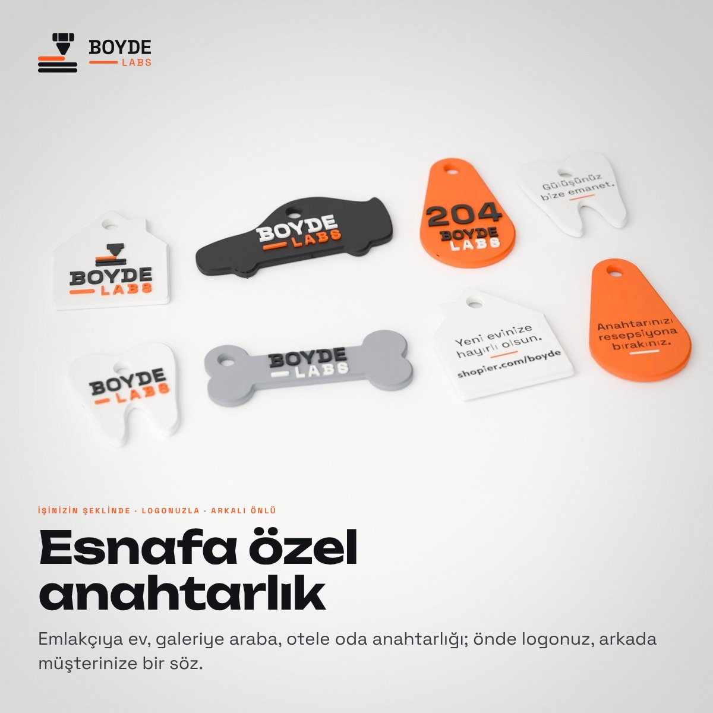

# BOYDE LABS · esnafa özel anahtarlıklar



İstek: "Emlakçılar vs. için ev şeklinde vs. böyle esnaflara özel anahtarlıklar üret, hepsi BOYDE markalı olsun;
5 adet örnek, kabartmalı ön yüzey, düz arka yüzey ve Shopier için hazırla."

## Modeller

| Kod | Model | Kimin için | Ölçü | Renkler | Ön yüz | Arka yüz |
| --- | --- | --- | --- | --- | --- | --- |
| E01 | Ev | emlakçılar | 41 × 49 mm | beyaz · siyah · turuncu | işaret ve BOYDE LABS; delik çatının tepesinde | "Yeni evinize hayırlı olsun." ve shopier.com/boyde |
| E02 | Araba | oto galeriler | 72 × 34 mm | siyah · beyaz · turuncu | BOYDE LABS; delik tavanda, asılınca düz durur | "Yolunuz açık olsun." ve shopier.com/boyde |
| E03 | Oda | oteller | 34 × 60 mm | turuncu · siyah · beyaz | büyük oda numarası (204) ve BOYDE LABS; delik dar uçta | "Anahtarınızı resepsiyona bırakınız." |
| E04 | Diş | diş klinikleri | 36 × 43 mm | beyaz · siyah · turuncu | BOYDE LABS; delik kronun ortasında | "Gülüşünüz bize emanet." |
| E05 | Kemik | veteriner, pet shop | 68 × 27 mm | gri · siyah · beyaz | BOYDE LABS; delik bir uçta | "Patili dostunuz bize emanet." |

Örneklerde kendi markamız var (BOYDE LABS); müşterinin anahtarlığı kendi logosu ve sözüyle basılır.

**Yapı (toptan anahtarlıklarla aynı, `scripts/boyde_anahtarlik_toptan.py`):**

- **Gövde:** 3,2 mm, pahlı kenarlar.
- **Ön yüz:** 0,8 mm kabartma, renkli.
- **Arka yüz:** düz; yazı yüzeyle aynı hizada gömme renk (0,6 mm).
- **Delik:** Ø5,2 mm, çevresinde en az 3,5 mm et. Asılınca biçim düz durur (ev çatıdan, araba tavandan asılır).
- **Kontrol:** kenara ya da deliğe taşan yazı yok (kırpılan alan 0). 0,7 mm'den ince ya da 0,6 mm'den dar kalan
  alan model başına ≤ 1 mm² (harf köşeleri).

## Fotoğraflar (`fotograf/`)

| Dosya | Ne |
| --- | --- |
| `<model>_iki.jpg` | masada iki adet: biri önden (kabartma), biri ters çevrilmiş (arka yüz) |
| `<model>_halka.jpg` | zincirli halka takımında asılı iki adet: biri önünü, biri arkasını gösterir |
| `kapak.jpg` | sekiz adet masada, iki sıra: beş model önden, üçü bir de arkadan |
| `dizi.jpg` | beş model halka takımlarıyla yan yana, siyah fonda (arkada hafif hale: siyah araba fonda kaybolmasın) |

## Shopier (`shopier/`, 1200 × 1200, yükleme sırasıyla)

| Dosya | Ne |
| --- | --- |
| `01_kapak.jpg` | beş model, "Esnafa özel anahtarlık" |
| `02_bes_model.jpg` | beş model halka takımlarıyla, siyah fonda; kodları ve sektörleri |
| `03_E01_ev_halka.jpg` … `07_E05_kemik_halka.jpg` | her model zincirli halka takımıyla (solda ön, sağda arka yüz); sağ üstte sektör |
| `08_E01_ev_arkali_onlu.jpg` … `12_E05_kemik_arkali_onlu.jpg` | her model masada arkalı önlü; altta arka yüzdeki söz |
| `13_olcu_ozellik.jpg` | beş biçim gerçek oranlarıyla (ön ve arka), özellikler |
| `14_nasil_siparis.jpg` | dört adım, WhatsApp |

Ürün adı ve açıklaması: `boyde_labs/urunler/shopier/urun_metinleri.md` (5. ürün).

## Yeniden üretmek

```bash
python3 scripts/boyde_anahtarlik_esnaf.py            # modeller, ön ve arka görünüş, baskı kontrolü
python3 scripts/boyde_anahtarlik_esnaf.py --foto     # Blender fotoğrafları (bpy 4.2)
python3 scripts/boyde_anahtarlik_esnaf.py --shopier  # Shopier görselleri
```
