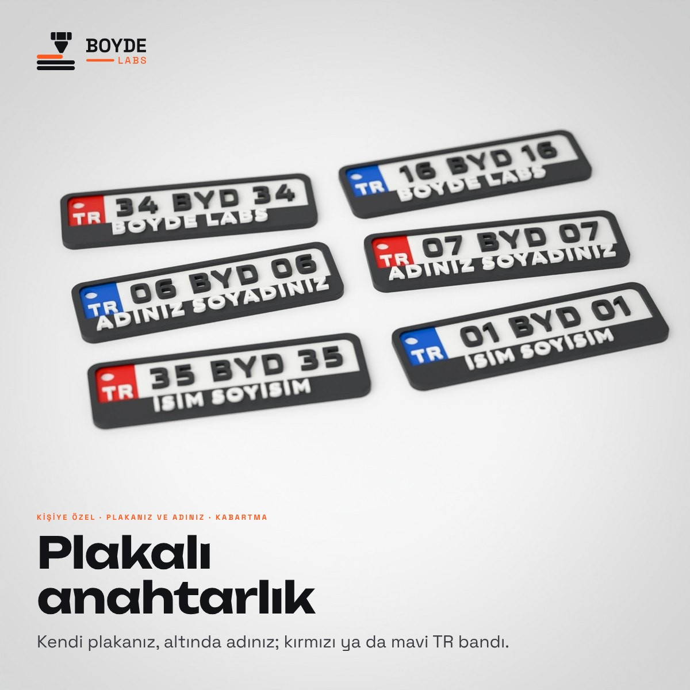

# BOYDE LABS · kişiye özel plakalı anahtarlık



İstek: "Shopier'e yüklememiz gereken bir ürün daha var: kişiye özel plakalı anahtarlık; STL dosyası ve bütün ürün
bilgileri burada" (Bambu Studio örneği, `Birleştir.stl`). "Kırmızı versiyonunda yap TR yazısını", "mavisini neden
yapmadın", "ikisini tek görselde birleştir".

## Model (`scripts/boyde_plakali_anahtarlik.py`)

Ölçüler kullanıcının STL'inden: 70 × 22 mm, köşe R3,6; 2 mm siyah çerçeve, alt şerit (adın zemini), beyaz plaka
zemini, solda TR bandı. TR bandı **mavi** (örnekteki gibi) ya da **kırmızı**; TR beyaz.

| Katman (z, mm) | Renk | Ne |
| --- | --- | --- |
| 0–2,2 | siyah | çerçeve ve alt şerit |
| 0–0,4 | siyah | zeminin ve bandın altı: arka yüz tamamen siyah |
| 0,4–1,6 | beyaz | plaka zemini (1,2 mm, 6 katman: tok beyaz) |
| 0,4–1,8 | kırmızı ya da mavi | TR bandı (`tasarla(plaka, ad, "kirmizi"/"mavi")`; 1,4 mm) |
| 1,6–2,9 | siyah | plaka yazısı, 1,3 mm kabartma (Saira SemiBold, DIN benzeri; büyük harf boyu ~6,5 mm) |
| 1,8–2,5 | beyaz | TR |
| 2,2–3,2 | beyaz | ad ya da söz, 1 mm kabartma (Outfit ExtraBold) |

Toplam 3,2 mm. Arka yüz siyah ve renkler kalın ("arka plakalarını da siyah yapalım", "mavi ve beyazın son katman
dolgusunu artır"): Shopier görselleri bu değişiklikten önce üretildi, arka yüzleri eski (beyaz ve bant rengi).

- **Delik:** Ø3,5 mm, TR bandının sol üstünde (üstte 2,45, solda 3,25 mm et). Kullanıcının örneğinde kesici gövdeydi,
  birleştirince STL'e çıkmamıştı.
- **Ad:** genişliğe sığdırılır; İ noktaları ve Ğ işaretiyle şeride sığmazsa küçülür. Küçük boyda da harf içi ve İ
  noktası ≥ 0,7 mm kalsın diye Outfit ExtraBold (Montserrat'ta noktalar 0,7 mm'nin altına iniyordu). Küçülünce ince
  kalan adlarda (Ş, Ç çengelli) yazı küçülmek yerine şeritte kayar (alt çerçeveye ya da plakaya 0,6 mm kalana dek).
- **Atölye:** uygulamada "Plakalı anahtarlık" ürünü bu modeli kullanır (`atolye/urunler/plakali.py`): plaka, yazı ve
  bant rengi girilir; sipariş adedi kadar X2D 3MF ve önizleme hazırlanır.
- **Kontrol:** yazılar zeminden taşmaz (kırpılan 0), 0,7 mm'den ince kalan yer yok.

Örnek yazılar uydurma (gerçek plaka ya da kişi değil): 34 BYD 34 · BOYDE LABS (kırmızı), 06 BYD 06 · ADINIZ
SOYADINIZ (mavi), 35 BYD 35 · İSİM SOYİSİM (kırmızı); kapakta ayrıca 16, 07 ve 01 (karışık); renk görselinde 34 BYD 34
kırmızı ve mavi.

## Fotoğraflar (`fotograf/`)

| Dosya | Ne |
| --- | --- |
| `<model>_iki.jpg` | masada iki adet: biri önden, biri ters (düz arka yüz) |
| `<model>_halka.jpg` | zincirli halka takımında asılı (delik sol üstte: plaka dik asılır) |
| `kapak.jpg` | altı farklı plaka masada, önden (kırmızı ve mavi) |
| `uc.jpg` | üç örnek alt alta |
| `renk.jpg` | aynı plaka kırmızı ve mavi bantla, alt alta |

## Shopier (`shopier/`, 1200 × 1200, yükleme sırasıyla)

| Dosya | Ne |
| --- | --- |
| `01_kapak.jpg` | altı plaka (kırmızı ve mavi), "Plakalı anahtarlık" |
| `02_renk_secenek.jpg` | aynı plaka kırmızı ve mavi bantla, tek görselde: "Kırmızı ya da mavi, siz seçin." |
| `03_uc_ornek.jpg` | üç örnek, plaka ve yazıları |
| `04_p01_onlu_arkali.jpg` … `06_p03_onlu_arkali.jpg` | her örnek önlü arkalı, BOYDE çerçevesinde |
| `07_halka.jpg` | zincirli halka takımıyla |
| `08_olcu_ozellik.jpg` | ön görünüş 70 × 22 mm, renkler, özellikler |
| `09_nasil_siparis.jpg` | dört adım, WhatsApp |

Ürün adı ve açıklaması: `boyde_labs/urunler/shopier/urun_metinleri.md` (6. ürün).

## Yeniden üretmek

```bash
python3 scripts/boyde_plakali_anahtarlik.py            # modeller, ön ve arka görünüş, kontrol
python3 scripts/boyde_plakali_anahtarlik.py --foto     # Blender fotoğrafları (bpy 4.2)
python3 scripts/boyde_plakali_anahtarlik.py --shopier  # Shopier görselleri
```
