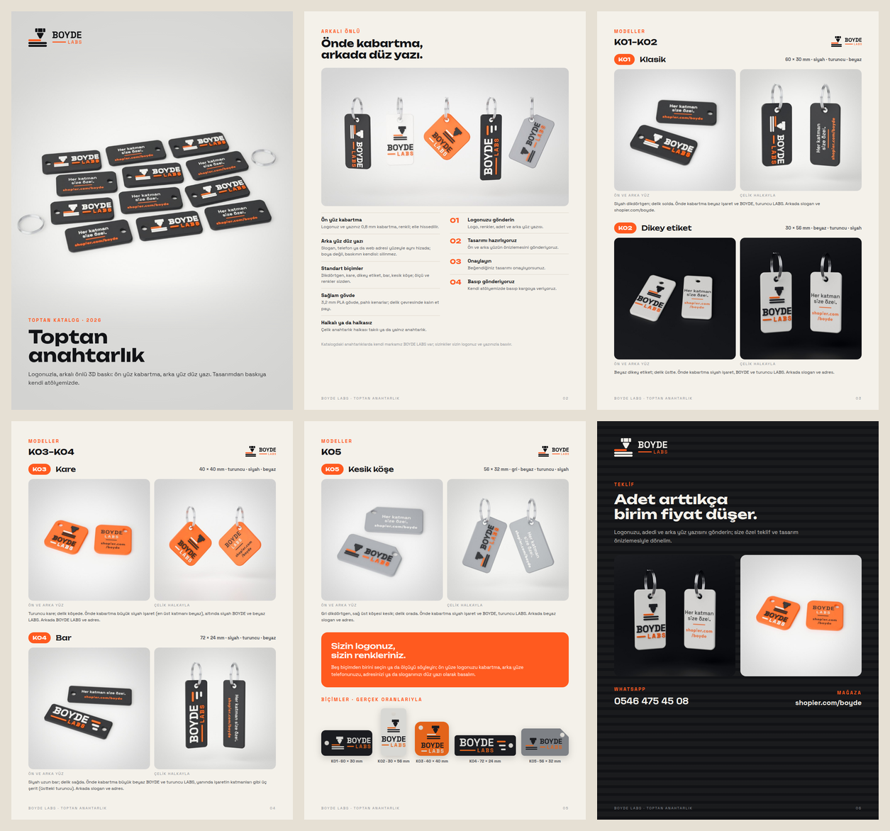

# BOYDE LABS · toptan anahtarlık kataloğu



İstekler:
- "Toptan anahtarlık için bir katalog hazırla, BOYDE olsun, 5 anahtarlık örneği çiz, bazı fotoğraflara anahtarlık
  halkası da ekle."
- "Hepsi standart anahtarlık şeklinde (dikdörtgen vs.) olsun, markaları sallama, BOYDE LABS olarak yap."
- "Ön yüz kabartmalı yazı, arka yüz düz yazı; arkalı önlü, tek karede iki açıdan görünsün."
- "Katman katmanı sil, 'Her katman size özel' yaz."

## Modeller

| Kod | Model | Ölçü | Renkler | Kısaca |
| --- | --- | --- | --- | --- |
| K01 | Klasik | 60 × 30 mm | siyah · beyaz · turuncu | delik solda; işaret ve BOYDE LABS yan yana |
| K02 | Dikey etiket | 30 × 56 mm | beyaz · siyah · turuncu | delik üstte; işaret üstte, yazı altında |
| K03 | Kare | 40 × 40 mm | turuncu · siyah · beyaz | delik köşede; büyük işaret, altında yazı |
| K04 | Bar | 72 × 24 mm | siyah · beyaz · turuncu | delik sağda; büyük BOYDE LABS, yanında katman şeritleri |
| K05 | Kesik köşe | 56 × 32 mm | gri · siyah · turuncu · beyaz | sağ üst köşe kesik, delik orada |

- **Ön yüz:** 3b · Katman işareti ve BOYDE / LABS 0,8 mm (4 katman) kabartma, renkli.
- **Arka yüz:** "Her katman size özel." ve shopier.com/boyde; yüzeyle aynı hizada gömme renk (0,6 mm, tablaya
  bakan ilk 3 katman).
- **Gövde:** 3,2 mm, alt ve üst kenarda 3 katmanlık pah; delik Ø5,2 mm.
- **Baskıya uygunluk:** kabartma kenardan 1 mm, delikten 0,8 mm içeride.
  - LABS en az 4,2 mm ve kalın; 3 mm'de çizgileri 0,5 mm kalıyordu.
  - İşaretteki nozulun 0,7 mm'den dar yarıkları kapalı. Katman çizgileri 0,15 mm ince, araları 0,7 mm'nin
    üstünde.
  - Arka yüzdeki i, ö noktaları ve noktalama biraz büyütüldü (silinmesin).
  - Ölçülen: 0,7 mm'den ince ya da 0,6 mm'den dar kalan alan model başına ≤ 1,1 mm² (harf köşeleri).

## Fotoğraflar (`fotograf/`)

| Dosya | Ne |
| --- | --- |
| `<model>_iki.jpg` | masada iki adet: biri önden (kabartma), biri ters çevrilmiş (arka yüz) |
| `<model>_halka.jpg` | çelik halkalarda asılı iki adet: biri önünü, biri arkasını gösterir |
| `kapak.jpg` | 12 adet K01 (yarısı önden, yarısı arkadan) ve iki boş halka: toptan parti |
| `dizi.jpg` | beş model halkalarıyla yan yana |

- Halka Ø25 mm çelik, iki tur; iki tur da deliğin içinden geçer.
- Fon: koyu anahtarlıklar beyaz fonda, beyaz gövdeli K02 logodaki siyahta.

## Katalog

`katalog.pdf` (A4, 6 sayfa):
1. Kapak
2. Arkalı önlü: özellikler ve sipariş adımları
3–5. Modeller: her biri arkalı önlü ve halkalı fotoğrafıyla
6. Teklif: WhatsApp ve shopier.com/boyde

Fiyat yazılmadı; "adet arttıkça birim fiyat düşer, teklif alın".

## Yeniden üretmek

```bash
python3 scripts/boyde_anahtarlik_toptan.py            # modeller, ön ve arka görünüş, baskı kontrolü
python3 scripts/boyde_anahtarlik_toptan.py --foto     # Blender fotoğrafları (~15 dk)
python3 scripts/boyde_anahtarlik_toptan.py --katalog  # katalog.pdf ve katalog.png
```
