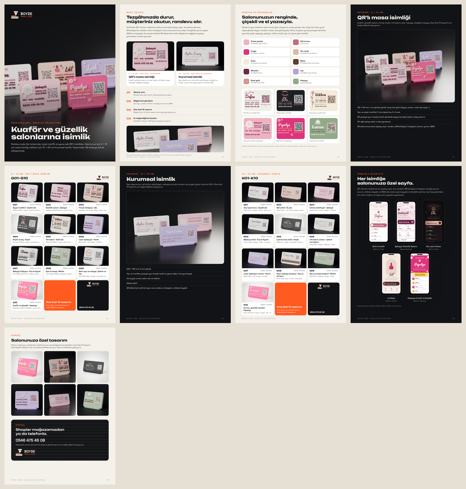
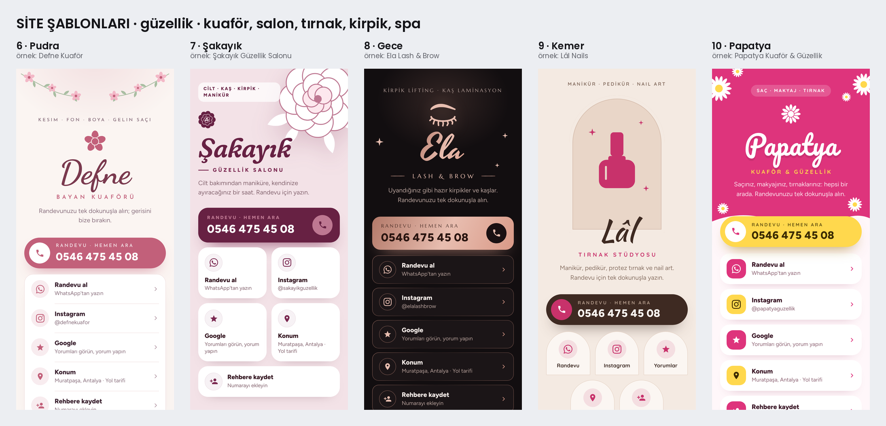

# BOYDE LABS · güzellik koleksiyonu



Katalog: [`katalog.pdf`](katalog.pdf) (A4, 9 sayfa).

İstek: "pembe beyaz ve kadınların kullandığı tarzdaki renklerden hem 9 × 12 hem de 10 × 20 10'ar adet örnek ürün;
kuaför, beauty salonları, tırnakçılar... sadece pembe-beyaz değil, hafif ten rengi gibi güzel görünen renkler; yazı
fontları daha tatlı ve dikkat çekici, çiçek motifleri", ardından "5 adet farklı internet sitesi tasarla bu
ürünlerimize uygun".

Bütün işletme ve kişi adları uydurma; telefon BOYDE'nin (0546 475 45 08); QR'lar örnek modunda (okunmaz), IBAN örnek.

## Ürünler

**9 × 12 cm QR'lı masa isimliği** (120 × 90 mm, 1 cm gövde, yazı ve motifler 2 mm kabartma, QR yüzeyle aynı hizada)

| Kod | Örnek işletme | Sektör | Tasarım | Renkler |
| --- | --- | --- | --- | --- |
| G01 | Defne Kuaför | Bayan kuaförü | Çiçekli dal | beyaz · pudra · gül kurusu · mürdüm |
| G02 | Şakayık Güzellik Salonu | Güzellik salonu | Şakayık | pudra · beyaz · mürdüm |
| G03 | Lâl Nails | Tırnak stüdyosu | Oje | ten rengi · fuşya · moka · beyaz |
| G04 | Ela Lash & Brow | Kirpik ve kaş | Kirpik | siyah · rose gold · pudra · beyaz |
| G05 | Gülce Cilt Bakım | Cilt bakım | Güllü dal | krem · gül kurusu · adaçayı · moka |
| G06 | İpek Lazer | Lazer epilasyon | Parıltı | lila · beyaz · mürdüm |
| G07 | Duru Makeup Studio | Makyaj stüdyosu | Ruj ve fiyonk | beyaz · siyah · rose gold · pudra |
| G08 | Lotus Spa & Masaj | Spa ve masaj | Nilüfer | adaçayı · beyaz · moka |
| G09 | Zarif Gelin Başı | Gelin saçı ve makyaj | Çelenk ve taç | beyaz · rose gold · pudra · siyah |
| G10 | Papatya Kuaför & Güzellik | Kuaför ve güzellik | Papatya | fuşya · beyaz · sarı · siyah |

**10 × 20 cm kurumsal isimlik** (200 × 100 mm, 5 mm gövde, yazı ve motifler yüzeyle aynı hizada renkli dolgu)

| Kod | Örnek kişi | Görev | Tasarım | Renkler |
| --- | --- | --- | --- | --- |
| K01 | Aylin Ersoy (Defne Kuaför) | Saç tasarımcısı | Çiçekli dal | beyaz · pudra · gül kurusu · mürdüm |
| K02 | Buse Yalçın (Lâl Nails) | Nail artist | Üç oje | ten rengi · fuşya · pudra · moka |
| K03 | Gizem Aksu (Şakayık) | Uzman estetisyen | Şakayık | pudra · beyaz · mürdüm |
| K04 | Ceren Uysal | Makeup artist | Ruj ve fiyonk | beyaz · siyah · rose gold · pudra |
| K05 | Melis Tan (Ela) | Lash & brow artist | Kirpik | siyah · rose gold · pudra · beyaz |
| K06 | Derya Ilgın (Gülce) | Cilt bakım uzmanı | Çelenk monogram | beyaz · adaçayı · moka · gül kurusu |
| K07 | Nazlı Erdem (İpek Lazer) | Lazer epilasyon uzmanı | Parıltı | lila · beyaz · mürdüm |
| K08 | Pınar Ateş | Kalıcı makyaj sanatçısı | Kaş ve alt bant | krem · moka · rose gold |
| K09 | Ezgi Polat (Lotus Spa) | Spa ve masaj terapisti | Nilüfer | adaçayı · beyaz · moka |
| K10 | Burcu Demirel (Papatya) | Kurucu, güzellik merkezi | Papatya | fuşya · beyaz · sarı · siyah |

### Renkler (PLA)

Fotoğraflarda kullanılan tonlar; baskıda karşılığı yakın Bambu filamenti:

| Renk | Yakın filament |
| --- | --- |
| pudra pembe | PLA Matte Sakura Pink |
| gül kurusu | pembe ile mürdüm arası (dusty rose) |
| fuşya | PLA Basic Hot Pink / Magenta |
| ten rengi (nude) | PLA Matte Latte Brown |
| krem | PLA Matte Ivory / Bone White |
| moka | PLA Matte Dark Chocolate |
| mürdüm | PLA Matte Plum |
| lila | PLA Matte Lilac Purple |
| rose gold | PLA Silk Rose Gold (metalik) |
| adaçayı | yumuşak yeşil (sage) |

### Yazı tipleri ve motifler

- **El yazısı ve yumuşak serif (adlar):**
  - Pacifico, Kaushan Script, Yesteryear, Norican, Caveat, Fraunces;
  - 10 × 20'de dolgu olduğundan Dancing Script, Playball, Marcellus ve Josefin Sans da.
  - Hepsi OFL, `scripts/fonts`.
- **Küçük yazı:**
  - 9 × 12'de Baloo 2 ExtraBold (yuvarlak);
  - 10 × 20'de Josefin Sans ve Quicksand.
- **Motifler** (`scripts/boyde_guzellik.py`): beş yapraklı çiçek, papatya, gül, şakayık, nilüfer, yapraklı dal,
  çelenk, fiyonk, oje, ruj, kirpik (kaşlı), gelin tacı, parıltı, kalp, damla.

### Basılabilirlik

- **9 × 12 kabartma:** küçük yazı en az 4,3 mm; çizgi ≥ 0,75 mm, harf içi ≥ 0,5 mm.
  - Önceki örneklerdeki Outfit'ten ince değil.
  - İnce el yazıları (Zarif'teki ad, GELİN BAŞI) kabartma değil, dolgu.
- **Motiflerde** en ince yer ≥ 0,8 mm; taç yaprakları arasında 0,7–0,8 mm boşluk var, tek renkte de çiçek okunur.
- **10 × 20 dolgu:** çizgi ≥ 0,5 mm.
- **QR:**
  - renkli gövdede beyaz karoda, kareler koyu renkte;
  - her ürünün üstten görünüşünde okuyucularla denenir: örnekte okunmamalı.

## Siteler: 5 güzellik şablonu (6–10)



İsimlikteki QR'ın açtığı sayfa için lastikçi şablonlarının (1–5) yanında güzellik sektörüne beş şablon:

- **İçerik ve davranış aynı:** Hemen Ara, WhatsApp, Instagram, Google, konum, rehber, IBAN ve karekod.
- **Güzelliğe özel:** WhatsApp satırı "Randevu al".
- **Ad el yazısıyla:** yazılır gibi soldan açılır.

| | Şablon | Örnek | Kısaca |
| --- | --- | --- | --- |
| 6 | **Pudra** | Defne Kuaför | pudra zemin, köşelerde çiçekli dallar, ortalı el yazısı ad, yuvarlak düğme, beyaz kartta liste |
| 7 | **Şakayık** | Şakayık Güzellik | pembe zemin, sağ üstte iri şakayık, sola yaslı italik ad, koyu Hemen Ara, iki sütun kutucuk |
| 8 | **Gece** | Ela Lash & Brow | koyu zemin, rose gold ad ve parıltılar, altın çerçeveli satırlar; lüks |
| 9 | **Kemer** | Lâl Nails | nude zemin, kemer çerçevede logo, fırça yazısıyla ad, üçerli kemer kutucuklar |
| 10 | **Papatya** | Papatya Kuaför & Güzellik | canlı renkli dalgalı başlık, papatyalar, sarı Hemen Ara, renkli simgeli kartlar |

- **Kullanım:** `python3 scripts/sablon_site.py <klasör> --guzellik`.
  - 6–10 arasında sıradakini alır; güzellik şablonları kendi içinde döner.
  - Lastikçi sırası 1–5 değişmez.
- **Örnekler:** `siteler/<işletme>/`.
  - Bilgiler ve logo işareti: isimliklerdeki motiften.
  - Önizleme ve deneme dosyası: `site_sablonlari/guzellik/<no>_<ad>/`.

## Atölye uygulamasında

İki ürün olarak: **Güzellik isimliği 9 × 12** (`atolye/urunler/guzellik_9x12.py`) ve **Güzellik isimliği 10 × 20**
(kişi; `guzellik_10x20.py`).

- **Düzenler:** müşterinin bilgileriyle buradaki 20 modelden genelleştirildi (`atolye/tasarim/guzellik.py`).
- **Katalog:** 10 tasarım (G01…, K01…).
- **Çıktı:** X2D 3MF, önizlemeler ve güzellik şablonlarından (6–10) sayfa.
- **Ayrıntı:** `atolye/README.md`.

## Dosyalar

| Dosya | Ne |
| --- | --- |
| `katalog.pdf` | A4 katalog (9 sayfa): kapak, nasıl çalışır, renkler ve dokunuşlar, iki kategori (giriş ve 10 model), siteler, sipariş; `katalog.png` sayfaların önizlemesi |
| `kaynak/<ürün>_duz.png` | düz görünüş (saydam); `.npz` modeller git'e girmez |
| `fotograf/<ürün>_studyo.jpg`, `_on.jpg`, `_masa.jpg` | Blender fotoğrafları (açık gövdeliler koyu fonda, koyular beyazda) |
| `fotograf/kapak_9x12.jpg`, `kapak_10x20.jpg` | kategori kapakları |
| `shopier/9x12/`, `shopier/10x20/` | her biri bir Shopier ürünü, yükleme sırasıyla 15 görsel: 01 kapak, 02 on tasarım bir arada, 03–12 modeller BOYDE çerçevesinde (G01…, K01…), 13 renkler ve özellikler, 14 site (10 × 20: dijital kartvizit), 15 nasıl sipariş. Ürün adı ve açıklaması: `boyde_labs/urunler/shopier/urun_metinleri.md` (7 ve 8) |
| `shopier/site_ornekleri/` | ek: 5 site görseli, isimliğin fotoğrafı ve telefonda QR'ın açtığı sayfa |
| `siteler/kisi_<ad>/` | 10 × 20 kişilerinin dijital kartvizit örnekleri (aynı beş şablon) |
| `siteler/<işletme>/` | örnek sitelerin `bilgiler.json`'u, logo işareti, telefon ekranı |

## Yeniden üretmek

```bash
python3 scripts/boyde_guzellik.py                  # 20 model, QR denetimi, düz görünüşler (~2 dk)
python3 scripts/boyde_guzellik.py --foto           # fotoğraflar ve kapaklar (bpy 4.2; ürün başına ~4 dk)
python3 scripts/sablon_site.py --katalog-guzellik  # 5 güzellik şablonu, örnekleriyle
python3 scripts/boyde_guzellik_gorsel.py           # Shopier ve site görselleri, katalog
python3 scripts/boyde_guzellik_gorsel.py --katalog # yalnız katalog
```
