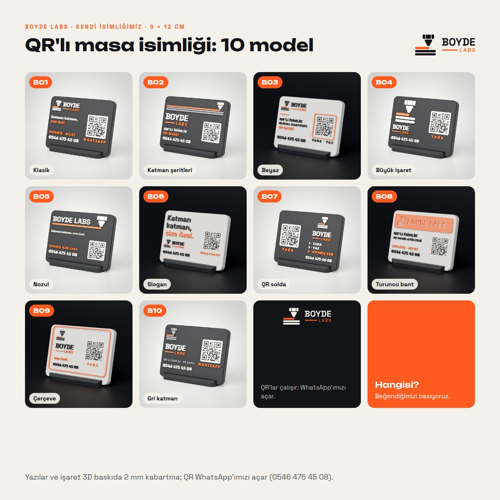

# BOYDE LABS · kendi QR'lı isimliklerimiz



İstek: "BOYDE için bize de hem 9 × 12 hem 10 × 20, 10 adet ürün örneği, QR'lı masalık sunar mısın".

- **Marka:**
  - 3b · Katman işareti: nozul katmanların üstünde, en üst katman turuncu.
  - İki katlı yazı: BOYDE, altında turuncu çizgi ve LABS (Space Grotesk).
  - Slogan: "Katman katman, size özel."
- **Renkler:** paletten. Siyah gövde (INK), beyaz (PAPER), turuncu (ORANGE), gri (GRAY).
- **QR'lar çalışır:** WhatsApp'ımızı açar (`https://wa.me/905464754508`). Telefon 0546 475 45 08.
  - Her model üretilirken QR'ın düz görünüşte bu adresi okuttuğu denetlenir.

## 9 × 12 cm (120 × 90 mm)

1 cm siyah ya da beyaz gövde, yazı ve işaret 2 mm kabartma, QR yüzeyle aynı hizada, siyah sehpa.

| Kod | Model | Kısaca |
| --- | --- | --- |
| B01 | Klasik | siyah; işaret ve yazı, slogan, telefon; QR sağda |
| B02 | Katman şeritleri | siyah; işaretin katmanları boydan uzar, en üstteki turuncu |
| B03 | Beyaz | beyaz; hizmetler, turuncu çizgi; QR turuncu çerçeveli |
| B04 | Büyük işaret | siyah; solda büyük işaret, sağda QR |
| B05 | Nozul | siyah; nozul, bastığı turuncu çizgi BOYDE LABS'in altından geçer |
| B06 | Slogan | beyaz; büyük "Katman katman, size özel." |
| B07 | QR solda | siyah; QR solda, sağda işaret, yazı ve üç adım (tara, yaz, sipariş ver) |
| B08 | Turuncu bant | beyaz; üstte turuncu bant, içinde işaret ve BOYDE LABS oyuk |
| B09 | Çerçeve | beyaz; kenarda turuncu çerçeve |
| B10 | Gri katman | siyah; işaret gri, altta gri hizmet satırı |

## 10 × 20 cm (200 × 100 mm)

5 mm gövde, yazı ve işaret yüzeyle aynı hizada renkli dolgu, sehpa gövde renginde.

| Kod | Model | Kısaca |
| --- | --- | --- |
| B01 | Kurumsal | beyaz; büyük işaret ve yazı, dikey gri çizgi, QR |
| B02 | Siyah | siyah; işaret, yazı, hizmetler gri |
| B03 | Alt bant | beyaz; altta siyah bant, içinde hizmetler ve telefon oyuk |
| B04 | Turuncu blok | beyaz; solda turuncu blok, içinde işaret oyuk |
| B05 | Büyük yazı | siyah; boydan BOYDE, altında turuncu çizgi ve LABS |
| B06 | Slogan | beyaz; büyük slogan, QR turuncu çerçeveli |
| B07 | Hizmetler | siyah; 01 · 02 · 03 numaralı hizmetler |
| B08 | Uzayan katmanlar | beyaz; işaretin katmanları sola boydan uzar |
| B09 | Resepsiyon | beyaz; ortada işaret ve yazı, "Hoş geldiniz" |
| B10 | Kartvizit | siyah; atölye, telefon ve WhatsApp; QR turuncu çerçeveli |

## Dosyalar

| Dosya | Ne |
| --- | --- |
| `sunum_9x12.jpg`, `sunum_10x20.jpg` | 10 modelin fotoğrafları bir arada (kodlu) |
| `sunum.pdf` | iki sayfa: iki ölçü |
| `fotograf/<model>_studyo.jpg` | stüdyo fotoğrafı (beyaz gövde logodaki siyahta, siyah gövde beyaz fonda) |
| `kaynak/<model>_duz.png` | düz görünüş (saydam); `kaynak/*.npz` git'e girmez |

## Yeniden üretmek

```bash
python3 scripts/boyde_kendi.py --rapor   # modeller, QR denetimi, basılabilirlik (harf içi ve ara, mm)
python3 scripts/boyde_kendi.py --foto    # stüdyo fotoğrafları (Blender, model başına ~1,5 dk)
python3 scripts/boyde_kendi.py --sunum   # sunum görselleri ve PDF
```
