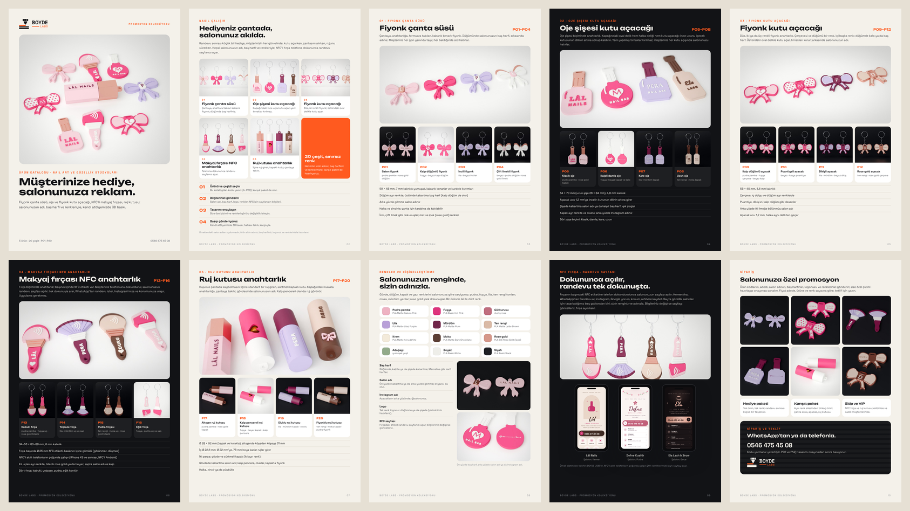

# BOYDE LABS · promosyon koleksiyonu (nail art ve güzellik stüdyoları)



- **Katalog:** [`katalog.pdf`](katalog.pdf) (A4, 10 sayfa).
- **İstek:** "nail art stüdyolarına falan promosyon ürünler için … örnek görselleri bizim tarzımızda çeşitlendireceksin
  ve bana bi pdf katoloğu vereceksin".
- **Örnekler:** kullanıcının gönderdiği beş ürün türü (MakerWorld'deki modeller):
  - fiyonk çanta süsü;
  - ruj kutusu;
  - fiyonk kutu açacağı;
  - makyaj fırçası NFC anahtarlık;
  - oje şişesi kutu açacağı.
- **Geometri:** o modellerden alınmadı; kendi çizimimiz (`scripts/boyde_promosyon.py`).
- **Örnekler uydurma:** salon adları (Lâl Nails, Mina Nail Bar, Pera Nail Art, Ela Lash & Brow, Duru Makeup); telefon
  BOYDE'nin (0546 475 45 08).

## Ürünler (P01–P20)

| Kod | Tür | Çeşit | Renkler |
| --- | --- | --- | --- |
| P01 | Fiyonk çanta süsü | Saten fiyonk | pudra pembe · rose gold düğüm, beyaz baş harf; arkada salon adı |
| P02 | | Kalp düğümlü | fuşya · beyaz kalp düğüm |
| P03 | | İncili | lila · beyaz inciler, mürdüm harf |
| P04 | | Çift ilmekli | beyaz · pudra düğüm · rose gold arka ilmek |
| P05 | Oje şişesi kutu açacağı | Klasik | pudra pembe · rose gold kapak, fuşya yazı |
| P06 | | Kalpli damla | fuşya · beyaz kapak ve kalp |
| P07 | | Kare | lila · mürdüm kapak, beyaz yazı |
| P08 | | Uzun | ten rengi · moka kapak ve yazı |
| P09 | Fiyonk kutu açacağı | Kalp düğümlü | pudra · fuşya çerçeve · beyaz kalp |
| P10 | | Puantiyeli | beyaz · fuşya çerçeve ve puantiye |
| P11 | | Dikişli | lila · mürdüm · beyaz dikiş izi |
| P12 | | Rose gold | ten rengi · rose gold çerçeve ve düğüm |
| P13 | Makyaj fırçası NFC | Kabuki | pudra · fuşya uç · rose gold bilezik · fuşya sap |
| P14 | | Yelpaze | lila · mürdüm uç ve sap · beyaz bilezik |
| P15 | | Pudra fırçası | ten rengi · moka uç ve sap · rose gold bilezik |
| P16 | | Eğik kontür | fuşya · pudra uç ve sap · beyaz bilezik |
| P17 | Ruj kutusu | Altıgen | pudra pembe · rose gold kapak · mürdüm yazı |
| P18 | | Kalp pencereli | fuşya · beyaz kapak (ruj pencereden görünür) |
| P19 | | Oluklu | lila · mürdüm kapak |
| P20 | | Fiyonklu | ten rengi · moka kapak · pudra fiyonk |

## Yapı

- **Fiyonk çanta süsü:**
  - 59 × 48 × 7 mm; gövde 3,4 mm, üstü 2,2 mm yarıçapla kubbe (kabarık kenar), kurdele kıvrımları oluk.
  - Düğüm ayrı renk, üstünde 1 mm kabartma baş harf.
  - Arka yüzde 0,6 mm gömme salon adı (tablada, ayrı renk); tepede Ø 3,5 halka deliği.
- **Kutu açacakları:**
  - Oje 34 × 70 × 4,8 mm, fiyonk 58 × 40 × 4,6 mm.
  - Üstteki oval yuva (9 × 3,2 mm) hem halka deliği hem açacak: yuvanın üstündeki dil ucunda 1,2 mm'ye incelir.
  - Yazı ve süsler 0,8 mm kabartma.
- **NFC fırça:**
  - Baş 5,6 mm, bilezik 5,2, sap 4,6 mm.
  - Başta Ø 26 × 1,2 mm cep (z 2,8–4,0): baskı duraklatılır, Ø 25 NTAG213/215 etiketi konur.
  - Kıl uçları ayrı renk; sapta kabartma salon adı ve kalp.
- **Ruj kutusu:**
  - İki parça: gövde (iç Ø 22,6, dip 2 mm, boyun Ø 25 × 14 mm) ve sürtmeli kapak (iç Ø 25,2, tepede halka kulağı).
  - Kapalıyken Ø 28 × 92 mm.
  - İç boy 78 mm: Ø 22 mm'ye kadar rujlar girer.
  - Dik basılır; fotoğraflarda masada yatık.
- **Renkler:** güzellik koleksiyonunun renkleri (`boyde_labs/guzellik/README.md` → Renkler); rose gold ipek.

## Dosyalar

| Dosya | Ne |
| --- | --- |
| `katalog.pdf`, `katalog.png` | A4 katalog: kapak, nasıl çalışır, beş tür (masada dört çeşit, çeşitler halkada), renkler ve kişiselleştirme, NFC ve randevu sayfası, sipariş |
| `kaynak/<model>_on.png`, `_aci.png`, `_arka.png` | önizlemeler (saydam); `.npz` modeller git'e girmez |
| `fotograf/<model>_iki.jpg`, `_halka.jpg` | Blender: masada önlü arkalı, halkada asılı |
| `fotograf/grup_<tür>.jpg`, `dizi_<tür>.jpg`, `kapak.jpg` | türün dört çeşidi masada ve asılı; kapak |

## Yeniden üretmek

```bash
python3 scripts/boyde_promosyon.py            # 20 model ve önizlemeler (~1 dk)
python3 scripts/boyde_promosyon.py --foto     # fotoğraflar (bpy 4.2; ~45 dk)
python3 scripts/boyde_promosyon.py --katalog  # A4 katalog
```
