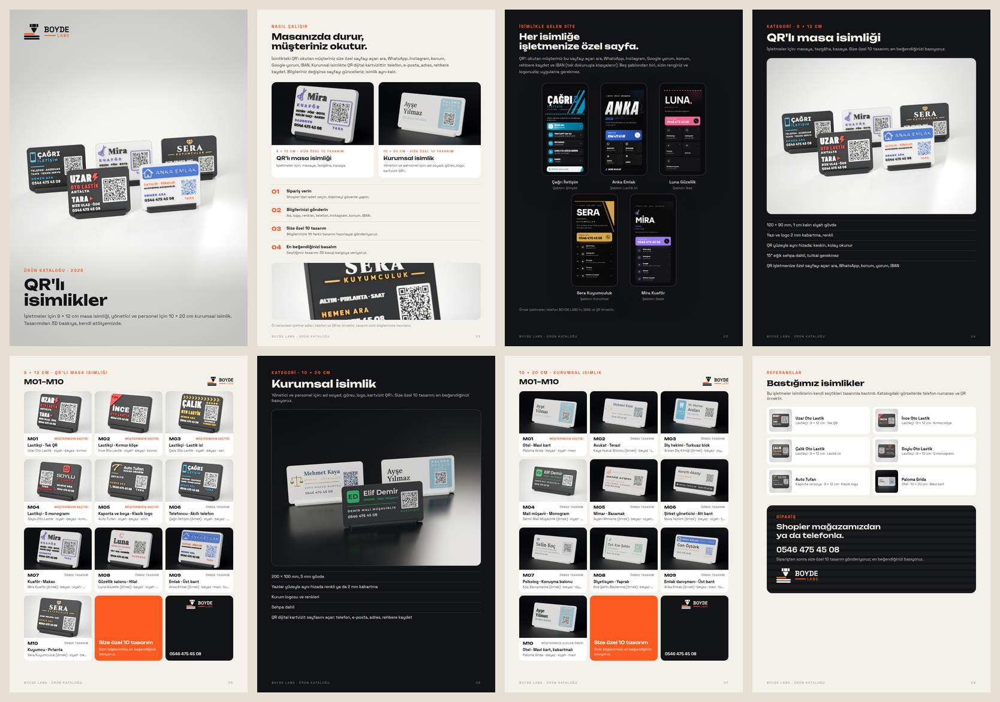

# BOYDE LABS · ürün kataloğu ve Shopier görselleri



İki ürün kategorisi, her birinde 10 model ("10 adet küçük, 10 adet büyük boy"):

| Kategori | Ölçü | Kimin için | Modeller |
| --- | --- | --- | --- |
| QR'lı masa isimliği | 9 × 12 cm (120 × 90 mm) | işletmeler: masa, tezgâh, kasa | M01–M10 |
| Kurumsal isimlik | 10 × 20 cm (200 × 100 mm) | yönetici ve personel: ad soyad, görev, logo | M01–M10 |

## Modeller

**9 × 12 cm**

- **Müşterilerin bastırdıkları:** Uzar, İnce, Çalık, Soylu Oto Lastik ve Auto Tufan.
- **Farklı sektörlere örnekler:** telefoncu, kuaför, güzellik salonu, emlak, kuyumcu.
  - İşletmeler uydurma (`scripts/boyde_sektor.py`).
  - Sanayi, galeri ve restoran bu katalogda yok; onların ayrı işleri var.
  - Berber, optik, veteriner ve spor salonu tasarımları da betikte duruyor (yedek).

**10 × 20 cm**

- **Müşterinin bastırdığı:** Paloma Grida; ayrıca aynı isimliğin kabartmalı sürümü.
- **Örnekler:**
  - avukat;
  - diş hekimi;
  - mali müşavir;
  - mimar;
  - şirket yöneticisi;
  - psikolog;
  - diyetisyen;
  - emlak danışmanı.

**Örnek modu** (`scripts/boyde_urunler.py`):

- **QR'lar çalışmaz:** bulucu kareler ve zamanlama desenleri gerçek QR'daki gibi. Geri kalan kareler (biçim bilgisi dahil) rastgele: QR gibi görünür ama okunmaz. Her ürünün üstten görünüşünde iki okuyucuyla (zxing, OpenCV) denenir; okunursa üretim durur.
- **Telefonlar:** hepsinde 0546 475 45 08.
- **Kişi adları:** Paloma isimliğinde gerçek kişinin adı yerine "Ayşe Yılmaz · Ön Büro Müdürü". Sektör örneklerindeki ad ve işletmeler uydurma.

## Dosyalar

| Dosya | Ne |
| --- | --- |
| `katalog.pdf` | A4 katalog: kapak, nasıl çalışır, iki kategori (giriş ve modeller), referanslar ve sipariş |
| `shopier/9x12/`, `shopier/10x20/` | Shopier ürün görselleri, 1200 × 1200 JPG: 10 model (01_M01 … 10_M10), BOYDE çerçevesinde |
| `cerceveli/<kategori>/` | her ürünün üç fotoğrafı (stüdyo, karşıdan, masa) BOYDE çerçevesinde: Instagram ve Shopier'e ek görsel |
| `shopier/<kategori>/ek/` | isteğe bağlı: kapak, 10 model bir arada, ölçü ve özellikler, nasıl çalışır |
| `shopier/site_ornekleri/` | 3 örnek site görseli (1200 × 1200), isimliğin QR'ının açtığı sayfa: Çağrı İletişim · Şimşek, Sera Kuyumculuk · Kurumsal, Mira Kuaför · Sade (`scripts/boyde_site_gorsel.py`) |
| `siteler/<işletme>/` | örnek sitelerin bilgileri, logo işareti ve ekran görüntüleri (uydurma işletmeler; şablon sırasına yazılmaz) |
| `fotograf/<ürün>_studyo.jpg` | stüdyo fonunda, 3/4 |
| `fotograf/<ürün>_on.jpg` | stüdyo fonunda, karşıdan |
| `fotograf/<ürün>_masa.jpg` | ahşap masada |
| `fotograf/kapak_<kategori>.jpg` | kategori kapakları |
| `kaynak/<ürün>_duz.png` | düz görünüş (saydam) |

**BOYDE çerçevesi:** ürünlerin bizim olduğu anlaşılsın diye ("BOYDE ürünü olarak pazarlamamız gerekiyor").

- Kenarlık koyu, üzerinde katman çizgileri.
- Fotoğrafın köşesinde "BOYDE LABS ürünü" etiketi.
- Altta bant: logo, model kodu, ad, ölçü, "tasarım ve 3D baskı: BOYDE LABS".
- Müşteri ürünlerinde bant "… için ürettik" der.

**Shopier'e yükleme:**

- Her kategori bir ürün; 10 model görseli sırasıyla yüklenir.
- Görsel sınırı izin verirse `ek/kapak.jpg` ilk görsel olur.
- `ek/modeller.jpg` 10 modeli bir arada gösterir.
- Müşteri model kodunu (M01 …) sipariş notuna yazar.

## Yeniden üretmek

```bash
python3 scripts/boyde_urunler.py      # modelleri kurar, QR denetler, kaynak/ (~2 dk)
pip install bpy==4.2.0
python3 scripts/boyde_urun_foto.py    # fotoğraflar (Blender Cycles, ürün başına ~4 dk)
python3 scripts/boyde_urun_foto.py --kapak --ornek 40
python3 scripts/boyde_site_gorsel.py  # örnek site görselleri (~2 dk; isimlik fotoğrafları çizildikten sonra)
python3 scripts/boyde_katalog.py      # katalog.pdf ve shopier/ (~1 dk)
```
