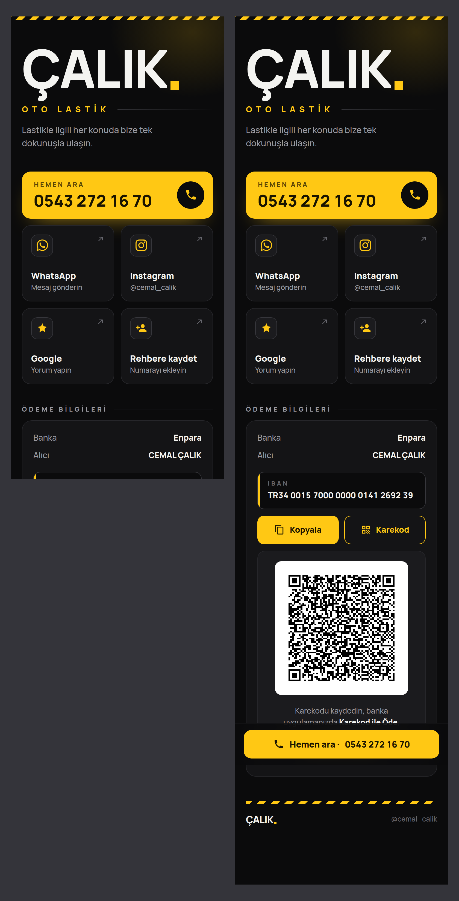
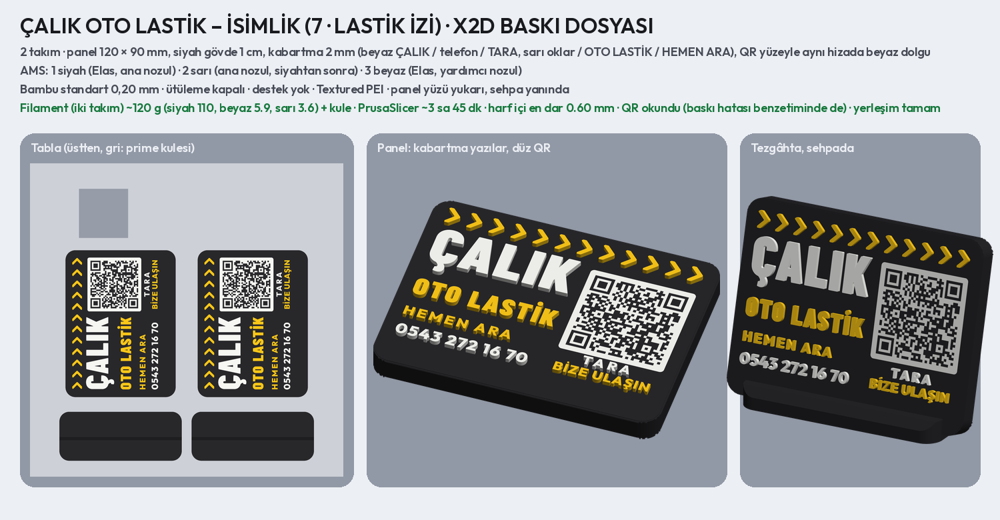
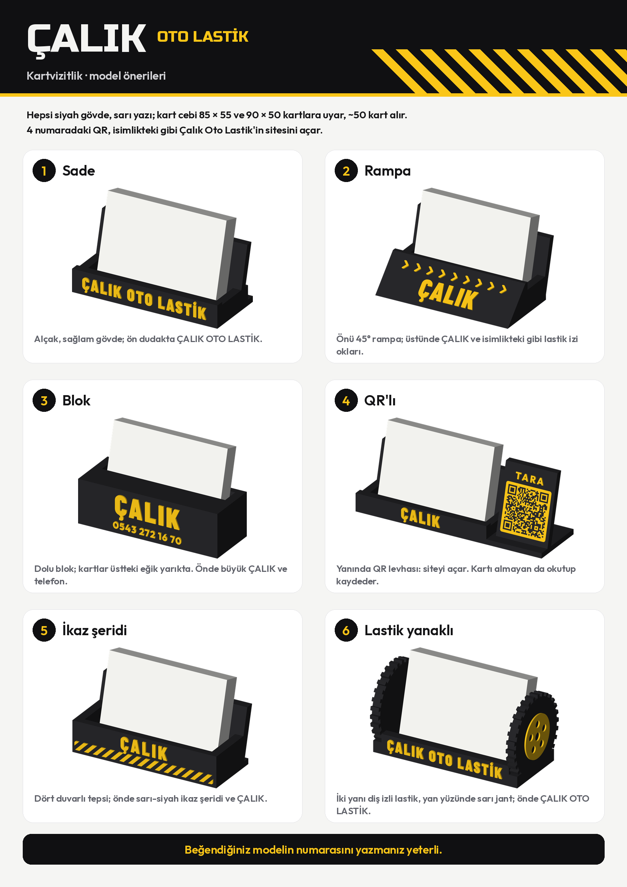

# ÇALIK OTO LASTİK – Google yorum QR'lı tezgâh isimliği önerileri

Müşteriye gönderilecek katalog: **`musteri_1.png`** (1–6), **`musteri_2.png`** (7–10), ikisi birlikte
**`musteri_katalog.pdf`**. Ayrıntılı sayfalar: `<numara>_<ad>.png` (önden, tezgâhta, yandan).

- Hepsi siyah zemin, sarı ve beyaz yazı. Her birinde ayrı simge, yerleşim ve yazı tipi:
  1 Jant · 2 Anahtar · 3 Telefon · 4 İkaz şeridi · 5 Hız göstergesi · 6 Araba · 7 Lastik izi · 8 Şimşek ·
  9 Dama bayrağı · 10 Sarı blok (oyma yazı).
- İçerik: ÇALIK, OTO LASTİK, HEMEN ARA, telefon **0543 272 16 70**.
- **Tek QR: Google yorum.** Üstünde beş sarı yıldız, altında GOOGLE / YORUM YAP.
- Simgeler kalın ve sade: en ince yeri ≥ 1,2 mm, yıldızların uçları yuvarlatılmış. Makinede kolay basılır.
- Yapı Uzar ve İNCE isimlikleriyle aynı: 120 × 90 mm, köşeler R8, siyah gövde 1 cm, yazılar ve simgeler 2 mm
  kabartma, QR yüzeyle aynı hizada beyaz karo, 15° eğik sehpa.
- Küçük satırlar Outfit ExtraBold ile yazılır. Her satırın en dar harf içi boşluğu ölçülür (≥ 0,6 mm).
- Satırlar arası, simge ve QR çevresi ≥ 2 mm; sehpanın örttüğü alt şerit boş bırakılır.

## Google bağlantısı

Bağlantı `bilgiler.json` dosyasının `google` alanında tutulur. Örneklerde şimdilik Google'da "çalık oto lastik"
araması açılıyor. Baskıdan önce işletmenin yorum bağlantısı buraya yazılmalı:

1. Google İşletme Profili'nde **Yorum iste** (Ask for reviews) bölümüne gir.
2. Oradaki bağlantıyı kopyala (`https://g.page/r/…/review`) ve `google` alanına yaz.
3. Tasarımlar aynı kalır; QR'ı yeniden üretmek yeterli.

Seçilen tasarım X2D dosyasına çevrilirken `scripts/uzar_isimlik_baski.py` örnek alınır.

```bash
pip install segno zxing-cpp svgelements
python3 scripts/calik_isimlik.py           # 10 öneri ve katalog
python3 scripts/calik_isimlik.py araba     # yalnız eşleşen tasarımlar
```

## İşletme sayfası



Uzar ve İnce'nin sayfalarıyla aynı işleri yapar; tasarımı farklıdır. Koyu tema, sade ve kurumsal:

- **Yazı:** tek yazı tipi (Manrope), her şey aynı sol hizada.
- **Sarı yalnız vurgu:** ÇALIK'ın sonundaki nokta, OTO LASTİK, Hemen Ara düğmesi ve IBAN çizgisi.
- **İkaz şeridi:** isimliklerdeki şerit sayfanın en üstünde ve altbilgide ince bir şerit olarak durur.
- **İletişim:** sarı Hemen Ara düğmesi; altında WhatsApp, Instagram, Google ve Rehbere kaydet kutuları.
- **Ödeme:** banka, alıcı ve IBAN tek kartta; altında Kopyala ve Karekod düğmeleri.

**Animasyon** (`sayfa_tur.gif`):

- **Açılış:** ikaz şeridi kayarak gelir, arkada sarı ışık süzülür. ÇALIK harf harf maskeden yükselir ve sarı nokta
  belirir. OTO LASTİK harf aralığı daralarak oturur, düğmeler sırayla gelir.
- **Kaydırma:** şeritler kaydırdıkça akar. Ödeme kartı görününce IBAN çizgisi uzar. Hemen Ara ekrandan çıkınca altta
  arama şeridi belirir.
- **Sürekli:** Hemen Ara birkaç saniyede bir hafifçe parlar ve telefon simgesi çalar.

**Bilgiler** (`bilgiler.json`):

- Telefon ve WhatsApp: 0543 272 16 70
- Instagram: @cemal_calik
- Google: `share.google` bağlantısı
- IBAN: TR34 0015 7000 0000 0141 2692 39, CEMAL ÇALIK, Enpara

**Karekod:** fotoğraftaki Enpara karekodundan okundu. CRC tutuyor; içindeki IBAN aynı, alıcı "Cemal Calik".
Sayfadaki karekod bankanınkiyle aynı baytlarla ve aynı hata düzeltmeyle (H) çizilir.

**Yayın:** ortak Cloudflare hesabında (`qrsistem`) yeni bir Worker açılır, adı `calikotolastik`, ve
`calik_site.zip` yüklenir. Adres `https://calikotolastik.qrsistem.workers.dev/` olur. Bu adres
`bilgiler.json` → `sayfa_url` alanına yazılır ve `python3 scripts/calik_sayfa.py` yeniden çalıştırılır.

## Baskı dosyası: seçilen 7 · Lastik izi (X2D)



**`baski/calik_isimlik_x2d.3mf`**: Bambu Studio'da proje olarak açılıp doğrudan basılır. Tablada **iki takım**
(panel + sehpa) var; biri silinirse tek takım basılır. Ölçüler ve ayarlar Uzar ve İnce'nin isimlikleriyle aynı.

| | |
| --- | --- |
| Panel | 120 × 90 mm, siyah gövde **1 cm**, köşeler R8, kenarlar basamaklı pahlı; yüzü yukarı basılır |
| Kabartma | **2 mm** (10 katman): ÇALIK, telefon, GOOGLE beyaz; lastik izi okları, OTO LASTİK, HEMEN ARA, beş yıldız, YORUM YAP sarı |
| QR | **siteyi** açar (**https://calikotolastik.qrsistem.workers.dev/**; sayfada Google yorum düğmesi var). Müşteri isteğiyle isimlik katalogdaki gibi kalır: QR'ın üstünde yıldızlar, altında GOOGLE / YORUM YAP (`bilgiler.json` → `isimlik_qr: "sayfa"`, `isimlik_etiket: "google"`). Yüzeyle aynı hizada beyaz dolgu (0,8 mm), 38 mm, kare 1,02 mm; görüntüden ve baskı hatası benzetiminden okundu |
| Hiza | okların ucu QR'ın sağ kenarında; yıldızların üstü ÇALIK'ın üstüyle, YORUM YAP telefonla aynı hizada (`baski/on_yuz.png`) |
| AMS | 1 siyah (Elas, ana nozul) · 2 sarı (ana nozul) · 3 beyaz (Elas, yardımcı nozul) |
| Ayarlar | Bambu standart 0,20 mm; **ütüleme kapalı**; destek yok; Textured PEI; Generic PLA |
| Filament | iki takım ~120 g (siyah 111, beyaz 5,4, sarı 3,9) + kule; PrusaSlicer ~3 sa 39 dk (Bambu Studio kendi süresini gösterir) |
| Sehpa | 100 × 40 × 10 mm, aynı tablada; panel yuvaya (10,3 mm) 15° eğik takılır, tutkal gerekmez |

```bash
python3 scripts/calik_isimlik_baski.py    # baski/calik_isimlik_x2d.3mf, baski/onizleme.png
```

## Kartvizitlik önerileri



Müşteriye gönderilecek katalog: **`kartvizitlik/musteri_kartvizitlik.png`** (ve `.pdf`). Ayrıntılı sayfalar:
`kartvizitlik/<numara>_<ad>.png` (3/4 kartlarla, önden, yandan).

| | Model | Biçim ve süs |
| --- | --- | --- |
| 1 | Sade | alçak L gövde; ön dudakta ÇALIK OTO LASTİK |
| 2 | Rampa | önü 45° rampa; üstünde ÇALIK ve isimlikteki lastik izi okları |
| 3 | Blok | dolu blok, kartlar üstteki eğik yarıkta; önde büyük ÇALIK ve telefon |
| 4 | QR'lı | yanında 15° yaslı QR levhası (siteyi açar, TARA); QR sarı dolgu, yüzeyle aynı hizada, 36 mm, kare 0,97 mm |
| 5 | İkaz şeridi | dört duvarlı tepsi; önde sarı-siyah ikaz şeridi ve ÇALIK |
| 6 | Lastik yanaklı | iki yanı diş izli lastik, yan yüzünde sarı jant; önde ÇALIK OTO LASTİK |

- Kart cebi 92 mm geniş: 85 × 55 ve 90 × 50 kartlar sığar, ~50 kart alır; kartlar 15° arkaya yaslanır.
- Siyah gövde (ana nozul), sarı yazı ve süs (yardımcı nozul), 1 mm kabartma. Tabana oturarak dik basılır, destek
  gerekmez (lastik yanaklarının altı dolu). Model başına ~30–42 g.

```bash
python3 scripts/calik_kartvizitlik.py          # 6 model ve katalog
python3 scripts/calik_kartvizitlik.py 6_       # yalnız eşleşen modeller
```
