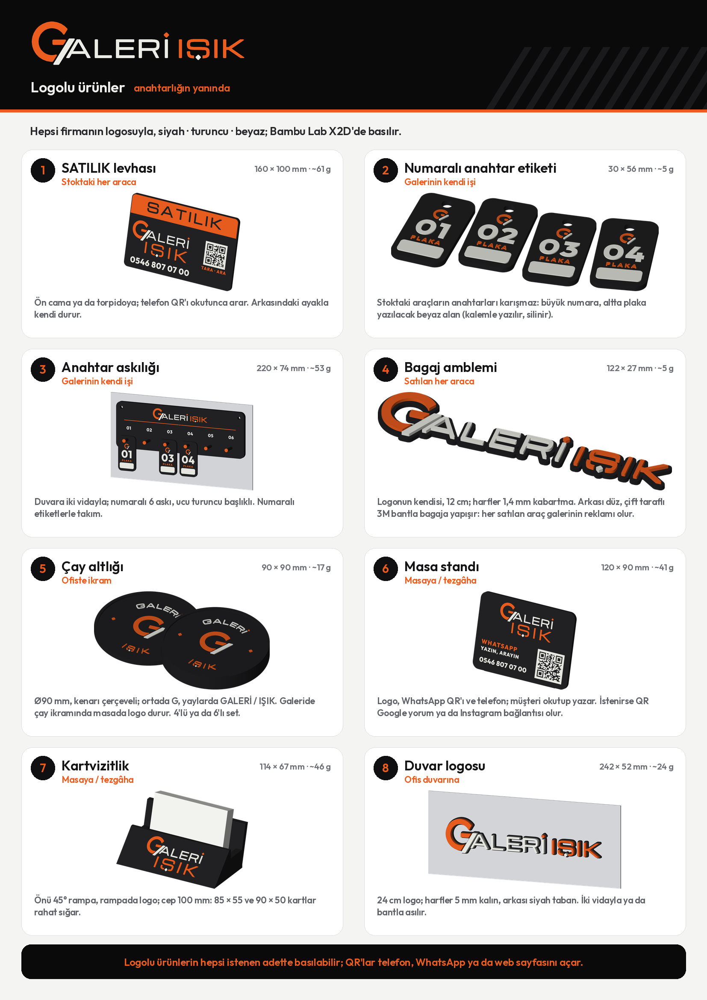

# GALERİ IŞIK

- **Anahtarlık önerileri (20):** [`anahtarlik/galeri_isik`](../anahtarlik/galeri_isik/README.md)
- **Logolu ürünler (8 örnek):** `urunler/urunler.png` ve `urunler/urunler.pdf`. Ayrıntılı görseller
  `urunler/<n>_<ad>.png`.



| | Ürün | Kime | Ölçü · gram |
| --- | --- | --- | --- |
| 1 | SATILIK levhası | stoktaki her araca (ön cam / torpido); telefon QR'ı | 160 × 100 mm · ~61 g |
| 2 | Numaralı anahtar etiketi | galerinin anahtarları; büyük numara, plaka yazılacak beyaz alan | 30 × 56 mm · ~5 g |
| 3 | Anahtar askılığı | galeri duvarı; 6 numaralı askı | 220 × 74 mm · ~53 g |
| 4 | Bagaj amblemi | satılan her araca; logonun kendisi, çift taraflı bantla | 122 × 27 mm · ~5 g |
| 5 | Çay altlığı | ofiste ikram; 4'lü / 6'lı set | Ø90 mm · ~17 g |
| 6 | Masa standı | masa / tezgâh; WhatsApp QR'ı ve telefon | 120 × 90 mm · ~41 g |
| 7 | Kartvizitlik | masa / tezgâh; 45° rampada logo, cep 100 mm | 114 × 67 mm · ~46 g |
| 8 | Duvar logosu | ofis duvarı; 24 cm logo | 242 × 52 mm · ~24 g |

Hepsi siyah gövde, turuncu ve beyaz logo (scripts/galeri_isik_anahtarlik.py'deki logo geometrisi). Ölçüler X2D
tablasına (256 × 256 mm) sığar. Gramlar gövde hacminden tahmindir; seçilen ürünün baskı dosyasında dilimleyiciyle
ölçülür.

- **SATILIK levhası:** QR'ı `TEL:+905468070700` (okutunca arar).
- **Masa standı:** QR'ı `https://wa.me/905468070700` (numara WhatsApp'ta kayıtlıysa sohbet açılır). İstenirse Google
  yorum, Instagram ya da işletme sayfası bağlantısı olur.

```bash
python3 scripts/galeri_isik_urunler.py
```
