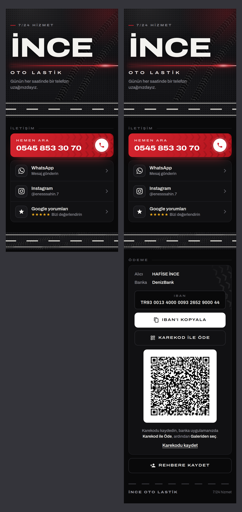

# İNCE OTO LASTİK – tek QR'lı tezgâh isimliği önerileri

Müşteriye gönderilecek katalog: **`musteri_1.png`** (1–6), **`musteri_2.png`** (7–10), ikisi birlikte
**`musteri_katalog.pdf`**. Ayrıntılı sayfalar: `<numara>_<ad>.png` (önden, tezgâhta, yandan).

- 1–7 beyaz zemin (siyah, kırmızı yazı), 8–10 siyah zemin (beyaz, kırmızı yazı). Her biri ayrı fikir ve yazı tipi:
  1 Plaka · 2 Minimal · 3 Kırmızı blok · 4 Yol · 5 Dama bayrağı · 6 Hız çizgileri · 7 Jant · 8 Kırmızı köşe ·
  9 Kırmızı çerçeve · 10 Oklar.
- İçerik: İNCE, OTO LASTİK, 7/24 HİZMET, telefon **0545 853 30 70**, tek QR. Süsler kalın ve sade (kolay basılır).
- Yapı Uzar Oto Lastik'in basılan isimliğiyle aynı: 120 × 90 mm, köşeler R8, gövde 1 cm, yazılar ve simge 2 mm
  kabartma, QR yüzeyle aynı hizada (beyaz zeminde siyah kareler, siyah zeminde beyaz karo), 15° eğik sehpa.
- Küçük satırlar Outfit ExtraBold: harf içi boşluklar kabartmada dolmasın diye her satır ölçülür (en dar ≥ 0,6 mm).

**QR:** işletmenin sitesi henüz yok; örneklerde QR telefonu arar (`TEL:+905458533070`). Site hazır olunca adresi
`bilgiler.json` → `sayfa_url`a yazılır, QR site adresine döner (seçilen tasarım o zaman X2D dosyasına çevrilir;
`scripts/uzar_isimlik_baski.py` örnek alınır).

```bash
python3 scripts/ince_isimlik.py           # 10 öneri ve katalog
python3 scripts/ince_isimlik.py klasik    # yalnız eşleşen tasarımlar
```

## İşletme sayfası (QR'ın açacağı site)



Uzar'ın sayfasıyla aynı işleri yapar; tasarımı farklıdır. Siyah gece yolu teması: geniş ve kalın Archivo yazısı,
tek vurgu rengi olarak kırmızı. Lastik çizimi yok; tema yalnız asfalttaki izlerle ve yolla verilir:

- **Başlık:** yoldan çıkıp İNCE yazısının arkasından savrulan iki teker izi. Altta koyu lastik sürtmesi, üstünde diş
  baskısı var; iz baştan sona soluklaşır.
- **Yol şeritleri:** başlığın altında ve bölümler arasında yol var (kenar çizgileri, kesik şerit). Kesik şerit
  sayfa kaydırıldıkça akar.
- **Hemen Ara düğmesi ve ödeme kartı:** hafif lastik baskısı.

**Animasyon** yalnız açılışta, bir kez oynar (`sayfa_animasyon.gif`, tam tur: `sayfa_tur.gif`):

- İz eğri boyunca çizilir.
- Stop lambası ışığı yazının altından geçer.
- İNCE yazısı yükselir ve yol şeridi kayıp durur.
- Düğmeler sırayla gelir.

Kendiliğinden sürekli dönen ya da akan bir şey yok.

**İçerik:**

- Hemen Ara: 0545 853 30 70
- WhatsApp: aynı numara, hazır mesajla açılır.
- Instagram: @enesssahin.7
- Google yorumları: işletmenin `share.google` bağlantısı.
- Ödeme: HAFİSE İNCE, DenizBank. IBAN tek dokunuşla kopyalanır; karekod kaydedilip banka uygulamasında galeriden
  okutulur.
- Rehbere Kaydet.

**Karekod:** fotoğraftaki DenizBank karekodundan okundu. CRC tutuyor, içindeki IBAN ve alıcı `bilgiler.json` ile
aynı. Sayfadaki karekod bankanınkiyle aynı baytlarla çizilir (UTF-8, hata düzeltme Q), bu yüzden İ harfleri banka
uygulamasında bozulmaz. Karekodun içinde 19.10.2029 tarihi var; geçerlilik süresi olabilir.

**Yayın:** Uzar'daki gibi işletmenin Cloudflare hesabında yeni bir Worker açılır ve `ince_site.zip` yüklenir.
Sonra:

1. Adresi (`…workers.dev`) `bilgiler.json` → `sayfa_url` alanına yaz.
2. `python3 scripts/ince_sayfa.py` çalıştır; paylaşım kartı adresi kullanır.
3. `python3 scripts/ince_isimlik.py` çalıştır; isimlikteki QR siteye döner.

`sayfa_onizleme.html` tek dosyalık önizlemedir (yazı tipleri ve karekod gömülü).

**Claude önizlemesi:** `sayfa_artifact.html` yalnız kontrol içindir; sitenin kendisi değildir.
Orada üstte Claude yazar, Hemen Ara numarayı kopyalar, karekod ve rehber indirme bağlantıları yoktur.
