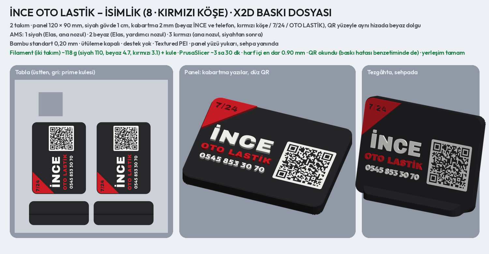

# İNCE OTO LASTİK – tek QR'lı tezgâh isimliği önerileri

Müşteriye gönderilecek katalog: **`musteri_1.png`** (1–6), **`musteri_2.png`** (7–10), ikisi birlikte
**`musteri_katalog.pdf`**. Ayrıntılı sayfalar: `<numara>_<ad>.png` (önden, tezgâhta, yandan).

- 1–7 beyaz zemin (siyah, kırmızı yazı), 8–10 siyah zemin (beyaz, kırmızı yazı). Her biri ayrı fikir ve yazı tipi:
  1 Plaka · 2 Minimal · 3 Kırmızı blok · 4 Yol · 5 Dama bayrağı · 6 Hız çizgileri · 7 Jant · 8 Kırmızı köşe ·
  9 Kırmızı çerçeve · 10 Oklar.
- İçerik: İNCE, OTO LASTİK, 7/24 HİZMET, telefon **0545 853 30 70**, tek QR. Süsler kalın ve sade (kolay basılır).
- Yapı Uzar Oto Lastik'in basılan isimliğiyle aynı: 120 × 90 mm, köşeler R8, gövde 1 cm, yazılar ve simge 2 mm
  kabartma, QR yüzeyle aynı hizada (beyaz zeminde siyah kareler, siyah zeminde beyaz karo), 15° eğik sehpa.
- Küçük satırlar Outfit ExtraBold: harf içi boşluklar kabartmada dolmasın diye her satır ölçülür (en dar ≥ 0,6 mm).

**QR:** işletme sayfasını açar: **https://inceotolastik.qrsistem.workers.dev/** (`bilgiler.json` → `sayfa_url`).
Seçilen tasarım X2D dosyasına çevrilirken `scripts/uzar_isimlik_baski.py` örnek alınır.

```bash
python3 scripts/ince_isimlik.py           # 10 öneri ve katalog
python3 scripts/ince_isimlik.py klasik    # yalnız eşleşen tasarımlar
```

## İşletme sayfası (QR'ın açacağı site)


Uzar'ın sayfasıyla aynı işleri yapar; tasarımı farklıdır. Siyah zemin, yarış havası: eğik, dar ve kalın Saira
Condensed Black Italic, tek vurgu rengi kırmızı. Lastik çizimi yok; tasarımın dili lastik izi, yani gidiş yönüne bakan
ok biçimli diş baskısı (Hemen Ara düğmesindeki desen):

- **Başlık:** logonun arkasından çapraz geçen büyük diş bandı.
- **Desen tekrarı:** kutucukların ve IBAN kartının köşesinde, altbilgide aynı baskı.
- **Ödeme:** banka kartı gibi tasarlanmış IBAN kartı (banka, IBAN, alıcı); altında Kopyala ve Karekod düğmeleri.

**Animasyon** (`sayfa_animasyon.gif`, tam tur: `sayfa_tur.gif`):

- **Açılış:** diş bandı yuvarlanarak gelip durur, İNCE harf harf yükselir, OTO LASTİK soldan açılır, düğmeler
  sırayla gelir. Hemen Ara'nın diş baskısı akıp durur, telefon bir kez çalar.
- **Kaydırma:** desenler kaydırdıkça akar. IBAN kartı göründüğünde üzerinden ışık geçer. Hemen Ara ekrandan
  çıkınca sağ altta kırmızı ara düğmesi belirir.
- **Sürekli:** yalnız küçük işaretler oynar. 7/24 noktası atar; Hemen Ara birkaç saniyede bir parlar ve telefon
  çalar.

Dönen bir şey yok. Telefonda "hareketi azalt" açıksa animasyonlar oynamaz.

**İçerik:**

- Hemen Ara: 0545 853 30 70
- WhatsApp: aynı numara, hazır mesajla açılır.
- Instagram: @enesssahin.7
- Google yorumları: işletmenin `share.google` bağlantısı.
- Ödeme: HAFİSE İNCE, DenizBank. IBAN tek dokunuşla kopyalanır; karekod kaydedilip banka uygulamasında galeriden
  okutulur.
- Rehbere Kaydet.

**Karekod:** fotoğraftaki DenizBank karekodundan okundu. CRC tutuyor, içindeki IBAN ve alıcı `bilgiler.json` ile
aynı. Sayfadaki karekod bankanınkiyle aynı baytlarla çizilir (UTF-8, hata düzeltme Q), bu yüzden İ harfleri banka
uygulamasında bozulmaz. Karekodun içinde 19.10.2029 tarihi var; geçerlilik süresi olabilir.

**Yayın:** Uzar kendi hesabında kalır. İnce, Çalık ve sonraki bütün işletmeler bir kez açılan **ortak Cloudflare
hesabında** durur; her işletme o hesapta ayrı bir Worker'dır, adres `<işletme>.<ortak alt alan>.workers.dev` olur.

- Ortak hesabın alt alanı (Workers & Pages → Account details → Subdomain) bir kez seçilir ve bir daha
  değiştirilmez. Değişirse oradaki bütün basılı QR'lar çalışmaz.
- Ortak hesabın alt alanı `qrsistem`. İnce'nin Worker'ı `inceotolastik`: adres **https://inceotolastik.qrsistem.workers.dev/**.
- Site değişince `ince_site.zip` aynı Worker'a **New deployment** ile yüklenir. Adres değişirse:

1. Adresi (`…workers.dev`) `bilgiler.json` → `sayfa_url` alanına yaz.
2. `python3 scripts/ince_sayfa.py` çalıştır; paylaşım kartı adresi kullanır.
3. `python3 scripts/ince_isimlik.py` çalıştır; isimlikteki QR siteye döner.

`sayfa_onizleme.html` tek dosyalık önizlemedir (yazı tipleri ve karekod gömülü).

**Claude önizlemesi:** `sayfa_artifact.html` yalnız kontrol içindir; sitenin kendisi değildir.
Orada üstte Claude yazar, Hemen Ara numarayı kopyalar, karekod ve rehber indirme bağlantıları yoktur.

## Baskı dosyası: seçilen 8 · Kırmızı köşe (X2D)



**`baski/ince_isimlik_x2d.3mf`**: Bambu Studio'da proje olarak açılıp doğrudan basılır. Tablada **iki takım**
(panel + sehpa) var; biri silinirse tek takım basılır. Ölçüler ve ayarlar Uzar'ın isimliğiyle aynı.

| | |
| --- | --- |
| Panel | 120 × 90 mm, siyah gövde **1 cm**, köşeler R8, kenarlar basamaklı pahlı; yüzü yukarı basılır |
| Kabartma | **2 mm** (10 katman): İNCE ve telefon beyaz; köşe üçgeni (içinde oyma 7/24) ve OTO LASTİK kırmızı |
| Yazılar | sol sütunda ortalı, QR'la aynı yükseklikte; harf içi boşluklar ≥ 0,9 mm, İ noktaları harften ayrık |
| QR | yüzeyle aynı hizada beyaz dolgu (0,8 mm), 42 mm, kare 1,13 mm; siteyi açar, görüntüden ve baskı hatası benzetiminden okundu |
| AMS | 1 siyah (Elas, ana nozul) · 2 beyaz (Elas, yardımcı nozul) · 3 kırmızı (ana nozul) |
| Ayarlar | Bambu standart 0,20 mm; **ütüleme kapalı**; destek yok; Textured PEI; Elas için Generic PLA |
| Filament | iki takım ~118 g (siyah 110, beyaz 4,7, kırmızı 3,1) + kule; PrusaSlicer ~3 sa 30 dk (Bambu Studio kendi süresini gösterir) |
| Sehpa | 100 × 40 × 10 mm, aynı tablada; panel yuvaya (10,3 mm) 15° eğik takılır, tutkal gerekmez |

```bash
python3 scripts/ince_isimlik_baski.py    # baski/ince_isimlik_x2d.3mf, baski/onizleme.png
```
