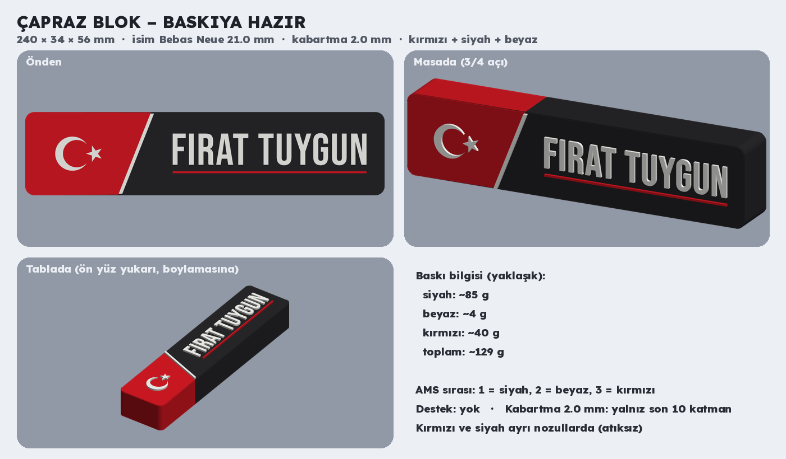
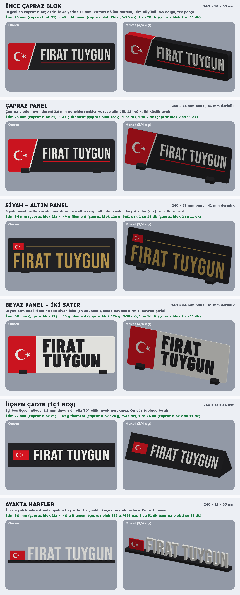
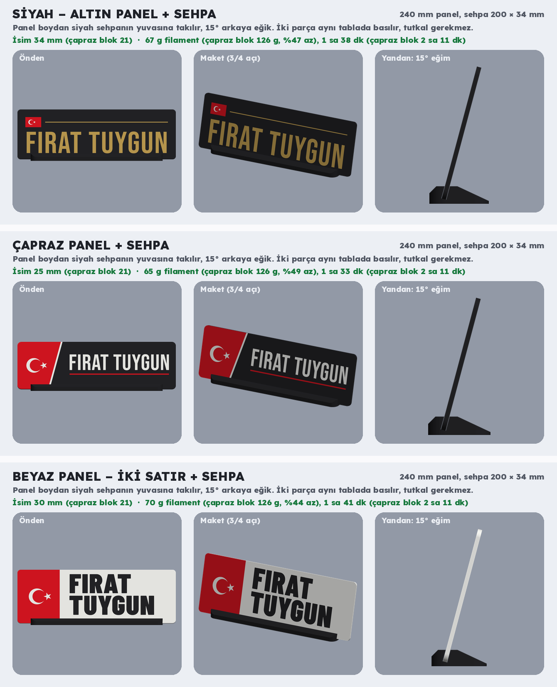
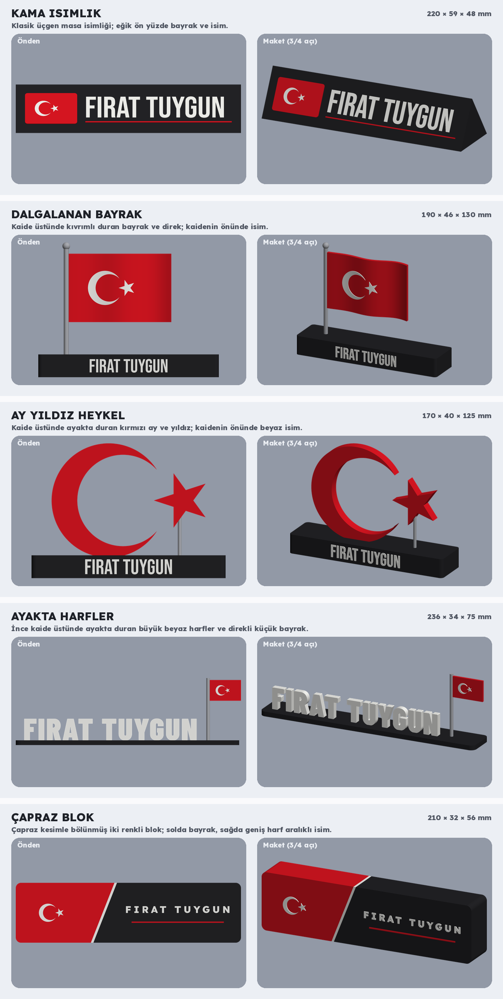

# FIRAT TUYGUN masa isimliği tasarımları (Türk bayraklı)

## Baskıya hazır: çapraz blok



**`capraz_blok.3mf`** – Bambu Studio'da açıp doğrudan dilimlenebilir (Bambu Lab X2D, PLA Basic, 0,20 mm).

| | |
| --- | --- |
| Ölçü | 240 × 34 × 56 mm (genişlik × derinlik × yükseklik; ön yüz kabartması dahil) |
| İsim | Bebas Neue, 21 mm, kalın beyaz; altında kırmızı çizgi |
| Kabartma | 2,0 mm (beyaz ay-yıldız, isim, ayraç ve kırmızı çizgi) |
| Renkler (AMS sırası) | 1 = siyah, 2 = beyaz, 3 = kırmızı (Bambu PLA Basic Red) |
| Filament (yaklaşık) | siyah ~85 g, kırmızı ~40 g, beyaz ~4 g (2 duvar, %15 dolgu) |

Baskı:
- Ön yüz **yukarı** bakacak şekilde yatık basılır, destek gerekmez.
- Kırmızı ve siyah kısımlar bloğun tüm derinliği boyunca sürer. Bambu Studio'da filament eşlemesinde siyah ve kırmızı
  **farklı nozullara** gelmeli (otomatik eşleme temizlemeyi en aza indirmeye çalışır; kontrol et). Böylece katman başına
  temizleme atığı olmaz.
- Beyaz (ay-yıldız, isim, ayraç) ve kırmızı alt çizgi ön yüzde 2,0 mm kabartma: yalnızca son 10 katman.
- X2D'de ikinci nozul tablanın sol 20,5 mm'sine erişemediği için blok tablaya **boylamasına** yerleştirildi.
- İlk katman 0,3 mm içe çekik, ön yüz kenarı 0,6 mm pahlı; nesne ayarında Arachne açık.

Kontroller: parçalar sağlam ve birbirine girmiyor, tek gövde; birbirine 0,6 mm'den yakın öğe yok; ince kısım olarak
kalanlar yalnızca yıldızın ve harflerin sivri uçları.

Yeniden üretme: `python3 scripts/capraz_blok.py`

## İkinci tur: daha şık, daha büyük yazı, daha az filament — `yeni/`



Görseller tasarım seçimi içindir; seçilen 3MF'e çevrilir. Gram ve süre, her tasarım **baskı yönünde** PrusaSlicer'da
Bambu X2D standart değerleriyle (0,20 mm, 2 duvar, %15 dolgu) dilimlenerek ölçüldü (`yeni/olcum.json`; süreye filament
değişimi dahil değil). Çapraz blok aynı yöntemle: **126 g, 2 sa 11 dk**.

| No | Tasarım | Ölçü | İsim | Filament | Süre |
| --- | --- | --- | --- | --- | --- |
| 1 | İnce çapraz blok (%5 dolgu) | 240 × 18 × 60 mm | 25 mm | 63 g (%50 az) | 1 sa 20 dk |
| 2 | Çapraz panel + 2 ayak | 240 × 74 mm, 2,6 mm panel | 25 mm | 47 g (%62 az) | 1 sa 9 dk |
| 3 | Siyah – altın panel + 2 ayak | 240 × 78 mm, 2,6 mm panel | 34 mm | 49 g (%61 az) | 1 sa 14 dk |
| 4 | Beyaz panel, iki satır + 2 ayak | 240 × 84 mm, 2,6 mm panel | 2 × 30 mm | 53 g (%58 az) | 1 sa 16 dk |
| 5 | Üçgen çadır (içi boş, 1,2 mm duvar) | 240 × 62 × 54 mm | 27 mm | 69 g (%45 az) | 1 sa 24 dk |
| 6 | Ayakta harfler | 240 × 22 × 35 mm | 30 mm | 40 g (%68 az) | 1 sa 31 dk |

- **Paneller (2–4) ön yüzü tablada basılır:** yazı ve bayrak yüzeye gömülü renk (0,8 mm, 4 katman). Tabla yüzünde
  basıldığı için en keskin yüz; renk değişimi yalnız ilk 4 katmanda, temizleme atığı az. Panel ayakların yuvasına
  takılır, 12° arkaya eğik durur.
- Çadır (5) da ön yüzü tablada basılır; diğer iki yüz 60° yükselir, destek gerekmez.
- **Tasarımı değiştirmeden tasarruf:** mevcut çapraz blok %15 yerine **%5 dolguyla** basılırsa 126 g → **79 g**,
  2 sa 11 dk → **1 sa 36 dk** (dekoratif blok; dolgu yük taşımıyor).

### Boydan sehpalı paneller



Panel, iki küçük ayak yerine **boydan siyah sehpanın** yuvasına takılır ve **15° arkaya eğik** durur; oturan kişinin
bakışına döner. İki parça aynı tablada basılır, tutkal gerekmez (yuva panelden 0,3 mm geniş).

- Sehpa 200 × 34 × 10 mm: önü pahlı, arkaya doğru incelen alçak kama, uçları yuvarlatılmış. Altında yuvanın arkasında
  görünmeyen boydan bir kanal (5 × 16 mm) var; filamenti yarıya indirir, tavanı köprüyle basılır. Sehpa ~21 g.
- Ölçülen (sehpa dahil): siyah – altın **67 g, 1 sa 38 dk** · çapraz **65 g, 1 sa 33 dk** · beyaz **70 g, 1 sa 41 dk**
  (çapraz blok 126 g, 2 sa 11 dk).

Yeniden üretme: `python3 scripts/masa_isimligi_yeni.py`

## İlk tasarım önerileri



Bu klasördeki görseller **tasarım seçimi** içindir. Seçilen tasarım baskıya hazır Bambu Lab (X2D) 3MF dosyasına
çevrilecek. Geometri gerçek ölçülerle (mm) kuruldu, bu yüzden görsellerdeki ölçüler baskıdakiyle aynı olur.

| No | Tasarım | Ölçü (yaklaşık) | Renkler | Baskı notu (3B'ye çevirirken) |
| --- | --- | --- | --- | --- |
| 1 | Kama isimlik | 220 × 59 × 48 mm | siyah, kırmızı, beyaz | Arka yüzü tablada yatırılarak basılır; ön yüz grafikleri en üst katmanlarda renkli olur |
| 2 | Dalgalanan bayrak | 190 × 46 × 130 mm | siyah, kırmızı, beyaz, gri direk | Kaide, kıvrımlı bayrak ve direk ayrı parçalar; bayrak dik basılır (desteksiz), direk kaideye geçmeli |
| 3 | Ay yıldız heykel | 170 × 40 × 125 mm | siyah, kırmızı, beyaz, gri çubuk | Ay ve yıldız dik basılır (desteksiz); kaideye geçmeli yuvalarla takılır |
| 4 | Ayakta harfler | 236 × 34 × 75 mm | siyah, beyaz, kırmızı | Kaide ve harfler tek parça dik basılabilir; bayrak ayrı parça |
| 5 | Çapraz blok | 210 × 32 × 56 mm | kırmızı, siyah, beyaz | Ön yüz yukarı bakacak şekilde yatık basılır; tek parça |

Türk bayrağı resmi oranlarla çizildi: yükseklik G, boy 1,5 G; ayın dış dairesi 0,5 G, iç dairesi 0,4 G çaplı ve
1/16 G kaydırılmış; yıldız 1/4 G çaplı çembere oturur, bir ucu hilale bakar. Kırmızı: #E30A17.

## Yeniden üretme

```bash
pip install numpy manifold3d pillow shapely scipy fonttools uharfbuzz
python3 scripts/masa_isimligi.py
```
