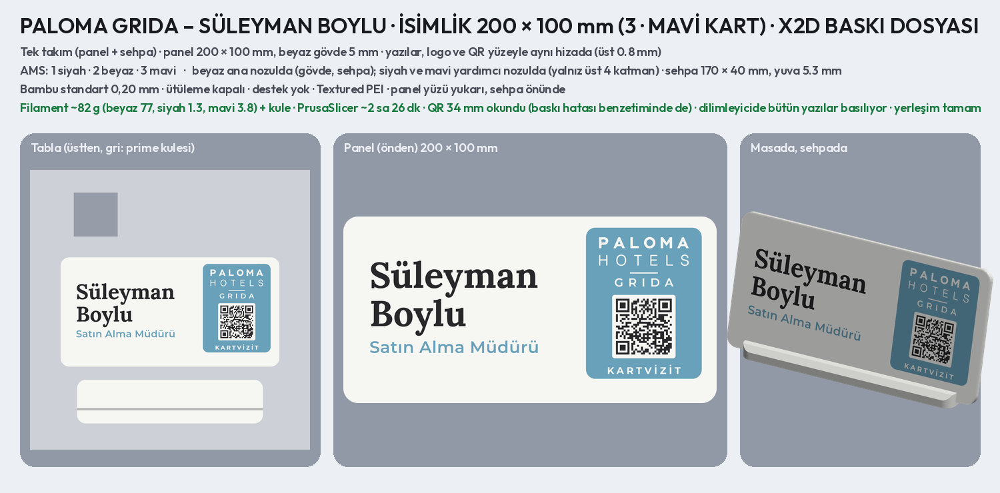
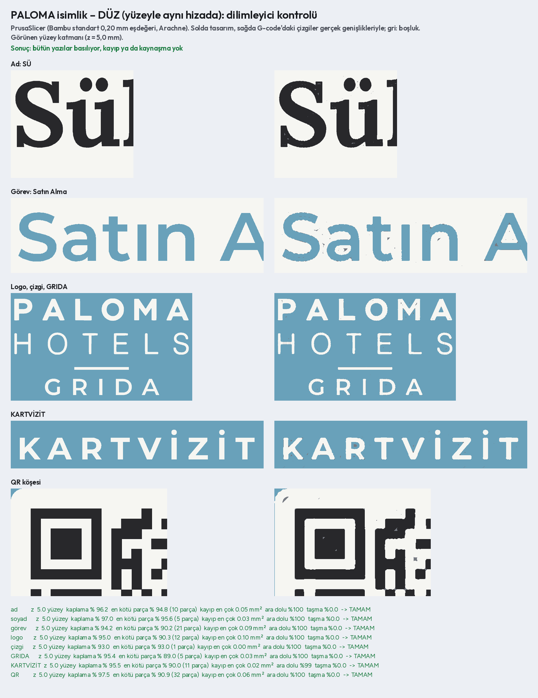
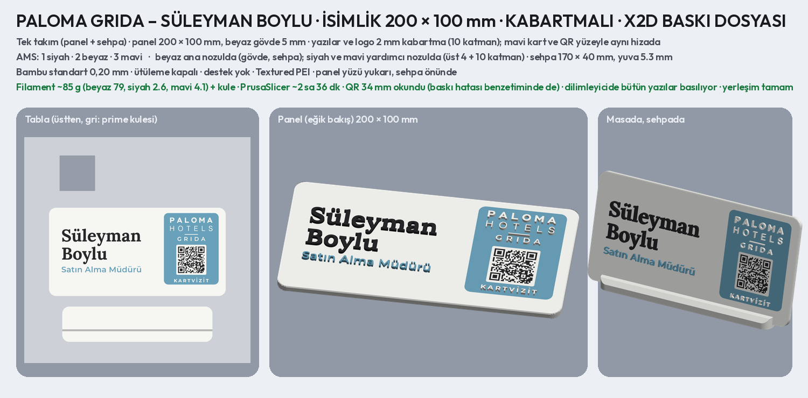
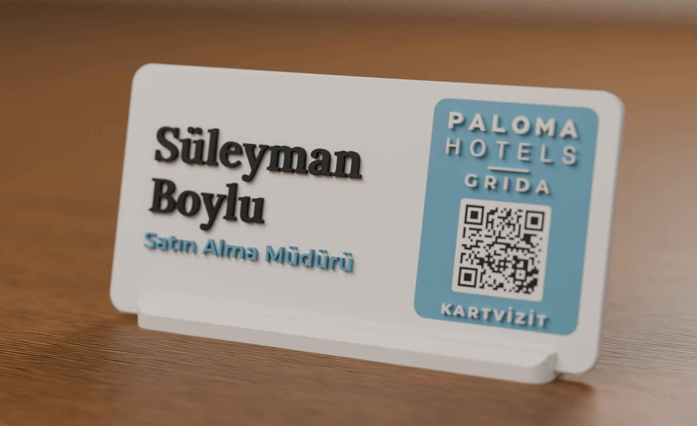
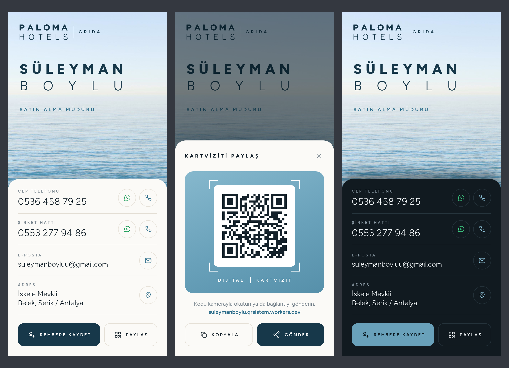
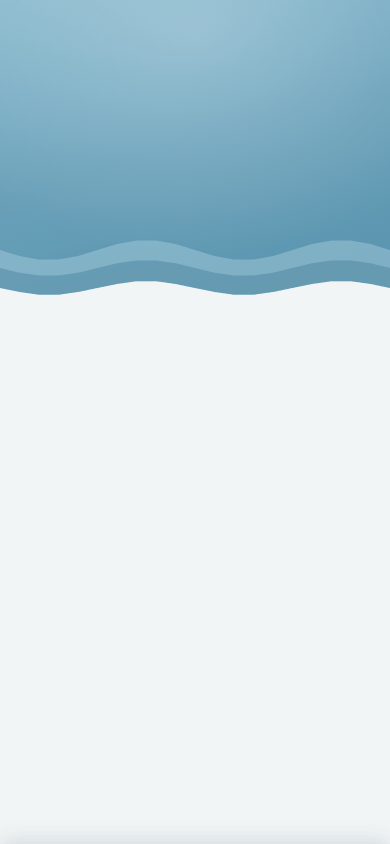

# PALOMA GRIDA – Süleyman Boylu, QR'lı masa isimliği önerileri

Müşteriye gönderilecek katalog: **`musteri_1.jpg`**, **`musteri_2.jpg`** ve **`musteri_3.jpg`** (öneriler),
**`musteri_4.jpg`** (kartvizit sayfası); PNG'leri ve hepsi birlikte **`musteri_katalog.pdf`**. Ayrıntılı sayfalar:
`<renk>_<numara>_<ad>.png` (önden, masada, yandan).

## 2. tur

İlk tur estetik ve kurumsal bulunmadı, yazılar okunaksız göründü; logo da yoktu. Bu turda:

- **Gerçek logo:** Paloma Hotels logosu (PALOMA / HOTELS). Otelin sitesi bu ortamdan açılmadığı için Instagram
  profilinin ekran görüntüsünden vektöre çevrildi (`logo/`, `scripts/paloma_logo.py`). Mavi, logonun mavisi
  (#69A1BA).
- **Düz renkli dolgu:** logo, yazılar ve QR kabartma değil, yüzeyle aynı hizada 0,8 mm dolgu. Baskı gibi düz ve net
  görünür, kenar gölgesi olmaz. Logodaki ince HOTELS harfleri de böyle basılabiliyor: en az 0,56 mm'ye
  kalınlaştırıldı.
- **Yazılar:** ad soyad büyük-küçük harfle Montserrat SemiBold ya da Lora Bold. Görev Montserrat'la, mavi; otel
  "Paloma Grida" ya da logonun yanında "| GRIDA". Az öğe, geniş boşluk.
- **QR:** sondaki `/` olmadan adres 42 bayt, 3. sürüme (29 × 29) sığıyor. 30–31 mm karoda kare 0,90–0,93 mm.

## Öneriler (5 düzen × 2 renk)

Tek numaralar beyaz tabla (siyah ve mavi yazı), çift numaralar siyah tabla (beyaz ve mavi detay).

| No | Düzen | Ne var |
| --- | --- | --- |
| 1, 2 | Sütun | Solda logo, iki satır ad soyad, görev ve otel; ince mavi dikey çizgi; sağda QR |
| 3, 4 | Geniş isim | Üstte boydan ad soyad ve görev, mavi çizgi; altta logo, GRIDA ve QR |
| 5, 6 | Mavi kart | Sağda mavi kart içinde beyaz QR; solda logo, ad soyad (Lora), görev ve otel |
| 7, 8 | Üst bant | Üstte mavi bant içinde beyaz logo ve GRIDA (Instagram'daki gibi); altta ad soyad, görev, QR |
| 9, 10 | Ortalı | Logo ve GRIDA, ad soyad (Lora), kısa mavi çizgi, görev; altta ortada QR |

- **QR:** dijital kartvizit `https://suleymanboylu.qrsistem.workers.dev` (`bilgiler.json` → `sayfa_url`). Hepsi
  görüntüden ve baskı hatası benzetiminden okundu.
- **Yapı:** 120 × 90 mm, köşeler R8, gövde 1 cm, 15° eğik sehpa (Uzar, İNCE, Çalık ve Soylu isimlikleriyle aynı).
  Dolgular 0,8 mm (4 katman); renk değişimi yalnız üst 4 katmanda.
- **Kontroller:** çizgiler ≥ 0,5 mm, harf içleri ve aralar ≥ 0,4 mm, öğeler arası ≥ 2 mm, kenara ve sehpaya ≥ 3 mm.
- **Filament:** mavi için logonun mavisine (#69A1BA) en yakın açık mavi / çelik mavisi seçilmeli; görsellerde bu
  renk kullanıldı.

```bash
python3 scripts/paloma_logo.py <ekran_görüntüsü>   # logoyu vektöre çevirir (logo/)
python3 scripts/paloma_isimlik.py                  # 10 öneri ve katalog (4 süreçte)
python3 scripts/paloma_isimlik.py bant             # yalnız eşleşen düzenler
python3 scripts/paloma_isimlik.py katalog          # yalnız katalog sayfaları
```

## Baskı dosyası: seçilen 3 · Mavi kart, beyaz tabla, 200 × 100 mm (X2D)



**Müşterinin istekleri:**

- 3 numara, ama PALOMA HOTELS ve GRIDA mavi kartın içinde; ayrıca "Paloma Grida" satırı yok.
- Boyu 20 cm, daha ince, biraz daha yüksek: 2:1 dikdörtgen.

**Düzen:** kartın içinde üstten aşağı logo, ince çizgi, GRIDA, QR ve KARTVİZİT. Solda iki satır ad soyad (Lora) ve
görev ("Satın Alma Müdürü", büyük harf yüksekliği 6,2 mm: büyütülmüştü, istek üzerine eski boyutuna döndü).

**`baski/paloma_isimlik_x2d.3mf`**: Bambu Studio'da proje olarak açılıp doğrudan basılır. Panel 200 mm olduğu için
tablaya **bir takım** (panel + sehpa) sığar; ikinci takım için dosya bir kez daha basılır. Diğer ayarlar Uzar, İNCE,
Çalık ve Soylu'nun isimlikleriyle aynı.

| | |
| --- | --- |
| Panel | **200 × 100 mm**, beyaz gövde **5 mm**, köşeler R8, kenarlar basamaklı pahlı; yüzü yukarı basılır |
| Yazılar | yüzeyle aynı hizada renkli dolgu, üst 4 katman (0,8 mm): siyah ad soyad ve QR kareleri; mavi kart ve görev. Logo, çizgi, GRIDA ve KARTVİZİT kartta boşluk: tablanın beyazı görünür |
| QR | siteyi açar (**https://suleymanboylu.qrsistem.workers.dev**); 34 mm, kare 1,03 mm; görüntüden ve baskı hatası benzetiminden okundu |
| Kontrol | çizgiler en az 0,5 mm, harf içleri ve aralar en az 0,4 mm, öğeler arası en az 2 mm |
| AMS | 1 siyah · 2 beyaz · 3 mavi. Beyaz ana nozulda (gövde, sehpa); siyah ve mavi yardımcı nozulda (yalnız üst 4 katman) |
| Mavi | logonun mavisi (#69A1BA); en yakın açık / çelik mavisi filament |
| Ayarlar | Bambu standart 0,20 mm; **ütüleme kapalı**; destek yok; Textured PEI; Generic PLA |
| Filament | ~82 g (beyaz 77, mavi 3,9, siyah 1,3) + kule; PrusaSlicer ~2 sa 27 dk (Bambu Studio kendi süresini gösterir) |
| Sehpa | 170 × 40 × 10 mm, beyaz, aynı tablada; 5 mm'lik panel yuvaya (5,3 mm) 15° eğik takılır, tutkal gerekmez |

### Yazıların baskıya uygunluğu (dilimleyici kontrolü)



İki aşamada kontrol edildi:

- **Tasarım ölçüleri (0,4 mm nozul):**
  - En ince çizgi 0,56 mm (HOTELS harfleri; bunun için kalınlaştırıldı).
  - Harf içleri en az 0,75 mm.
  - Aralar en az 0,5 mm (KARTVİZİT'teki İ noktası ile harfi arası).
- **Dilimleyici çıktısı:** dosya PrusaSlicer'da Bambu standart ayarlarının karşılığıyla dilimlendi (`scripts/dilim.py`).
  G-code'daki çizgiler gerçek genişlikleriyle tasarımın üstüne kondu (`scripts/paloma_isimlik_dilim.py`):
  - Her yazının %93–97'si kendi renginde dolu. Kalan pay çizgilerin kenarlarındaki ince aralar; baskıda ezilerek
    kapanır.
  - En kötü harf bile %88 dolu. Basılmayan en büyük parça 0,1 mm².
  - Harf içleri ve aralar çevre renkle (beyaz ya da kartın mavisi) %99–100 dolu: harfler birbirine kaynaşmıyor.
  - **Sonuç:** bütün yazılar basılıyor. HOTELS'in ince çizgileri, İ ve Ü noktaları ve QR kareleri de buna dahil.

## Kabartmalı sürüm (ek)



**`baski/paloma_isimlik_kabartmali_x2d.3mf`**: aynı isimlik, yazılar kabartma. Ölçü, sehpa, AMS sırası ve ayarlar düz
sürümle aynı.

| | |
| --- | --- |
| Kabartma | yüzeyden **2 mm** (10 katman, Uzar'ın isimliğindeki gibi): ad soyad siyah, görev mavi; kartın içindeki logo, çizgi, GRIDA ve KARTVİZİT beyaz (kartın boşluklarından yükselir) |
| Aralar | kabartmada harf içleri ve aralar en az 0,7 mm (dolmasın diye); bunun için İ ve Ü noktaları harften biraz daha uzak |
| Düz kalanlar | mavi kart ve QR yüzeyle aynı hizada. Kabartma QR'da kare kenarlarının gölgesi okumayı bozar; düz QR keskin çıkar |
| Nozullar | beyaz ana nozulda; siyah ve mavi yardımcı nozulda. Renkli katman: üst 4 + kabartmanın 10 katmanı |
| Filament | ~85 g (beyaz 79, mavi 4,1, siyah 2,6) + kule. PrusaSlicer ~2 sa 36 dk; renk değişimi daha çok katmanda olduğu için Bambu Studio düz sürümden uzun gösterir |
| Kontrol | dilimleyicide bütün yazılar basılıyor: kabartmanın alt katmanında harflerin kenarı tam, üst katmanında %94–97 dolu; harf aralarına taşma yok ([kontrol](baski/dilim_kontrol_kabartmali.png)). QR okundu, baskı hatası benzetiminde de |



```bash
python3 scripts/paloma_isimlik_baski.py            # iki 3MF, önizlemeler, ölçüm ve dilimleyici kontrolü (~4 dk)
python3 scripts/paloma_isimlik_baski.py kabartma   # yalnız kabartmalı (ya da: duz)
python3 scripts/paloma_isimlik_foto.py --kabartma  # kabartmalı sürümün fotoğrafları (Blender)
```

## Dijital kartvizit sayfası





Soldan sağa: açık tema, Paylaş penceresi, koyu tema.

**Yazı sistemi Paloma Hotels'ten:**

- Otelin sitesi bu ortamdan açılmadığı için logonun harfleri (PALOMA / HOTELS) Google yazı tipleriyle harf harf
  karşılaştırıldı. En yakını **Figtree**: PALOMA satırı ExtraBold, HOTELS satırı Light ile örtüşüyor; Montserrat
  daha geniş kalıyor.
- Sayfada da aynı düzen: büyük harf, geniş aralık; ad PALOMA gibi kalın (SÜLEYMAN), soyad HOTELS gibi ince ve aynı
  genişliğe yayılmış (B O Y L U). Etiketler küçük ve aralıklı; tırnaklı yazı tipi yok.

**Tasarım (4. sürüm: tek parça).** Önceki sürümde logo, telefon ve WhatsApp birkaç yerde tekrar ediyordu; bölümler
de ayrı tasarımlar gibi duruyordu. Şimdi tek ekran var ve her bilgi bir kez geçiyor:

- **Arkada:** ufukta Akdeniz, sabit. Açık gökyüzünde logo | GRIDA, ad soyad ve görev koyu deniz mavisiyle yazılı.
- **Altta tek kart:**
  - cep telefonu ve şirket hattı (ikisinde de ara ve WhatsApp), e-posta ve adres (haritada açılır), ince çizgili
    yuvarlak simgelerle;
  - altta **Rehbere kaydet** ve **Paylaş**.
  - Kısa ekranlı telefonda kart görselin üstünden kayar.
- **Paylaş:** alttan bir pencere açılır. İçinde mavi kartta isimlikteki QR'ın aynısı (DİJİTAL | KARTVİZİT) ve sayfa
  adresi var. Kopyala ve Gönder (telefonun paylaşma menüsü) düğmeleriyle bağlantı iletilir. Adres `#qr` ile
  açılırsa pencere açık gelir.
- **Koyu mod:** telefon koyu moddaysa kart ve pencere gece renklerine geçer.
- **Görsel:** Blender'da çizildi (`gorsel/ufuk.jpg`, `scripts/paloma_gorsel.py`), telif sorunu yok.
- **Paylaşım görseli:** bağlantı WhatsApp'ta paylaşılınca deniz, logo, ad ve görev görünür (`site/paylas.jpg`).
- **Simge:** ana ekrana eklenince Paloma mavisinde beyaz logo (`site/simge.png`).
- **Boyut:** sayfanın tamamı yaklaşık 430 KB.

**Animasyon** (`sayfa_tur.gif`), sakin ve tek akış:

- **Açılış (~2,6 sn):**
  - Görsel yavaşça yaklaşır; PALOMA harfleri iner, HOTELS harfleri ortadan açılır, ayraç ve GRIDA gelir.
  - SÜLEYMAN harfleri maskeden çıkar, B O Y L U ortadan yerlerine yayılır; ince çizgi uzar, görevin harf aralığı
    açılır.
  - Kart alttan gelir; satırlar çizgileriyle sırayla belirir, simgeler çizilir.
- **Canlı arka plan:**
  - Deniz dalgalanır: fotoğraf telefonda WebGL ile perspektife göre kaydırılır; ufukta az, önde çok.
  - Dalgalar kıyıya doğru akar, güneş pırıltıları yanıp söner; gökyüzü kıpırdamaz.
  - Gökyüzünden ara ara küçük bir kuş sürüsü süzülür (paloma: güvercin), biri ufukta.
  - Görsel çok yavaş yaklaşıp uzaklaşır. WebGL olmayan telefonda fotoğraf durağan kalır.
- **Düğmeler:** WhatsApp düğmelerinden ara ara su halkası yayılır, Rehbere kaydet'in üstünden ışık geçer.
- **Paylaş:** pencere alttan kayar, QR kareleri çapraz dalgayla belirir, vizör köşeleri nefes alır.

Telefonda "hareketi azalt" açıksa animasyonlar oynamaz; sayfa doğrudan son hâliyle açılır.

**Denemek için:** `sayfa_deneme.html` tek dosya; yazı tipleri, görsel ve rehber kartı içinde. Yüklemeye gerek
yok, telefonda ya da tarayıcıda açılır. Yayına giden sürüm `site/` klasörü ve zip.

**Bilgiler:** hepsi `bilgiler.json` içinde. Değişince sayfa betiği yeniden çalıştırılır.

**Yayın:** ortak Cloudflare hesabında (`qrsistem`) yeni bir Worker açılır, adı tam olarak `suleymanboylu` olur ve
`paloma_site.zip` yüklenir. Adres `https://suleymanboylu.qrsistem.workers.dev` olur; isimliklerdeki QR bu adresi
açar.

```bash
python3 scripts/paloma_gorsel.py ufuk      # deniz görseli (Blender, ~5 dk)
python3 scripts/paloma_sayfa.py            # site, zip, önizleme ve tur GIF'i
python3 scripts/paloma_sayfa.py --hizli    # GIF'siz
```
