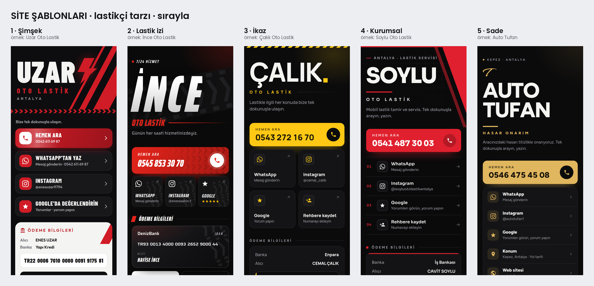

# Site şablonları: lastikçi tarzı, 5 şablon, sırayla



İsimliklerdeki QR'ın açtığı işletme siteleri (dijital kartvizit) bu beş şablondan biriyle yapılır.

- **Kural:** aksi söylenmedikçe tarz değişmez; yeni bir tasarım icat edilmez.
- **Süs yok:** "diğerleri gibi sade, modern olsun; değişik şeyler ekliyorsun". Gösterge, konsol tuşu, sayaç gibi
  ek süsler eklenmez; ilk denenen 5. şablon (Gösterge) bu yüzden kaldırıldı, yerine Sade geldi.
- **Sıra:** her yeni işletme bir sonraki şablonu alır: 1 → 2 → 3 → 4 → 5 → 1 …
- **Kayıt:** sıra `sira.json`da tutulur. Bir işletme bir kez şablon aldıysa yeniden üretimde aynı şablonda kalır.

| | Şablon | Nereden | Kısaca |
| --- | --- | --- | --- |
| 1 | **Şimşek** | Uzar Oto Lastik | dar kalın ad + şimşek (ya da işletmenin işareti), eğik şeritler, ok dişli şerit, büyük liste düğmeleri, açık renk ödeme kartı |
| 2 | **Lastik izi** | İnce Oto Lastik | eğik dar ad, lastik izi bandı, Hemen Ara'da diş baskısı, 3'erli kutucuklar, koyu banka kartı, sağ altta ara düğmesi |
| 3 | **İkaz** | Çalık Oto Lastik | ikaz şeridi, harf harf yükselen ad ve renkli nokta, 2 sütun kutucuk, altta arama şeridi |
| 4 | **Kurumsal** | Soylu Oto Lastik | sağ üstte eğik şerit, ızgara, numaralı liste (01, 02 …), üst çizgili ödeme kartı, altta arama şeridi |
| 5 | **Sade** | yeni (ilk: Auto Tufan) | süssüz ve modern: solda büyük ad, kısa renkli çizgi, bağlantılar tek kartta liste, ödeme kartı, altta arama şeridi |

**Hepsinde aynı içerik:**

- Hemen Ara.
- Bağlantılar:
  - WhatsApp, hazır mesajlı;
  - Instagram;
  - Google yorumları;
  - konum ve web sitesi, varsa;
  - Rehbere kaydet (vCard).
- Ödeme bilgileri:
  - banka, alıcı;
  - IBAN, tek dokunuşla kopyalanır;
  - banka karekodu: kaydedilip banka uygulamasında galeriden okutulur.

**Ortak davranış:**

- **Renk:** vurgu rengi işletmeye göre (`renk`); üstündeki yazı rengi kendiliğinden seçilir (açık renkte koyu yazı).
- **Uzun adlar:** büyük ad genişliğe sığdırılır; iki kelimeli uzun adlar alt alta yazılır.
- **Bağlantılar aynı sekmede açılır.** Yeni sekme, QR okuyucuların uygulama içi tarayıcılarında çoğu zaman açılmıyor.
- **Karekod kutusu:** JavaScript'siz de açılır (`#kk`).
- **Hareketi azalt:** telefonda açıksa animasyonlar oynamaz.
- **Dış bağlantı yok:** yazı tipleri ve simgeler sayfanın içinde.

**Denetim:** her üretimde önizleme alınır ve şunlar kontrol edilir:

- yazı tipleri yüklü;
- yatay taşma yok;
- yazılar sığıyor;
- büyük ad başlığa sığıyor;
- karekod okunuyor;
- sayfa hatası yok.

Her şablonun klasöründe örnek işletmesiyle `sayfa_onizleme.png` (ilk ekran ve tüm sayfa) ve `sayfa_deneme.html` (tek
dosya, telefonda açılır) var. 1–4 lastikçilerin kendi bilgileriyle. Lastikçilerin yayındaki siteleri kendi
betikleriyle (`scripts/uzar_sayfa.py` …) üretilmeye devam eder; şablonlar onların genelleştirilmiş kopyası.

## Yeni işletmenin sitesi

1. İşletme klasöründe `bilgiler.json`:

   ```json
   {
     "isletme": "KARDEŞLER OTO YIKAMA",
     "hizmet": "OTO YIKAMA",
     "etiket": "MURATPAŞA · ANTALYA",
     "aciklama": "Aracınız pırıl pırıl. Tek dokunuşla arayın, yazın.",
     "renk": "#1E88E5",
     "telefon": "0532 123 45 67",
     "whatsapp_mesaj": "Merhaba, bilgi almak istiyorum.",
     "instagram": "@kardeslerotoyikama",
     "google": "https://g.page/r/…/review",
     "harita": "https://maps.app.goo.gl/…",
     "web": "https://…",
     "iban": "TR…",
     "iban_alici": "MEHMET KARDEŞLER",
     "banka": "Ziraat Bankası",
     "iban_karekod": "…",
     "karekod_hata": "m",
     "sayfa_url": "https://<worker adı>.qrsistem.workers.dev/"
   }
   ```

   - **Zorunlu:** `isletme` (ya da `isim`), `telefon`, `iban`.
   - **İsteğe bağlı:**
     - `marka`: büyük yazılan ad; yoksa işletme adından hizmet çıkarılır.
     - `isaret`: logo işaretinin SVG'si, klasöre göre (`logo/…svg`).
     - `iban_ornek: true`: gerçek IBAN gelene kadar.
     - `sablon`: şablonu sabitlemek için.
2. Çalıştır:

   ```bash
   python3 scripts/sablon_site.py <klasör>              # sıradaki şablonla
   python3 scripts/sablon_site.py <klasör> --sablon 3   # şablonu elle seç (kayıt güncellenir)
   python3 scripts/sablon_site.py --sira                # kayıtlı işletmeler ve sıradaki şablon
   python3 scripts/sablon_site.py --katalog             # bu klasör: örnekler ve katalog.png
   ```

3. **Çıktı** (işletme klasöründe):
   - `site/`;
   - `<ad>_site.zip`;
   - `sayfa_onizleme.png`, `sayfa_tur.gif`;
   - `sayfa_deneme.html`.

   **Yayın:** ortak Cloudflare hesabında (`qrsistem`) işletmenin Worker'ına zip yüklenir.

Kod: `scripts/sablon_site.py` (üretici), `scripts/sablonlar/` (her şablon bir dosya, `ortak.py` ortak parçalar).
