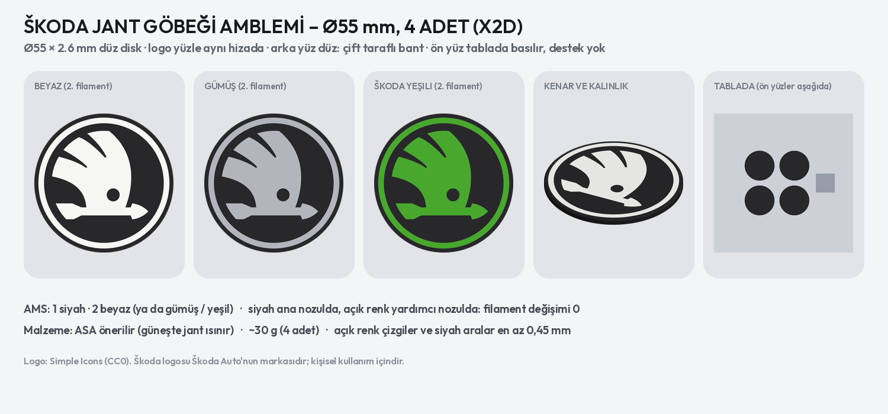

# Škoda jant göbeği amblemi – Ø55 mm, 4 adet (Bambu Lab X2D)



**`skoda_jant_gobegi_55mm.3mf`**: Bambu Studio'da proje olarak açılır; tablada 4 disk hazır, doğrudan basılır.

| | |
| --- | --- |
| Ölçü | **Ø55,0 × 2,6 mm** düz disk; ön kenarda 0,6 mm, arkada 0,4 mm pah |
| Logo | yüzeyle aynı hizada (orijinal amblem gibi düz): siyah zemin, açık renk halka ve kanatlı ok, okun gözü siyah, dışta 1,6 mm siyah kenar |
| Renkler (AMS) | 1 siyah · 2 beyaz. Gümüş ya da Škoda yeşili istenirse yalnız 2. filament değiştirilir |
| Nozullar | siyah ana nozulda, açık renk yardımcı nozulda: **filament değişimi yok** |
| Baskı | **ön yüz tablada**, destek yok, kenar (brim) yok; alt ve üst 5'er katman dolu |
| Filament | ~30 g (4 adet, PLA hesabı; ASA biraz daha hafif) |

- **Ön yüz tabla yüzeyine basılır:** FDM'de en düzgün ve keskin yüz. Dokulu PEI tabla mat ve ince dokulu bir yüz
  verir; düz (pürüzsüz) PEI tabla parlak, orijinal reçineli ambleme benzer bir yüz verir. Dosyada dokulu PEI seçili.
- **Açık renk 1,0 mm (5 katman):** beyaz opak çıkar, arkasındaki siyah gölge yapmaz.
- **En ince yerler:** açık renk çizgiler ve siyah aralar en az 0,45 mm (okun sivri uçları hariç).
- **Malzeme: ASA.** Güneşte jant çok ısınır; PLA yumuşar, eğilir. Dosyada PLA ayarı var: Bambu Studio'da iki
  filamenti de **Bambu ASA** (ya da kullandığın ASA) seç, doğru sıcaklıklar kendiliğinden gelir. ASA yoksa PETG.

## Yapıştırma

- **Bant:** otomotiv için çift taraflı köpük bant (3M VHB / 3M otomotiv bandı gibi), 0,8–1,1 mm. Diskin arka yüzü
  düz; bandı Ø52–53 mm yuvarlak kes ya da 3–4 şerit yapıştır.
- **Yüzeyi hazırla:** göbek yüzeyini alkolle sil ve kurut; 15 °C'nin altındaysa yüzeyi biraz ısıt.
- **Bastır:** amblemi ortalayıp 30 sn bastır. Bant tam gücüne 24 saatte ulaşır; o süre yıkama yapma.

Logo çizimi Simple Icons'tan (`scripts/logolar/skoda.svg`, CC0). Škoda logosu Škoda Auto'nun tescilli markasıdır;
kişisel kullanım dışında (satış) marka sahibinin izni gerekir.

## Yeniden üretme

```bash
pip install svgelements
python3 scripts/skoda_jant_gobegi.py
```

Çap, kalınlık ve renkler betiğin başında: `D`, `T`, `LOGO_D`, `INLAY`.
