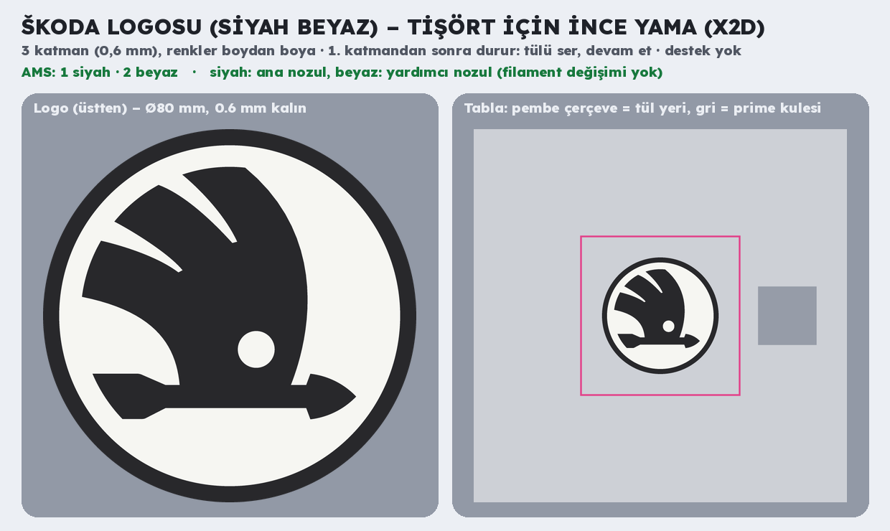

# Škoda logosu (siyah beyaz) – tişört için ince yama (Bambu Lab X2D)



**`skoda_logo_tisort.3mf`**: Bambu Studio'da proje olarak açılıp doğrudan basılır.

| | |
| --- | --- |
| Ölçü | Ø80 mm, **0,6 mm** (3 katman); renkler kalınlık boyunca, iki yüzde de logo görünür |
| Renkler (AMS sırası) | 1 siyah (dış halka, kanatlı ok) · 2 beyaz (zemin, okun gözü) |
| Nozullar (elle sabit) | siyah ana nozulda, beyaz yardımcı nozulda: **filament değişimi yok** |
| Filament | ~3,8 g (siyah 2,0 + beyaz 1,8; + kule), ~10 dk baskı |
| Ayarlar | Bambu standart profili; Elas için Generic PLA; destek yok; tabla Textured PEI |

En ince yerler ≥0,8 mm (yalnız okun sivri uçları daha ince, %0,02).

## Tül sandviç

BMW yamasıyla aynı (`../bmw_logo/README.md`): dosyada **1. katmandan sonra duraklatma hazır**. İlk katman bitince
~11 × 11 cm polyester/naylon tülü logonun üstüne gergin ser, köşelerinden kâğıt bantla tablaya yapıştır (pembe
çerçevenin içinde, kuleye taşmadan), devam et. Bitince tülü logonun 5–8 mm dışından kes, kenarından tişörte dik ya da
tekstil yapıştırıcısıyla yapıştır; üst yüz dışa baksın. Yıkama 30 °C ters, ütü ve kurutma makinesi yok.

Koyu renk tişört için ters renk (siyah zeminde beyaz logo) aynı kodla tek satırda çıkar.

Logo çizimi Simple Icons'tan (`scripts/logolar/skoda.svg`, CC0). Škoda logosu Škoda Auto'nun tescilli markasıdır;
kişisel kullanım dışında (satış) marka sahibinin izni gerekir.

## Yeniden üretme

```bash
pip install svgelements
python3 scripts/skoda_logo.py
```
