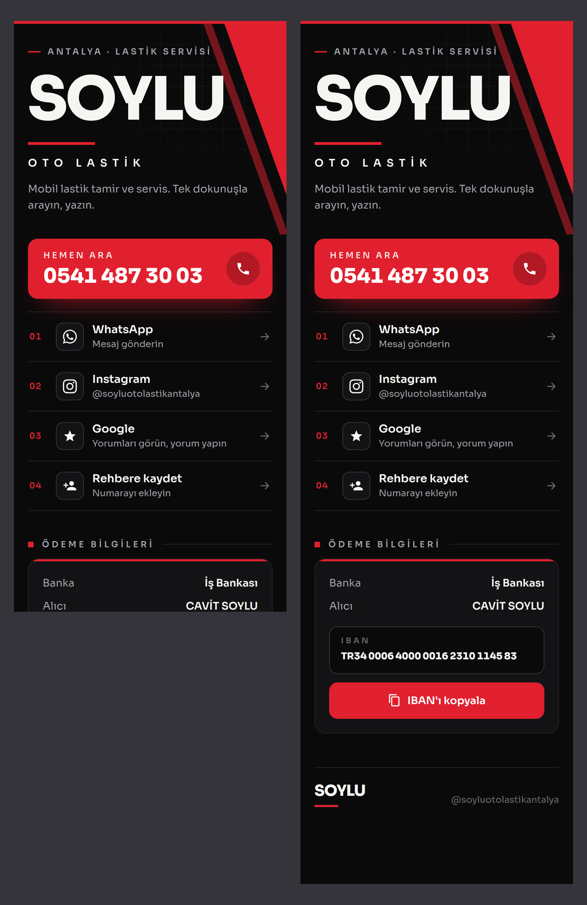

# SOYLU OTO LASTİK – QR'lı tezgâh isimliği önerileri

Müşteriye gönderilecek katalog: **`musteri_1.jpg`** (1–6), **`musteri_2.jpg`** (7–10); PNG'leri ve ikisi birlikte
**`musteri_katalog.pdf`**. Ayrıntılı sayfalar: `<numara>_<ad>.png` (önden, tezgâhta, yandan).

- Kurumsal: siyah zemin, beyaz ve kırmızı; az ve düzenli öğe, ince kırmızı çizgiler, geniş harf aralıkları.
- Her birinde ayrı yerleşim ve yazı tipi:
  1 Kırmızı çizgi (Manrope) · 2 Sol şerit (Sora) · 3 S monogramı (Michroma, QR solda) · 4 Geniş harf (Michroma) ·
  5 Çerçeve (Sora) · 6 Ortalı (Manrope) · 7 Kırmızı başlık (oyma SOYLU) · 8 Jant (Oswald) · 9 Rozet (Sora) ·
  10 Alt bant (Archivo Black, oyma telefon).
- İçerik: SOYLU, OTO LASTİK, HEMEN ARA, telefon **0541 487 30 03**, QR (TARA / BİZE ULAŞIN).
- **QR: işletme sayfası** `https://soyluotolastik.qrsistem.workers.dev/` (`bilgiler.json` → `sayfa_url`). Ortak
  Cloudflare hesabında (`qrsistem`) Worker adı tam olarak `soyluotolastik` olmalı. QR sürüm 4, hata düzeltme Q,
  34–38 mm (kare ≥ 0,91 mm); hepsi görüntüden ve baskı hatası benzetiminden okundu.
- Yapı Uzar, İNCE ve Çalık isimlikleriyle aynı: 120 × 90 mm, köşeler R8, siyah gövde 1 cm, yazılar 2 mm kabartma, QR
  yüzeyle aynı hizada beyaz karo, 15° eğik sehpa.
- Kontroller: satırlar arası ve kenarlara ≥ 2 mm; harf içi boşluklar ≥ 0,6 mm; simgelerde 1,2 mm'den ince yer
  < %4.

```bash
python3 scripts/soylu_isimlik.py            # 10 öneri ve katalog (4 süreçte)
python3 scripts/soylu_isimlik.py rozet      # yalnız eşleşen tasarımlar
```

## İşletme sayfası



Uzar, İnce ve Çalık'ın sayfalarıyla aynı işleri yapar, tasarımı farklıdır: siyah, beyaz ve kırmızı, kurumsal.

- **Yazı:** tek yazı tipi (Sora).
- **Kırmızı:** sağ üstte eğik şerit, SOYLU'nun altındaki çizgi, Hemen Ara, numaralı bağlantılar ve ödeme kartının üst
  çizgisi.
- **Bağlantılar:** kutu değil, numaralı liste (01 WhatsApp, 02 Instagram, 03 Google, 04 Rehbere kaydet).

**Animasyon** (`sayfa_tur.gif`):

- **Açılış:** kırmızı şerit sağdan kayarak gelir. Kırmızı blok SOYLU'yu soldan kapatıp sağa açar. Çizgi uzar, OTO
  LASTİK harf harf oturur, düğme ve satırlar sırayla gelir.
- **Kaydırma:** şerit hafifçe kayar. Ödeme kartı görününce üst çizgisi uzar ve IBAN dörtlü gruplar hâlinde belirir. Hemen
  Ara ekrandan çıkınca altta arama şeridi belirir.
- **Sürekli:** Hemen Ara'nın üstünden birkaç saniyede bir ışık geçer, telefon simgesi çalar.

**Bilgiler** (`bilgiler.json`): telefon ve WhatsApp 0541 487 30 03, Instagram @soyluotolastikantalya, Google yorum
bağlantısı, IBAN TR34 0006 4000 0016 2310 1145 83, CAVİT SOYLU, İş Bankası. **Banka karekodu** henüz yok; gelince
`iban_karekod` alanına yazılır ve ödeme kartına Karekod düğmesi eklenir.

**Yayın:** ortak Cloudflare hesabında (`qrsistem`) yeni bir Worker açılır, adı tam olarak `soyluotolastik`, ve
`soylu_site.zip` yüklenir. Adres `https://soyluotolastik.qrsistem.workers.dev/` olur; isimliklerdeki QR bu adresi açar.

```bash
python3 scripts/soylu_sayfa.py
```
