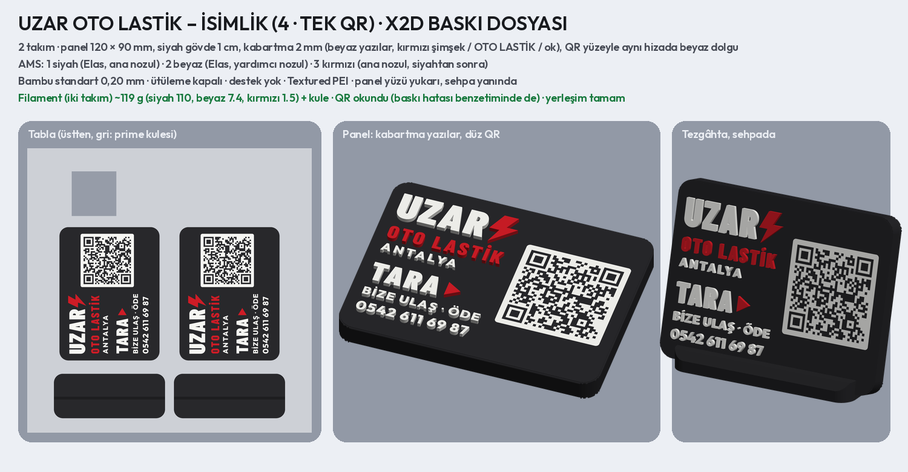

# UZAR OTO LASTİK – QR'lı tezgâh isimliği ve işletme sayfası


## Sistem

| QR | Okutunca |
| --- | --- |
| **TARA · BİZE ULAŞ** | işletme sayfası açılır: Hemen Ara (telefon uygulaması numarayla açılır), WhatsApp, Instagram (@enesuzar9794), Google'da değerlendir, IBAN (tek dokunuşla kopyala), karekod, Rehbere Kaydet |
| **KAREKOD İLE ÖDE** | banka uygulamasıyla okutulunca para gönderme ekranı ENES UZAR ve IBAN'ı dolu açılır (Yapı Kredi karekodunun içeriği fotoğraftan okundu, birebir yeniden çizildi) |

- Sayfa adresi: **https://flat-cake-6737.uzarotolastik.workers.dev/** (Cloudflare Workers, ücretsiz hesap).
  `pages.dev` adresleri Türkiye'de erişime kapalı (Kasım 2025), bu yüzden `workers.dev` kullanılıyor.
- Tüm bilgiler tek dosyada: `bilgiler.json`. IBAN mod-97 ile doğrulanır; karekodun CRC'si ve içindeki IBAN/alıcı
  bu IBAN'la karşılaştırılır (tutmazsa üretim durur).
- Sayfa adresi değişmediği sürece Instagram, Google bağlantısı, IBAN vb. **isimlik yeniden basılmadan** değişebilir:
  `python3 scripts/uzar_sayfa.py`, yeni `uzar_site.zip` aynı projeye yüklenir.
- QR kare boyu: sayfa 1,33 mm, karekod 0,90 mm (en az 0,9). Her QR baskıya giden geometriden ve isimliğin ön
  görünüşünden okundu; baskı ve okutma hatası benzetimlerinde de okundu (`qr_kontrol.png`).


## Sayfayı güncelleme (Cloudflare)

Site Cloudflare'de `flat-cake-6737` adlı Worker olarak yayında (hesabın workers.dev alt alanı `uzarotolastik`).
Bilgi değişirse: `python3 scripts/uzar_sayfa.py` → yeni `uzar_site.zip` (içinde `index.html` en üstte) →
Cloudflare'de Workers & Pages → `flat-cake-6737` → **New deployment** / dosyaları yükle. Adres aynı kalır,
isimlik yeniden basılmaz. Worker'ın adı ya da hesabın alt alanı değiştirilirse adres (ve QR) değişir.

## İsimlik (10 öneri, 4:3)

Müşteriye gönderilecek katalog: **`musteri_1.png`** (1–6), **`musteri_2.png`** (7–10), ikisi birlikte
**`musteri_katalog.pdf`**. Ayrıntılı sayfalar: `<numara>_<ad>.png` (ön, tezgâhta, yandan; filament; QR okuma).

Panel **120 × 90 × 2,6 mm**, köşeler R8, kenarlar iki yüzde 0,6 mm basamaklı pahla yumuşatılmış. Ön yüzü tablada
basılır: yazılar ve QR'ın beyaz zemini ilk 4 katmanda yüzeye gömülü renkli dolgu (0,8 mm), QR'ın siyah kareleri
gövdenin kendisi. Tablada basılan yüz düz ve keskin; Textured PEI ile mat olur (QR parlamaz). Panel 100 mm'lik
siyah sehpanın yuvasına 15° eğik takılır; ikisi aynı tablada, tutkalsız. Filament ~40 g (~20 TL, 500 TL/kg);
seçilen tasarım X2D dosyasına çevrilirken PrusaSlicer'da ölçülür.

1. **Sade** · 2. **Beyaz** · 3. **Ortalı** · 4. **Tek QR** (karekod sayfada) · 5. **Kırmızı bant** ·
6. **Kırmızı çerçeve** · 7. **Dikey şerit** · 8. **Beyaz, siyah başlık** · 9. **Lastik izi** · 10. **Siteyle aynı**

Claude'daki önizleme sayfası (`sayfa_artifact.html`) yalnız önizleme içindir; orada "Claude" yazısı görünür ve
telefon bağlantısı çalışmaz, isimliğe bağlanmaz.

## Baskı dosyası: seçilen 4 · Tek QR (X2D)



**`baski/uzar_isimlik_x2d.3mf`**: Bambu Studio'da proje olarak açılıp doğrudan basılır. Tablada **iki takım**
(panel + sehpa); biri silinirse tek takım basılır.

| | |
| --- | --- |
| Panel | 120 × 90 mm, siyah gövde **1 cm**, köşeler R8, kenarlar basamaklı pahlı; yüzü yukarı basılır |
| Kabartma | **2 mm** (10 katman): UZAR, ANTALYA, TARA, BİZE ULAŞ · ÖDE, telefon beyaz; şimşek, OTO LASTİK, ok kırmızı |
| QR | yüzeyle aynı hizada beyaz dolgu (0,8 mm), 48 mm, kare 1,29 mm; görüntüden ve baskı hatası benzetiminden okundu |
| Yazılar | küçük satırlar Outfit ExtraBold (sitedeki yazı tipi): rakam / harf içi boşluklar ≥ 0,65 mm, İ ve Ö noktaları harften ayrık |
| AMS | 1 siyah (Elas, ana nozul) · 2 beyaz (Elas, yardımcı nozul) · 3 kırmızı (ana nozul, siyah bitince bir kez geçer) |
| Ayarlar | Bambu standart 0,20 mm; **ütüleme kapalı**; destek yok; Textured PEI; Elas için Generic PLA |
| Filament | iki takım ~119 g (siyah 110, beyaz 7,4, kırmızı 1,5) + kule; takım başına ~60 g; PrusaSlicer ~3 sa 50 dk (Bambu Studio kendi süresini gösterir) |
| Sehpa | 100 × 40 × 10 mm, aynı tablada; panel yuvaya (10,3 mm) 15° eğik takılır, tutkal gerekmez |

Önerideki düzen korundu; baskı için QR 54 → 48 mm küçülüp sağa kaydı, sol sütundaki yazılar büyüdü.

## Yeniden üretme

```bash
pip install segno zxing-cpp opencv-python-headless playwright fonttools
python3 scripts/qr_sistemi.py            # QR kontrolü → qr_kontrol.png
python3 scripts/qr_sistemi.py oku resim.png   # banka karekodu ekran görüntüsünü okur
python3 scripts/uzar_sayfa.py            # sayfa → site/, uzar_site.zip, sayfa_onizleme.png
python3 scripts/uzar_isimlik.py          # isimlik görselleri → <tasarım>.png, hepsi.png
python3 scripts/uzar_isimlik_baski.py    # seçilen tasarımın X2D dosyası → baski/
```
