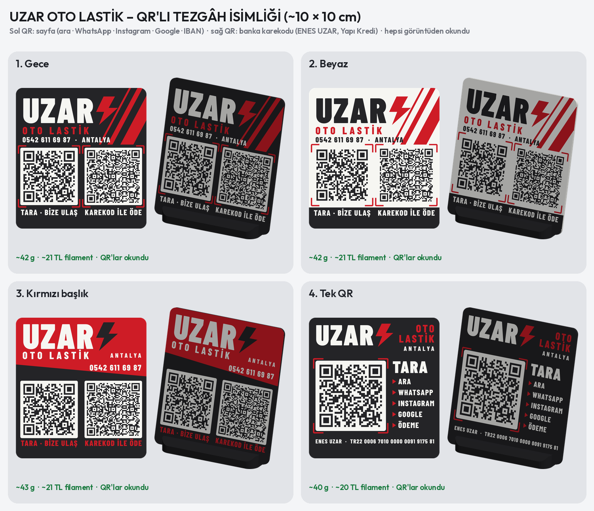
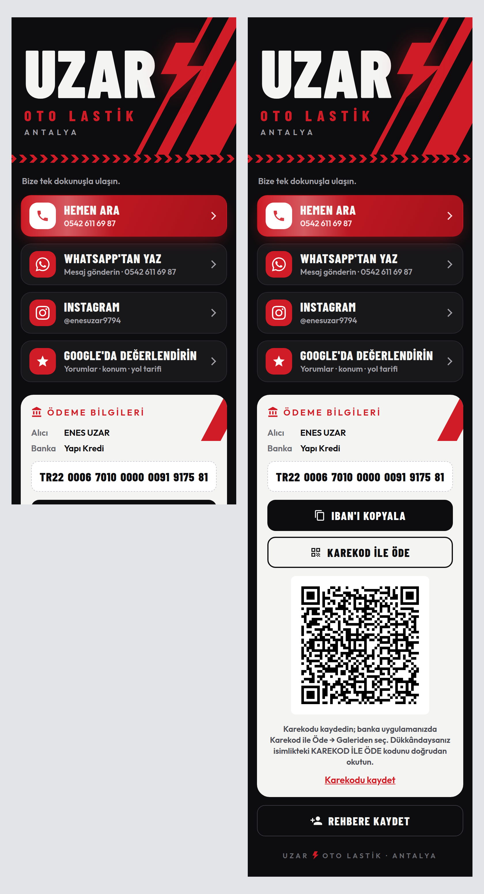

# UZAR OTO LASTİK – QR'lı tezgâh isimliği ve işletme sayfası



## Sistem

| QR | Okutunca | Not |
| --- | --- | --- |
| **TARA · BİZE ULAŞ** | işletme sayfası açılır: Hemen Ara, WhatsApp, Instagram (@enesuzar9794), Google'da değerlendir, IBAN (tek dokunuşla kopyala), karekod, Rehbere Kaydet | sayfa: `docs/uzar/`, adres `https://kivilcimdeli-cell.github.io/deneme/uzar/` |
| **KAREKOD İLE ÖDE** | banka uygulamasıyla okutulunca para gönderme ekranı ENES UZAR ve IBAN'ı dolu açılır | Yapı Kredi karekodunun içeriği fotoğraftan okundu, birebir yeniden çizildi |

- Tüm bilgiler tek dosyada: `bilgiler.json`. IBAN mod-97 ile doğrulanır; karekodun CRC'si ve içindeki IBAN/alıcı
  bu IBAN'la karşılaştırılır (tutmazsa üretim durur).
- Sayfa adresi değişmediği sürece Instagram, Google bağlantısı, IBAN vb. **isimlik yeniden basılmadan** sayfadan
  değiştirilebilir (`python3 scripts/uzar_sayfa.py`).
- QR kare boyu: sayfa 1,19 mm, karekod 0,90 mm (en az 0,9). Her QR baskıya giden geometriden ve isimliğin ön
  görünüşünden okundu; siyahın ±0,15 mm taşması, bulanıklık, 35° eğik bakış, uzaktan, gölge ve gürültü
  benzetimlerinde de okundu (`qr_kontrol.png`).



## İsimlik (4 öneri)

Panel 100 × 108 × 2,6 mm, ön yüzü tablada basılır: yazılar, şerit ve QR'ın beyaz zemini ilk 4 katmanda yüzeye
gömülü renkli dolgu (0,8 mm), QR'ın siyah kareleri gövdenin kendisi. Tablada basılan yüz düz ve keskin; Textured PEI
ile mat olur (QR parlamaz). Panel siyah sehpanın yuvasına 15° eğik takılır (alttaki 8 mm yuvada); ikisi aynı
tablada, tutkalsız. Filament ~40–43 g (~20–22 TL, 500 TL/kg); seçilen tasarım PrusaSlicer'da ölçülür.

1. **Gece** – sayfayla aynı görünüm: beyaz UZAR, kırmızı şimşek ve eğik şeritler, iki QR.
2. **Beyaz** – beyaz zemin, siyah yazı, altta siyah bantta etiketler.
3. **Kırmızı başlık** – eğik kesilmiş kırmızı bant, gövde renginde (siyah) şimşek.
4. **Tek QR** – yalnız sayfa QR'ı (karekod sayfada), yanında sayfadakilerin listesi, altta alıcı ve IBAN.

## Sayfanın yayına alınması (bir kez)

GitHub → `kivilcimdeli-cell/deneme` → **Settings → Pages** → Source: *Deploy from a branch* → Branch:
`claude/bambulab-dual-side-setup-vb4pwj`, klasör **/docs** → Save. Bir iki dakika sonra adres açılır.
İsimlik, sayfa açıldığı doğrulanmadan basılmamalı (QR bu adresi taşır).

## Yeniden üretme

```bash
pip install segno zxing-cpp opencv-python-headless playwright fonttools
python3 scripts/qr_sistemi.py            # QR kontrolü → qr_kontrol.png
python3 scripts/qr_sistemi.py oku resim.png   # banka karekodu ekran görüntüsünü okur
python3 scripts/uzar_sayfa.py            # sayfa → docs/uzar/, sayfa_onizleme.png
python3 scripts/uzar_isimlik.py          # isimlik görselleri → <tasarım>.png, hepsi.png
```
